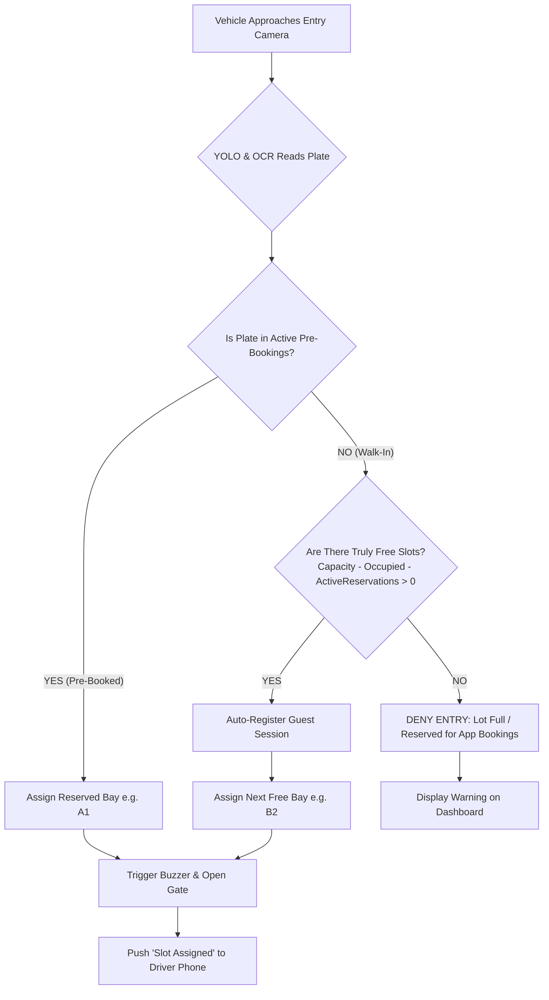

# AutoPark System: Complete End-to-End Application Architecture & Page Walkthrough

This document outlines the professional UI/UX architecture and screen-by-screen specification for the **AutoPark Smart Parking System**, custom-tailored to the **2-Camera Gateway** concept (Entry Camera + Exit Camera, with advance booking and walk-in entry support).

---

## 1. System Personas & Separation of Concerns

To avoid confusing examiners during presentations and ensure a real-world user experience, the system is split into two clean environments:

```
                                  AutoPark Platform
                                          │
                  ┌───────────────────────┴───────────────────────┐
                  ▼                                               ▼
       📱 Driver / Customer App                       🖥️ Operator / Control Room
       (Mobile-first Web / PWA)                       (Desktop / Admin Dashboard)
       • Live Slot Availability                       • Real-time Digital Twin (Bays A1-B3)
       • Advance Pre-Booking                          • Live ESP32-CAM Video & ANPR HUD
       • "My Active Parking" Live Pass                • Reservation Buffer Monitor
       • Walk-in Vehicle Lookup                       • Hardware-in-the-Loop (HIL) Test Bench
       • Digital Exit Receipt & Billing               • Manual Overrides & Emergency Reset
```

---

## 2. Screen-by-Screen Walkthrough: Driver / Customer App

### Screen 1: Home & Live Availability Screen (`/` or `/home`)
* **Target Audience**: Anyone looking for parking before leaving home, or arriving at the gate.
* **Layout & Visual Design**:
  * **Hero Header**: Greeting, parking facility status pill (`🟢 Gate Open • 4 of 6 Slots Open`), and rate card (e.g., `₹30/hr`).
  * **Dynamic Availability Gauge**:
    * Circular progress meter displaying:
      * **Total Capacity**: 6
      * **Available Now**: 4
      * **Guaranteed Reserved**: 1
      * **Occupied**: 1
    * Prominent badge: *"No sensor delays • AI Gate Tracked"*.
  * **Two Primary Action Buttons**:
    1. **Primary Button (Vibrant Glow)**: `📅 Reserve a Slot in Advance`
    2. **Secondary Button**: `🔍 Just Entered? Find My Slot by Plate` (For walk-in drivers).
  * **Live Slot Preview Grid**:
    * Interactive map showing Zone A (A1–A3) and Zone B (B1–B3).
    * Slots color-coded:
      * 🟢 **Green (Available)**: Can be booked or taken by walk-ins.
      * 🟡 **Yellow (Reserved)**: Booked by another app user; held safely.
      * 🔴 **Red (Occupied)**: Car currently parked inside.

---

### Screen 2: Advance Pre-Booking Screen (`/book`)
* **Target Audience**: Drivers reserving a slot before driving to the venue.
* **Form Elements**:
  1. **Vehicle Plate Number**: Clean input box with auto-formatting to Indian / standard format (e.g., `KA 05 KK 0403`).
  2. **Vehicle Category**: Visual toggle icons: `🚗 Car` | `🚙 SUV` | `⚡ EV`.
  3. **Expected Arrival Window**: Dropdown (e.g., `Within 30 mins`, `Next 1 Hour`, `Specific Time`).
  4. **Guarantee Counter**: Live counter showing *"3 Guaranteed Slots Available for Reservation"*.
* **Smart Conflict Prevention (The Math)**:
  * If $\text{Available Slots} - \text{Active Pre-Bookings} \le 0$, the booking button disables with the message: *"Advance bookings full for this hour; only walk-in entry available at gate"*.
* **On Submission**:
  * Generates an **Instant Digital Parking Pass** with a dynamic countdown (e.g., *Reserved for 45 minutes*).
  * Backend saves record with status `PENDING_ARRIVAL`.

---

### Screen 3: "Active Parking Pass" & Live Bay Navigator (`/my-pass`)
* **Target Audience**: The driver who is either approaching the gate or has just driven inside.
* **State A: Approaching Gate (`PENDING_ARRIVAL`)**:
  * Shows a pulsating radar animation: *"Approaching Gate... Drive up to Entry Camera"*.
  * Displays pre-registered plate: `KA-05-KK-0403`.
  * Instructions: *"Hold speed under 15 km/h. Camera will automatically recognize your plate and sound the entry buzzer."*
* **State B: Gate Scanned & Slot Assigned (`CHECKED_IN / ACTIVE`)**:
  * **Instant Transition via WebSocket** (No refresh needed).
  * **Celebratory Banner**: *"Welcome! Entry Gate Opened."*
  * **Prominent Bay Card**: Huge text: **`PROCEED TO SLOT A2`**.
  * **Mini Floorplan Direction**: Animated arrow showing driving route from Entrance $\rightarrow$ Main Aisle $\rightarrow$ Bay A2.
  * **Live Timer & Cost Meter**:
    * Entry Time: `10:15 AM`
    * Parked Duration: `00:42:15` (ticks live)
    * Accrued Fee: `₹30.00`
  * **One-Click Share**: Send pass to WhatsApp / Apple Wallet.

---

### Screen 4: Walk-in "Find My Slot" Screen (`/find-my-slot`)
* **Target Audience**: Drivers who arrived **without** pre-booking on the app.
* **How it Works**:
  1. The driver approaches the entry camera.
  2. The camera reads their plate (e.g., `KA 02 CD 5678`), verifies a free unreserved slot exists, assigns `Slot B1`, triggers buzzer, and saves an automatic walk-in session.
  3. The driver parks, opens the web app on their phone, and enters their plate number: `KA02CD5678`.
  4. **The Screen Shows**:
     * *"Welcome, Walk-in Guest!"*
     * Assigned Slot: **`B1`**
     * Entry Time & Active Parking Timer.
     * Option: *"Link your phone number to receive digital exit receipt"*.

---

### Screen 5: Exit & Checkout Screen (`/receipt/[session_id]`)
* **Target Audience**: Driver who just crossed the exit camera.
* **Trigger**: Automatically pushed to the driver's phone when Exit ESP32-CAM reads the plate.
* **Display Details**:
  * Status: `✅ Vehicle Safely Exited • Slot A2 Released`
  * **Session Summary Card**:
    * Vehicle Plate: `KA 05 KK 0403`
    * Slot Used: `A2 (Zone A)`
    * Total Duration: `1 Hour 14 Minutes`
    * Total Billed Amount: `₹40`
    * Payment Status: `Paid via Fastag / UPI / Cashless`
  * Download PDF Receipt button.

---

## 3. Screen-by-Screen Walkthrough: Operator / Control Room Console

### Screen 6: Live Digital Twin & Gate Command Center (`/operator`)
* **Target Audience**: Parking facility managers, college viva examiners, and system administrators.
* **Components**:
  1. **Top Metric Ribbon**:
     * `Total Bays: 6` | `Available: 3` | `Reserved (App): 2` | `Walk-in Free: 1` | `Occupied: 2`
  2. **Live Digital Twin Grid**:
     * Visual rendering of all bays A1 to B3.
     * Shows license plate tag inside occupied bays, vehicle type, and duration.
     * Manual release button on each bay for emergency overrides.
  3. **Dual ESP32-CAM Vision Monitors**:
     * **Entry Camera Feed**: Live snapshot, latest plate recognized, OCR confidence grade, buzzer status.
     * **Exit Camera Feed**: Live snapshot, latest exit detected, matched session ID, auto-freed slot confirmation.
  4. **Live Activity Stream**:
     * High-speed terminal-style audit feed logging WebSocket transactions, HTTP POSTs from ESP32s, and database commits.

---

### Screen 7: Hardware-in-the-Loop (HIL) Test Bench (Operator Drawer)
* **Target Audience**: Viva presentations, examiners, and automated regression testing.
* **Location**: Accessible via a sleek **"Diagnostics"** icon in the operator navigation bar.
* **Controls**:
  * `[▶ Simulate Pre-Booked Arrival]` $\rightarrow$ Tests authorized flow & reservation fulfillment.
  * `[▶ Simulate Walk-in Arrival]` $\rightarrow$ Tests unreserved slot allocation & guest session creation.
  * `[▶ Simulate Lot Full Walk-in Rejection]` $\rightarrow$ Proves pre-booked slots cannot be hijacked.
  * `[▶ Simulate Departure]` $\rightarrow$ Tests automatic slot release by plate correlation.
  * `[🔄 Reset Facility]` $\rightarrow$ Resets all bays to clean state.

---

## 4. System Conflict & Race Condition Protection

To satisfy the core requirement where pre-booking and walk-ins coexist without collision:



---

## 5. Summary of Why This Impresses Examiners
1. **Low Hardware Cost**: Solves an expensive multi-sensor problem with only two $5 ESP32-CAMs.
2. **True Full-Stack**: Spans embedded C++ (ESP32), Python Computer Vision (YOLOv11 + OCR), scalable backend (FastAPI + SQLite/Postgres), and modern mobile UI (Next.js + WebSockets).
3. **Robust System Design**: Handles edge cases (walk-ins vs advance bookings, slot race conditions, exit correlation) without needing human attendants.
