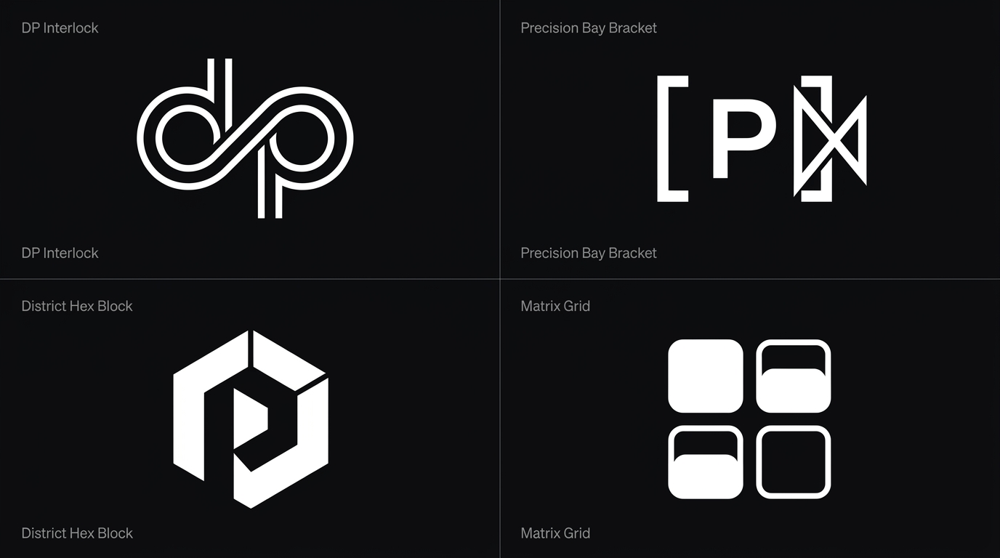
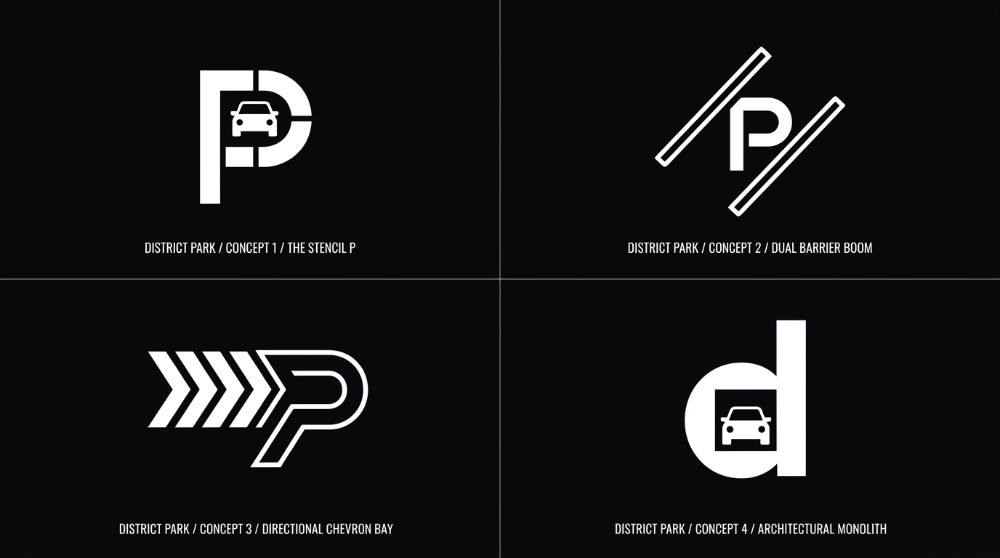

# District Park — Logo Identity Proposals

Here are new, refined monochrome logo concepts designed specifically for the **district park** identity. Each concept is crafted to match the pure black-and-white, high-contrast, Swiss architectural aesthetic seen in modern design systems like District and Polestar.

---

### Collection 1: Identity & Systems

| # | Concept Name | Visual Metaphor | Best Suited For |
|---|---|---|---|
| **1** | **DP Interlock (Loop)** | Continuous flowing 2-line stroke connecting lowercase `d` and `p`. Represents seamless entry-to-exit frictionless flow. | Modern tech mobility platform; extremely clean at small favicon / navbar sizes. |
| **2** | **Precision Bay Bracket `[ P ]`** | Optical ANPR camera focus brackets framing a bold `P` with gate geometric accents. | Highlighting automated optical detection, smart boom gates, and reserved bays. |
| **3** | **District Hex Block** | 3D isometric faceted precinct polygon with a clean negative space `P` carved out. | Structural, architectural, urban district real estate feel. |
| **4** | **Matrix Bay Grid** | 2x2 rounded square parking stall layout with real-time level fill indicators. | Direct visual cue for real-time bay occupancy and digital guidance. |

---

### Collection 2: Automotive & Access Dynamics

| # | Concept Name | Visual Metaphor | Best Suited For |
|---|---|---|---|
| **5** | **The Stencil P** | Modernist architectural underground garage floor stencil with vehicle silhouette. | Tactile, industrial-chic parking deck vibe. |
| **6** | **Dual Barrier Boom `// P //`** | Dynamic 45-degree angled parallel gate boom lines flanking the central parking `P`. | Expressing speed, barrier automation, and express lane access. |
| **7** | **Directional Chevron `>>> P`** | Precision guidance chevrons merging seamlessly into a streamlined bay. | Emphasizing driver wayfinding and real-time navigation. |
| **8** | **Architectural Monolith 'd'** | Heavy geometric lowercase 'd' whose counter-form houses a dedicated vehicle bay. | Bold, editorial branding with strong typography impact. |
