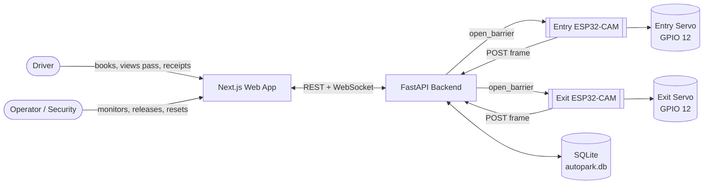
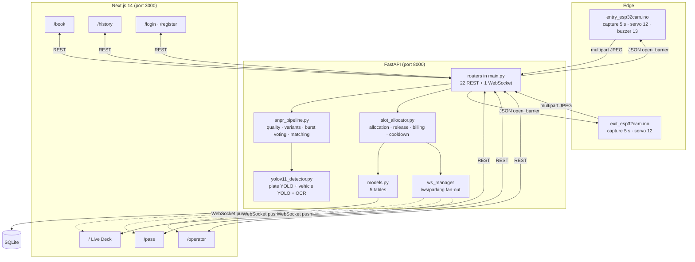
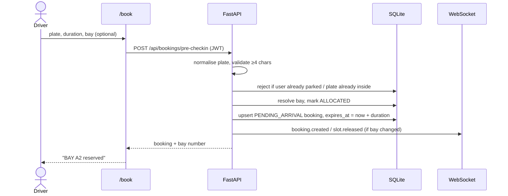
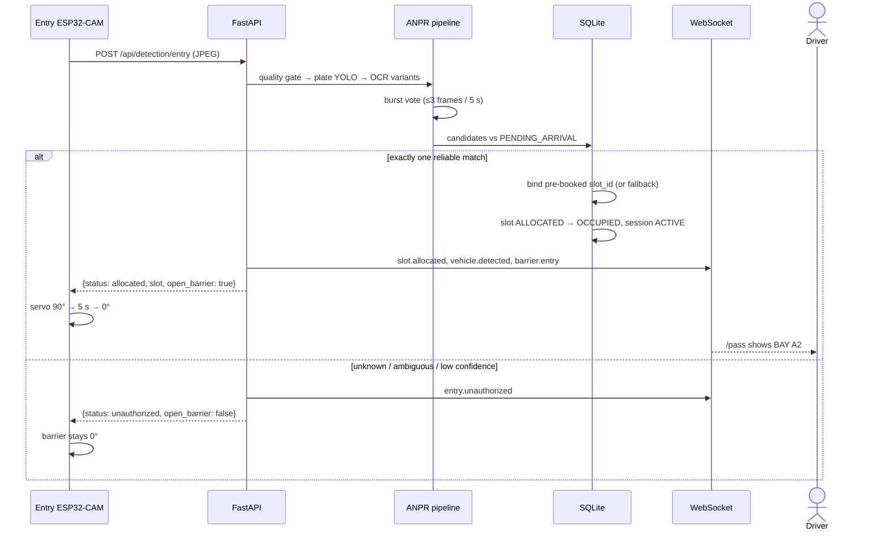
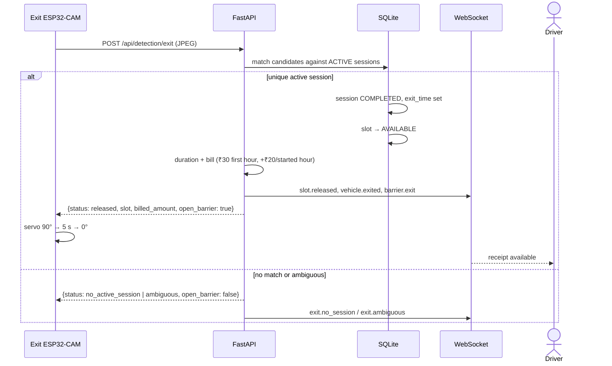
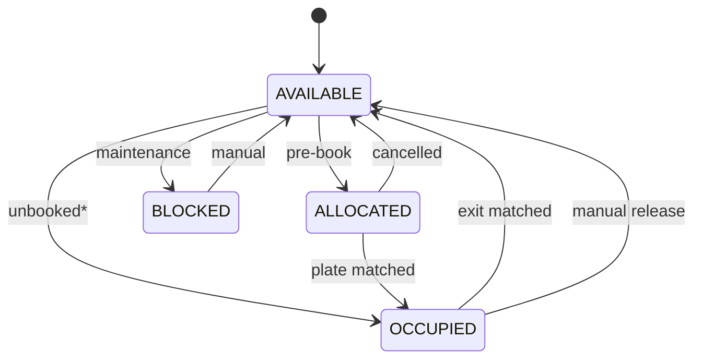
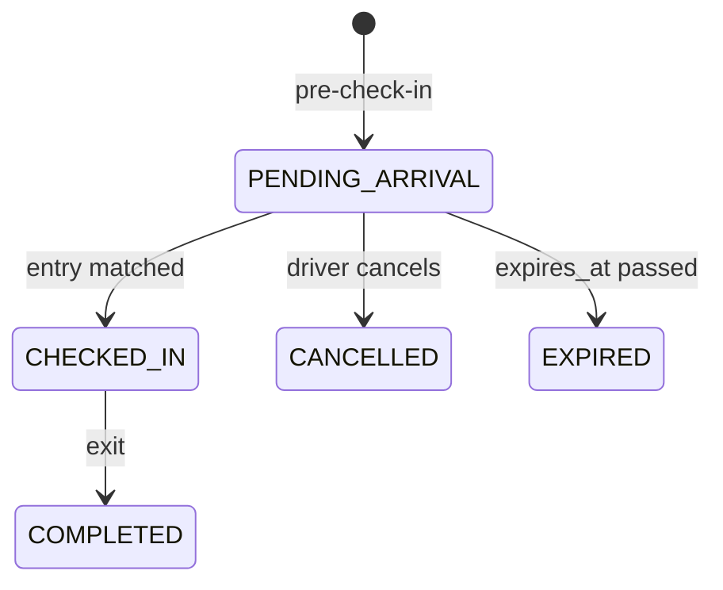
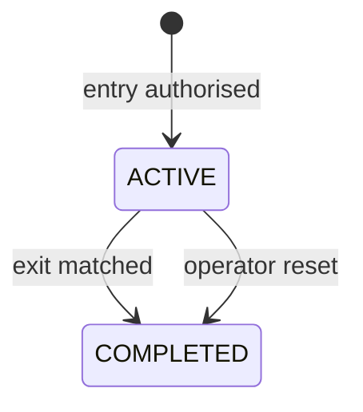
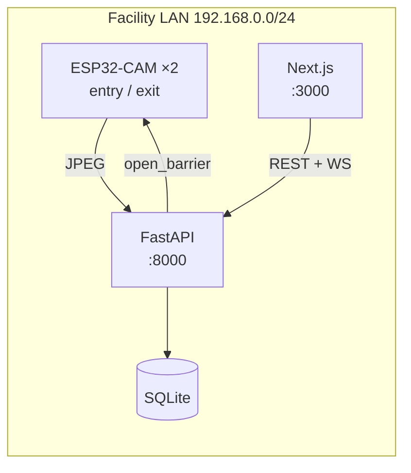

# 02 — System Architecture

---

## 1. Architectural style

AutoPark is an **edge-gateway, event-driven architecture** with a thin browser client.

- **Edge tier** — two ESP32-CAM nodes. They do exactly two things: capture a JPEG every
  five seconds and actuate a servo when told to. They hold no state about the lot.
- **Application tier** — a FastAPI service that owns all decisions: identity, plate
  matching, bay allocation, billing and audit. It is the single source of truth.
- **Presentation tier** — a Next.js application that renders state and reacts to
  WebSocket events. It never computes occupancy.
- **Data tier** — SQLite through SQLAlchemy, with five tables.

The important architectural consequence: **cameras are sensors, not controllers.** If a
camera is replaced, the lot state is unaffected. If the backend is down, the barriers
fail closed.

---

## 2. Context diagram

---

## 3. Container / component view

---

## 4. End-to-end data flow

### 4.1 Booking (before arrival)

Key rule: **booking consumes the bay immediately.** A reserved bay is not offered to
anyone else, even though the car has not arrived.

### 4.2 Entry (authorised)

### 4.3 Exit

### 4.4 Realtime fan-out

Every state change is broadcast on `/ws/parking`. Clients (Live Deck, Active Pass,
Operator Console) subscribe once and patch local state. There is no polling loop for
occupancy.

Event types actually emitted by the backend:

| Event | Meaning |
|---|---|
| `slot.allocated` | A bay changed to ALLOCATED/OCCUPIED |
| `slot.released` | A bay became AVAILABLE |
| `booking.created` | Pre-registration created |
| `booking.cancelled` | Pre-registration cancelled |
| `vehicle.detected` | A frame produced a detection result |
| `vehicle.exited` | Exit matched an active session |
| `entry.unauthorized` | Entry refused |
| `exit.no_session` | Exit plate matched nothing |
| `exit.ambiguous` | Exit matched more than one session |
| `parking.full` | No bay available |
| `barrier.entry` / `barrier.exit` | Barrier action for the UI indicator |
| `buzzer.triggered` | Optional buzzer fired |
| `demo.reset` | Facility reset |

---

## 5. State machines

### 5.1 Parking bay

\* In the current access policy an unbooked vehicle is refused, so the direct
`AVAILABLE → OCCUPIED` transition only occurs through the HIL simulator, which is
intended as an operator override.

### 5.2 Booking

### 5.3 Session

---

## 6. Why two cameras instead of per-bay sensors

| Dimension | Per-bay sensors | AutoPark (gate cameras) |
|---|---|---|
| Sensing devices | one per bay (6 here, n in general) | **2, constant** |
| Power/cabling per bay | required | none |
| Mounting per bay | required | none |
| Occupancy accuracy | direct measurement | derived; relies on plate reads |
| Failure blast radius | one bay | one gate (half the flow) |
| Unreadable plate | irrelevant | bay can appear stuck until override |
| Cost growth with capacity | linear | constant |
| Retrofit into existing lot | invasive | gate-mounted only |

**The honest trade-off:** direct sensing is more robust per bay. AutoPark exchanges
per-bay robustness for constant hardware cost and a single integration point, and pays
for it with a dependency on plate recognition quality. That dependency is managed with
confidence thresholds, ambiguity refusal, cooldowns, evidence capture and manual
release — not hidden.

---

## 7. Deployment topology

- No cloud dependency, no external database, no TLS terminator.
- Cameras are configured with the laptop's LAN address in firmware
  (`SERVER_HOST`, `SERVER_PORT`, `SERVER_PATH`).
- Both services are started detached with `scripts/host.sh`; logs in `.run/`.
- This is a **LAN deployment**, which is the realistic topology for a gate system. It
  is not an internet-hosted service.

---

## 8. Failure and degradation design

| Failure | System behaviour | Recovery |
|---|---|---|
| Backend unreachable | Cameras retry on next 5 s cycle; barrier stays closed (fail-safe) | restart backend |
| Camera offline | Last-seen status ages out after 30 s (`CAMERA_OFFLINE_TIMEOUT_SECONDS`) | power-cycle camera |
| Blurred / dark frame | Quality gate marks frame `blurry` / `poor_lighting`; no allocation | better lighting / refocus |
| Plate unreadable | `no_plate`; no allocation; event logged with evidence | manual release or retry |
| Plate matches two bookings | `ambiguous`; refused | operator verifies |
| Entry read succeeds, exit read fails | Bay remains OCCUPIED | operator manual release (`POST /api/parking/release/{slot}`) |
| Duplicate frames | 10 s per-plate cooldown + active-session check | automatic |
| Power loss mid-session | Session stays ACTIVE in DB | reset or manual release |
| Servo stalls | No position feedback; UI label is inferred, not measured | visual check / re-seat horn |

The barrier is deliberately **fail-closed**: the absence of an explicit `open_barrier:
true` from the backend leaves the arm at 0°.

---

## 9. Design decisions

| ID | Decision | Alternatives considered | Rationale | Trade-off accepted |
|---|---|---|---|---|
| D1 | Two gate cameras, no bay sensors | ultrasonic per bay; overhead vision | constant hardware cost; minimal retrofit | occupancy depends on plate reads |
| D2 | Pre-booked-only access | walk-in with buffer; hybrid | unambiguous policy; no double-allocation risk | no spontaneous visitors |
| D3 | Backend owns all state | camera-side decisions | single source of truth; auditable | backend is a single point of failure |
| D4 | Refuse on ambiguity | best-score admit | a false admit corrupts occupancy and revenue | occasional false rejects |
| D5 | SQLite | PostgreSQL | zero-ops, adequate for one lot | limited write concurrency |
| D6 | JWT + bcrypt | session cookies | stateless API, simple ESP32/browser split | token revocation is manual |
| D7 | WebSocket push | polling | instant UI, less load | connection lifecycle code |
| D8 | Servo barrier on GPIO 12 | buzzer only | physical access control, matches real gates | 5 V current and timer contention care |
| D9 | Deterministic billing in backend | client-side estimate | single authority; receipts cannot be edited | recomputation on every exit |
| D10 | Simulation endpoints | mock UI only | exercises the real DB/allocator/billing path | simulator can create real sessions |

---

## 10. Architectural invariants

These must remain true; violating one is a design regression.

1. **No bay is allocated without a plate decision.** The only exception is the explicit
   operator simulator.
2. **A bay is OCCUPIED only while an ACTIVE session references it.**
3. **Occupancy is never computed in the frontend.**
4. **The barrier opens only on an explicit backend boolean.**
5. **Every entry, exit and refusal writes a `DetectionEvent` row with evidence.**
6. **A booking always holds a concrete `slot_id`; releasing a booking releases the bay.**
7. **Ambiguity is a refusal, not a coin flip.**
