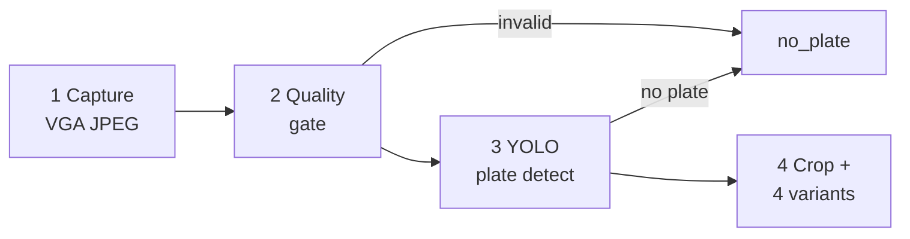
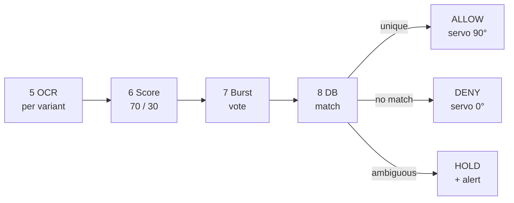

# 04 — ANPR Pipeline (Technical Deep Dive)

> This is the chapter examiners probe hardest. Every threshold below exists in the code
> and can be pointed to by file and function name.

---

## 1. The problem ANPR actually solves here

The system does not need to know *what* a plate says in general. It needs to answer one
question reliably:

> **"Does this frame correspond to exactly one vehicle that is allowed to be here?"**

That reframing matters. A generic OCR system optimises character accuracy. AutoPark
optimises **decision correctness** — and when the evidence is insufficient, the correct
decision is *refuse*, not *guess*.

---

## 2. Pipeline overview

The pipeline has two halves. The first turns a camera frame into candidate plate readings.
The second decides whether those readings are strong enough to open the barrier. Both
halves run inside a single request, so a frame is never left half-processed.

### 2.1 Capture and reading (stages 1–4)



### 2.2 Decision path (stages 5–8)



### 2.3 Where each stage lives

Stages live in:

| Stage | File | Function |
|---|---|---|
| Quality gate | `anpr_pipeline.py` | `assess_image_quality()` |
| Preprocessing variants | `anpr_pipeline.py` | `generate_plate_variants()` |
| OCR + candidate scoring | `anpr_pipeline.py` | `process_frame()` / `extract_candidates()` |
| Burst accumulation | `anpr_pipeline.py` | `FrameBurstAccumulator` |
| Entry matching | `anpr_pipeline.py` | `match_entry_pre_registration()` |
| Exit matching | `anpr_pipeline.py` | `match_exit_active_session()` |
| Allocation policy | `slot_allocator.py` | `allocate_entry_slot()` |
| Release + billing | `slot_allocator.py` | `release_exit_slot()` |

---

## 3. Stage 1 — Capture (edge)

| Parameter | Value | Reason |
|---|---|---|
| Capture interval | 5000 ms | Enough for a slow-moving car; keeps bandwidth low |
| Frame size | VGA 640×480 (PSRAM) / QVGA 320×240 (no PSRAM) | Plate must remain legible; PSRAM boards can afford VGA |
| JPEG quality | 10 (VGA) / 12 (QVGA) | Higher quality = larger payload; 10 is a good compromise |
| Frame buffers | 2 with `CAMERA_GRAB_LATEST` | Avoids sending a stale frame |
| Transport | HTTP multipart POST | Simple, debuggable, no broker needed |

Firmware is a **stateless sensor**: it does not decide, queue or retry beyond the next
cycle. If the backend is down, the next frame simply fails and the barrier stays closed.

---

## 4. Stage 2 — Image quality gate

Before spending compute on detection, the frame is graded:

| Metric | Computation | Threshold | Meaning |
|---|---|---|---|
| Sharpness | variance of Laplacian | `< 20.0` → `blurry` | motion blur / defocus |
| Brightness | mean pixel intensity | low/high bands | under/over-exposed |
| Contrast | standard deviation | low band | washed-out frame |
| Grade | derived | `invalid`, `blurry`, `poor_lighting`, `clear` | failure attribution |

Why it matters: it distinguishes **"camera problem"** from **"plate problem"** in the
diagnostics log. That is what makes the failure taxonomy defensible instead of a vague
"recognition failed".

**Report phrasing:** *"The quality gate converts an opaque recognition failure into an
attributable one — blur, lighting, plate localisation, or OCR."*

---

## 5. Stage 3 — Plate localisation (YOLOv11)

| Item | Value |
|---|---|
| Model | `backend/models/license_plate_best.pt` |
| Task | single-class object detection (plate region) |
| Inference confidence | 0.25 inside the detector |
| Backend acceptance | candidate confidence must clear **0.75** to be allocatable |
| Output | bounding box → crop → OCR |

Two confidences exist and they are **not the same thing**:

1. **Detector confidence** — how sure the model is that the box contains a plate.
2. **Candidate confidence** — the composite OCR score after voting.

The backend gate (`YOLO_CONFIDENCE_THRESHOLD = 0.75`) applies to the detection candidate
used for allocation. Do not conflate them on a slide; an examiner may ask.

A general vehicle model (`yolo11n.pt`) is also loaded to classify the vehicle type, but
the plate model is the one that gates access.

---

## 6. Stage 4 — Preprocessing variants

The crop is normalised four ways, because no single binarisation wins across lighting
conditions:

| Variant | Purpose | Typical failure it fixes |
|---|---|---|
| `adaptive` | local adaptive threshold | uneven illumination, shadows |
| `adaptive_inv` | inverted adaptive threshold | light text on dark plate |
| `otsu` | global Otsu threshold | clean, high-contrast plates |
| `clahe` | contrast-limited adaptive histogram equalisation | low-contrast / hazy frames |

Shared preprocessing: bilateral filtering (noise reduction without destroying edges),
CLAHE, and an unsharp mask (1.6 × original − 0.6 × blurred).

Evaluation order is deliberately `adaptive → adaptive_inv → otsu → clahe`, because
adaptive thresholding was observed to preserve the digit **4** better than **L** on the
ESP32-CAM images.

**Performance short-circuit:** once two variants have produced a candidate of at least
6 characters with confidence ≥ 0.75, the remaining variants are skipped. This keeps the
common case fast without weakening the difficult case.

---

## 7. Stage 5 — OCR and candidate scoring

EasyOCR runs with a restricted alphabet:

```
allowlist = "ABCDEFGHIJKLMNOPQRSTUVWXYZ0123456789"
detail = 1, paragraph = False
```

Restricting the alphabet removes punctuation noise and reduces confusions such as
`0`/`O` in non-plate text.

Results are sorted top-to-bottom, then left-to-right, so **two-line plates** concatenate
correctly (`KA 05` + `KK 0403` → `KA05KK0403`).

Candidates are then filtered:

- minimum 3 characters,
- at least two distinct characters (rejects `1111`, `AAAA`).

### Composite score

```
vote_ratio      = variants_that_agreed / 4
composite_score = 0.70 × max_confidence + 0.30 × vote_ratio
```

Clamped to 0.999. Why weight agreement? A single variant reading `KA05KK0403` at 0.80 is
less trustworthy than three variants agreeing on it at 0.78. The 70/30 split encodes
that intuition and is easy to defend.

Candidates are ranked by `(composite_score, votes)`.

---

## 8. Stage 6 — Multi-frame burst voting

A single frame is a single sample; motion blur and compression make any one frame
unreliable.

| Parameter | Value |
|---|---|
| Burst window | 5.0 s |
| Maximum frames | 3 |
| Aggregation | candidates merged across frames |
| Frame boost | `0.75 × max_conf + 0.25 × frame_ratio` |

`frame_ratio` is the fraction of frames in the burst that produced the candidate. A
reading seen in 3 of 3 frames outranks a higher-confidence reading seen once.

This is the practical answer to "what if one frame is bad?" — the system waits for
corroboration instead of trusting the first read.

---

## 9. Stage 7 — Database matching

### 9.1 Similarity scoring

`evaluate_plate_match(candidate, target)` returns:

| Condition | Score | Example |
|---|---|---|
| Exact match | **1.00** | `KA05KK0403` = `KA05KK0403` |
| Canonical match | **0.92** | `KA05KK04O3` → `KA05KK0403` |
| Substring / prefix (≥6 chars) | **0.88** | `INDKA01AB1234` contains `KA01AB1234` |
| Levenshtein distance 1, length ≥6 | **0.85** | one substitution |
| Levenshtein distance 1, length 4–5 | **0.75** | one substitution on a short plate |
| Levenshtein distance 2, length ≥7 | **0.76** | two edits on a long plate |
| Otherwise | **0.00** | — |

### 9.2 Canonicalisation map

OCR confuses characters that look alike. Before comparison:

```
I, L, J → 1
O, Q, D → 0
Z → 2
S → 5
B → 8
G → 6
```

So `KA05KK04O3` and `KA05KK0403` canonicalise to the same string. This is why a single
`O`/`0` error does not reject a legitimate driver.

### 9.3 Confidence weighting

The raw similarity is discounted by the OCR's own confidence:

```
adjusted_score = similarity × (0.80 + 0.20 × candidate_confidence)
```

A perfect string match read at 0.50 confidence scores `1.00 × 0.90 = 0.90`; the same
match at 0.95 scores `0.99`. The floor of 0.80 prevents a confident wrong read from
being discounted into a match, and the ceiling prevents a marginal read from
outranking a strong one.

### 9.4 Acceptance and ambiguity

| Rule | Value |
|---|---|
| Minimum adjusted score to be considered | **0.72** |
| Ambiguity condition | top two scores within **0.10** |
| Ambiguous outcome | **refuse**, raise operator alert |
| No candidate above threshold | `unauthorized` (entry) / `no_active_session` (exit) |

The ambiguity rule is the most important safety property in the project. If a reading
could plausibly belong to two bookings, the system does **not** pick the higher one — it
stops. A false admit creates a wrong bay, a wrong bill and a corrupted occupancy map; a
false reject costs one retry.

**Worked example — ambiguity**

```
Bookings: KA05KK0403, KA05KK0404
Reading : KA05KK0405  (one edit from each)
Scores  : 0.85, 0.85  → gap 0.00 < 0.10 → AMBIGUOUS → refuse
```

**Worked example — canonical match**

```
Booking: KA05KK0403
Reading: KA05KK04O3   (O instead of 0)
Canonical both → KA05KK0403 → similarity 0.92
candidate confidence 0.91 → adjusted 0.92 × 0.982 = 0.90 ≥ 0.72 → ALLOW
```

---

## 10. Stage 8 — Policy layer (allocation)

Matching produces a candidate booking; `allocate_entry_slot()` applies policy **in this
order**:

1. **Confidence gate** — `< 0.75` → `ignored`.
2. **Plate validity** — no candidate with ≥4 alphanumerics → `no_plate`.
3. **Already inside?** — plate matches an ACTIVE session → `already_allocated`
   (idempotent duplicate-frame handling).
4. **Cooldown** — same canonical plate within 10 s → `already_allocated`.
5. **Booking match or walk-in policy** — unique non-ambiguous booking matches held bay; if no booking exists and `ALLOW_WALKIN_ENTRY` is active, the first available bay is dynamically allocated. If lot is full, returns `parking_full`.
6. **Bay binding** — use the booking's `slot_id` if it is still AVAILABLE/ALLOCATED;
   otherwise assign the lowest-numbered free bay.
7. **Commit** — bay → OCCUPIED, session ACTIVE, booking CHECKED_IN (if booked), `DetectionEvent`
   written with evidence.
8. **Actuate** — response includes `open_barrier: true`, `barrier_action: OPEN`.

Every branch returns a machine-readable status, so the UI and the firmware never have to
parse prose.

---

## 11. Failure taxonomy

| Status | Cause | Barrier | Operator sees |
|---|---|---|---|
| `no_plate` | no plate box, unreadable, fewer than 4 alphanumerics (entry), bad quality | closed | "no plate" + stage |
| `ignored` | confidence < 0.75 | closed | low-confidence event |
| `unauthorized` | plate matches no booking when walk-in is disabled | closed | driver + plate + alert |
| `ambiguous` | two bookings within 0.10 | closed | both candidate plates |
| `already_allocated` | duplicate frame / cooldown / already inside | closed | existing bay |
| `parking_full` | no free bay | closed | full-lot alert |
| `released` | exit matched | open | bay, duration, bill |
| `no_active_session` | exit plate matches no ACTIVE session | closed | plate + alert |
| `exit ambiguous` | two sessions within 0.10 | closed | both plates |

---

## 12. Complexity and performance notes

Let `V` = 4 preprocessing variants, `F` ≤ 3 burst frames.

- Plate detection: one YOLO inference per frame.
- OCR: up to `V` passes per frame, short-circuited to 2 when confident.
- Matching: linear scan over pending bookings or active sessions, each comparison is
  `O(L²)` Levenshtein on plate length `L` (≈10). Negligible.

So the cost is dominated by **YOLO + OCR**, not by the matching logic. That is the
correct place for the cost: the safety logic is cheap enough to run on every frame.

**What to say if asked about latency:** measure it. Report the median and 95th
percentile of end-to-end time (frame POST → JSON response) across at least 30 runs, and
state the hardware used.

---

## 13. Tuning knobs (useful for the "future work" slide)

| Knob | Location | Effect of increasing |
|---|---|---|
| `YOLO_CONFIDENCE_THRESHOLD` | `config.py` | fewer false admits, more rejects |
| `DETECTION_COOLDOWN_SECONDS` | `config.py` | fewer duplicates, slower retries |
| Ambiguity gap `0.10` | `anpr_pipeline.py` | stricter uniqueness, more holds |
| Match floor `0.72` | `anpr_pipeline.py` | fewer matches, higher precision |
| Burst window / frames | `anpr_pipeline.py` | more corroboration, more latency |
| Composite weights (0.70/0.30) | `anpr_pipeline.py` | trust OCR confidence vs. agreement |

Every one of these is a **precision/recall trade-off**, and the defaults are deliberately
biased toward precision. That is a defensible design choice for access control, and it
should be stated as such.
