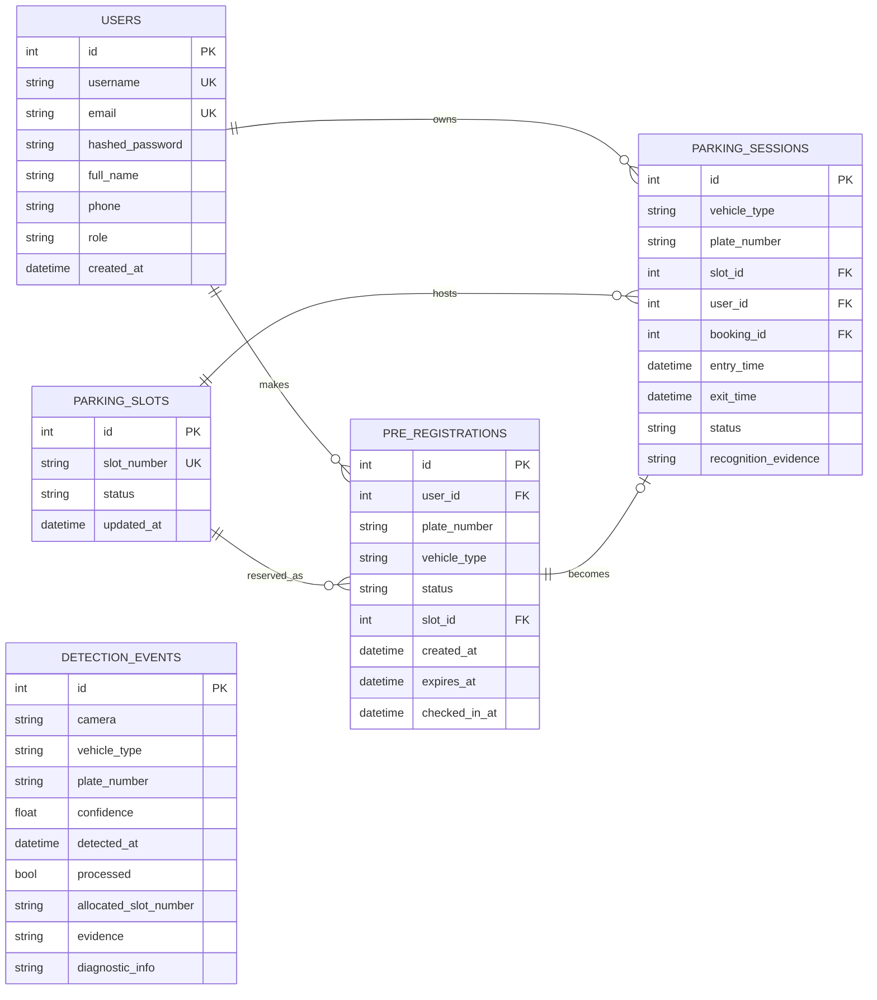

# 05 — Backend Design and Data Model

> Backend root: `backend/app/` · entrypoint: `backend/app/main.py` · port **8000**

---

## 1. Module map

| Module | Responsibility |
|---|---|
| `main.py` | App setup, 22 REST routes, 1 WebSocket route, startup warm-up, WebSocket broadcasts |
| `config.py` | Settings: slot list, thresholds, cooldown, JWT, database URL |
| `models.py` | Five SQLAlchemy models |
| `database.py` | Engine, session factory, `get_db` dependency |
| `schemas.py` | Pydantic request/response contracts |
| `auth.py` | bcrypt hashing, JWT creation/decoding, `get_current_user` |
| `slot_allocator.py` | Allocation, release, billing, cooldown, manual release, reset |
| `anpr_pipeline.py` | Quality gate, variants, OCR candidates, burst voting, DB matching |
| `yolov11_detector.py` | Plate YOLO + vehicle YOLO + OCR reader lifecycle |
| `yolo_detector.py` | Fallback detector and EasyOCR reader accessor |
| `frame_processor.py` | Per-camera frame processing wrapper |
| `train_yolov11.py` | Offline training script (not part of runtime) |
| `ws_manager.py` | WebSocket connection registry and broadcast |

---

## 2. Database schema



### Table notes

| Table | Purpose | Key invariant |
|---|---|---|
| `users` | Driver and operator accounts | unique username; bcrypt hash only |
| `parking_slots` | The six bays | `slot_number` unique; status is the occupancy authority |
| `pre_registrations` | Bookings before arrival | a booking holds exactly one `slot_id` |
| `parking_sessions` | Actual occupancy periods | `ACTIVE` ⇒ slot is `OCCUPIED` |
| `detection_events` | Audit trail of every detection/refusal | never deleted by reset |

Statuses:

- Slot: `AVAILABLE`, `ALLOCATED`, `OCCUPIED`, `BLOCKED`, `MAINTENANCE`
- Booking: `PENDING_ARRIVAL`, `CHECKED_IN`, `COMPLETED`, `CANCELLED`, `EXPIRED`
- Session: `ACTIVE`, `COMPLETED`

---

## 3. API reference

Base URL: `http://localhost:8000` · interactive docs: `/docs`

### 3.1 System

| Method | Path | Auth | Purpose |
|---|---|---|---|
| GET | `/` | — | Service banner |
| GET | `/health` | — | Health, model status, slot and session counts |
| GET | `/api/health` | — | Alias of `/health` |

### 3.2 Detection (edge cameras)

| Method | Path | Auth | Body | Purpose |
|---|---|---|---|---|
| POST | `/api/detection/entry` | — | multipart JPEG or form fields | Run ANPR, authorise, allocate, return barrier command |
| POST | `/api/detection/exit` | — | multipart JPEG or form fields | Run ANPR, match session, release, bill |

Form fallback fields: `vehicle_type`, `plate_number`, `confidence`, `sync`.
The firmware always uploads a JPEG.

### 3.3 Authentication

| Method | Path | Auth | Purpose |
|---|---|---|---|
| POST | `/api/auth/register` | — | Create account, return JWT |
| POST | `/api/auth/login` | — | Verify credentials, return JWT |
| GET | `/api/auth/me` | Bearer | Current user profile |

### 3.4 Bookings

| Method | Path | Auth | Purpose |
|---|---|---|---|
| POST | `/api/bookings/pre-checkin` | Bearer | Create or update a booking, bind a bay |
| GET | `/api/bookings/my-status` | Bearer | Active booking + active session |
| GET | `/api/bookings/my-history` | Bearer | Last 20 sessions → `{ "history": [...] }` |
| GET | `/api/bookings/pending` | — | All non-expired pending bookings (operator) |
| DELETE | `/api/bookings/{id}` | Bearer | Cancel own booking, release its bay |

### 3.5 Parking state and control

| Method | Path | Auth | Purpose |
|---|---|---|---|
| GET | `/api/parking/layout` | — | Slots with status and active session |
| GET | `/api/parking/slots` | — | Raw slot list |
| GET | `/api/parking/summary` | — | Counts: total, available, allocated, occupied, blocked |
| POST | `/api/parking/reset` | — | Reset facility: complete sessions, free bays, preserve history |
| POST | `/api/parking/release/{slot_number}` | — | Manual release of a stuck bay |
| POST | `/api/parking/simulate/entry` | — | HIL: authorised or unauthorised entry |
| POST | `/api/parking/simulate/exit` | — | HIL: exit for the active session |

### 3.6 Diagnostics

| Method | Path | Purpose |
|---|---|---|
| GET | `/api/anpr/diagnostics?limit=N` | Last N detection diagnostics (quality, candidates, timings, failure stage) |
| GET | `/api/anpr/debug-image/{name}` | Retrieve a stored debug capture |

### 3.7 WebSocket

| Path | Direction | Purpose |
|---|---|---|
| `/ws/parking` | server → client | Push all state-change events |

> **Security note for the report:** detection, parking-state, reset, release and
> simulation routes are intentionally unauthenticated so the ESP32-CAM and the demo can
> call them without a token. This is acceptable on an isolated facility LAN but must be
> stated as a limitation, not hidden.

---

## 4. Entry allocation algorithm

```
allocate_entry_slot(plate, confidence, candidates):
    if confidence < 0.75:                 return "ignored"
    if no candidate with >= 4 chars:      return "no_plate"
    lock allocation_lock:
        if plate matches an ACTIVE session:  return "already_allocated"
        if same canonical plate within 10 s: return "already_allocated"
        match = unique match among PENDING_ARRIVAL bookings
        if match is ambiguous:            return "ambiguous"
        if match is none:
            if not ALLOW_WALKIN_ENTRY:    return "unauthorized"
            booking = None                # proceed with dynamic walk-in allocation
        bay = booking.slot_id if (booking and booking.slot_id)
              else lowest-numbered AVAILABLE bay
        if no bay:                        return "parking_full"
        bay.status = OCCUPIED
        if booking: booking.status = CHECKED_IN
        create session(ACTIVE, plate, bay, booking, evidence)
        log DetectionEvent
        broadcast slot.allocated (signals UI to display bay callout & highlight card)
        return { status: "allocated", slot: bay, open_barrier: true }
```

Notes:

- The **bay the driver booked wins** over the lowest-numbered bay. This was a real bug,
  fixed by reading `pending_booking.slot_id` first.
- **Walk-in support:** Unreserved vehicles automatically receive the first available bay,
  enabling spontaneous access while preserving held reservations.
- The lock is an in-process `threading.Lock`. It is correct for one Uvicorn worker and
  insufficient for multiple workers — see limitations.
- Confidence here is the detection/candidate confidence supplied by the pipeline; the
  booking match score is a separate threshold (≥ 0.72).

---

## 5. Exit release algorithm

```
release_exit_slot(plate, confidence, candidates):
    if confidence < threshold: return "ignored"
    match candidates against ACTIVE sessions (score >= 0.72)
    if none:                      return "no_active_session"
    if top two within 0.10:       return "ambiguous"
    session = winner
    session.status = COMPLETED; session.exit_time = now
    bay.status = AVAILABLE
    booking.status = COMPLETED
    duration_minutes = max(1, floor((exit - entry) / 60))
    billed = 30 if d <= 60 else 30 + ((d - 1) // 60) * 20
    log DetectionEvent
    broadcast slot.released, vehicle.exited, barrier.exit
    return { status: "released", slot, duration_minutes, billed_amount, open_barrier: true }
```

---

## 6. Billing

**Formula (single source of truth, backend):**

```
if duration_minutes <= 60:
    amount = 30
else:
    amount = 30 + ((duration_minutes - 1) // 60) * 20
```

| Parked | Minutes | Amount |
|---|---|---|
| 1 min | 1 | ₹30 |
| 60 min | 60 | ₹30 |
| 61 min | 61 | ₹50 |
| 2 h | 120 | ₹50 |
| 2 h 1 min | 121 | ₹70 |
| 3 h | 180 | ₹70 |
| 3 h 1 min | 181 | ₹90 |

**Interpretation:** ₹30 covers the first hour; every additional **started** hour block
adds ₹20. Duration is floored to whole minutes and clamped to a minimum of 1.

**Important:** the frontend also estimates a fee for the history list, and it mirrors
this formula. The backend value is authoritative. For an in-progress session the client
shows a labelled **estimate**, not a paid amount.

---

## 7. Authentication and security

| Aspect | Implementation |
|---|---|
| Password storage | bcrypt hash (`bcrypt`), never plaintext |
| Token | JWT, HS256, payload `{sub: user_id, username, role, exp, iat}` |
| Expiry | 1440 minutes (24 h) |
| Secret | `JWT_SECRET` env var, with a development default in `config.py` |
| Transport | Bearer header |
| Roles | `driver`, `admin` stored on the user |
| Role enforcement | **not enforced on routes** — the operator console is not access-controlled |

Security limitations:

1. Default JWT secret is known; must be overridden in production.
2. No TLS; tokens travel in clear text on the LAN.
3. Detection and control routes are unauthenticated.
4. No rate limiting on login.
5. No refresh-token rotation or revocation list.

None of these affect the correctness of the parking logic, but all of them matter for a
real deployment. Stating them is stronger than being caught by them.

---

## 8. Concurrency and consistency

| Mechanism | Where | Guarantees |
|---|---|---|
| `allocation_lock` | `slot_allocator.py` | serialises allocation/release within the process |
| Per-plate cooldown | in-memory dict, 10 s | suppresses duplicate frames |
| DB transaction | SQLAlchemy session | commit-or-rollback per request |
| Slot status | database | occupancy authority |

**Known constraint:** the lock and cooldown live in process memory. Running Uvicorn with
multiple workers would allow two allocations to interleave. The correct production fix
is a database-level `SELECT … FOR UPDATE` or a unique partial index on active sessions
per bay. This is a legitimate "future work" item.

---

## 9. WebSocket contract

Connect: `ws://<host>:8000/ws/parking`

Every message:

```json
{ "type": "<event>", "data": { ... } }
```

| Type | Data highlights |
|---|---|
| `slot.allocated` | slot, plate, confidence |
| `slot.released` | slot, plate |
| `booking.created` | booking, plate, slot |
| `booking.cancelled` | booking id, slot |
| `vehicle.detected` | camera, detected, confidence, failure_stage |
| `vehicle.exited` | slot, plate |
| `entry.unauthorized` | camera, plate, message |
| `exit.no_session` | camera, plate, message |
| `exit.ambiguous` | camera, plate, message |
| `parking.full` | message |
| `barrier.entry` / `barrier.exit` | action, slot |
| `buzzer.triggered` | slot |
| `demo.reset` | message |

The manager keeps a set of live sockets, removes dead ones on send failure, and
broadcasts without blocking the request path.

---

## 10. Startup sequence

1. `Base.metadata.create_all()` — create missing tables.
2. `run_migrations()` — idempotent column additions (e.g. `plate_number`).
3. `init_slots_db()` — ensure the six configured bays exist; remove decommissioned bays
   only if they have no active session.
4. Background warm-up of YOLO and OCR so the first real frame is not slow.

Reset (`POST /api/parking/reset`):

- marks all ACTIVE sessions COMPLETED with an exit timestamp,
- cancels/complete active bookings,
- sets every configured bay AVAILABLE,
- clears cooldowns and caches,
- **preserves** historical sessions and detection events.

That last point matters for the demo: resetting between runs does not erase the audit
trail.

---

## 11. Error semantics

| Case | HTTP | Body |
|---|---|---|
| Bad credentials | 401 | `{"detail": "Invalid username or password"}` |
| Missing/expired token | 401 | `{"detail": "Could not validate credentials or session expired"}` |
| Plate < 4 chars | 400 | validation message |
| Bay already taken | 400 | `Bay A2 is currently allocated…` |
| Already parked | 400 | explains which vehicle and bay |
| No bay free | 400 | "All parking bays are fully occupied or reserved" |
| Unknown bay name | 400 | `Parking bay 'X' does not exist` |

Detection endpoints do **not** use HTTP errors for business outcomes; they return
`200` with a `status` field (`no_plate`, `unauthorized`, `ambiguous`, …) so the
firmware can branch without parsing error pages.
