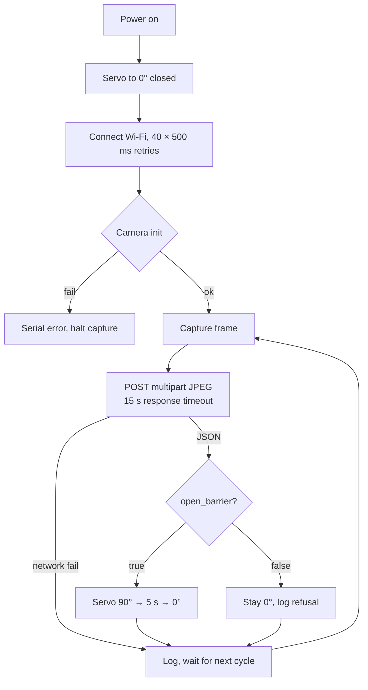

# 07 — Hardware Integration

> Firmware: `hardware/entry_esp32cam/entry_esp32cam.ino` (352 lines) and
> `hardware/exit_esp32cam/exit_esp32cam.ino` (347 lines)
> Wiring reference: `HARDWARE_GUIDE.md`

---

## 1. Bill of materials

| # | Component | Qty | Role | Indicative cost (INR)* |
|---|---|---|---|---|
| 1 | ESP32-CAM (AI-Thinker, OV2640, PSRAM recommended) | 2 | Gate camera + controller | 500–800 each |
| 2 | FTDI / USB-TTL programmer (3.3 V) | 1 | Flashing the ESP32-CAM | 200–400 |
| 3 | SG90 (or MG90S metal-gear) micro-servo | 2 | Boom barrier arm | 120–250 each |
| 4 | 5 V 2 A adapter or power bank | 2 | Stable servo + camera supply | 300–500 each |
| 5 | Active buzzer (optional) | 1–2 | Audible confirmation | 20 each |
| 6 | Jumper wires, breadboard | — | Prototyping | 150 |
| 7 | Boom arm material (cardboard / popsicle stick / 3D print) | 2 | Visible barrier arm | negligible |
| 8 | Mounting hardware, cable ties, base plates | — | Gate rig | 200 |

\* Indicative only — record the **actual** prices you paid in the report. Do not present
these as quotations.

**Why two servos, not one:** entry and exit are physically separate gates and must be
able to open independently. A single actuator would require a mechanical linkage across
the lot.

---

## 2. Pin map (both nodes)

| Signal | ESP32-CAM pin | Notes |
|---|---|---|
| Servo signal (orange/yellow) | **GPIO 12** | PWM control; 0° closed, 90° open |
| Servo VCC (red) | **5 V rail** | *not* 3.3 V — brown-outs and jitter otherwise |
| Servo GND (brown/black) | **GND** | must share ground with ESP32-CAM |
| Buzzer + (optional) | **GPIO 13** | active buzzer; `-1` disables in firmware |
| Buzzer − | GND | — |
| Camera | internal AI-Thinker pin map | `Y2…Y9`, `XCLK`, `PCLK`, `VSYNC`, `HREF`, `SIOD`, `SIOC`, `PWDN`, `RESET` |

GPIO 12 and 13 are free on the AI-Thinker camera pinout, which is why they were chosen.

### Power topology

```
5 V 2 A adapter ──┬── ESP32-CAM 5V
                  └── Servo VCC
GND ──────────────┬── ESP32-CAM GND
                  └── Servo GND
```

- Common ground is mandatory; without it the PWM signal has no reference.
- A 470 µF–1000 µF electrolytic capacitor across the 5 V rail near the servo reduces
  brown-out resets when the arm starts moving.
- Do **not** power the servo from the ESP32-CAM 3.3 V pin.

---

## 3. Wiring table — Entry node

| From | To | Purpose |
|---|---|---|
| ESP32-CAM 5V | 5 V rail | board power |
| ESP32-CAM GND | common GND | reference |
| GPIO 12 | servo signal | barrier PWM |
| 5 V rail | servo VCC | torque supply |
| common GND | servo GND | return |
| GPIO 13 | buzzer + | confirmation chirp (optional) |
| GND | buzzer − | return |

## 4. Wiring table — Exit node

Identical, without the buzzer:

| From | To | Purpose |
|---|---|---|
| ESP32-CAM 5V | 5 V rail | board power |
| ESP32-CAM GND | common GND | reference |
| GPIO 12 | servo signal | barrier PWM |
| 5 V rail | servo VCC | torque supply |
| common GND | servo GND | return |

---

## 5. Firmware lifecycle



Firmware facts:

| Item | Value |
|---|---|
| Capture interval | 5000 ms, measured **after** the previous cycle completes |
| Response timeout | 15 s |
| JSON parsing | ArduinoJson (v6 and v7 compatible) |
| Frame streaming | multipart body written directly from the camera frame buffer |
| Wi-Fi recovery | reconnect attempt every 5 s when disconnected |
| Boot behaviour | servo calibrated to 0°; optional buzzer chirp |
| Server target | `SERVER_HOST`, `SERVER_PORT`, `SERVER_PATH` constants at the top of each sketch |

> **Before flashing:** update `WIFI_SSID`, `WIFI_PASSWORD` and `SERVER_HOST` to the
> laptop's LAN IP. The repository values are development defaults and will not work on
> another network. This is the single most common setup failure.

---

## 6. Barrier control contract

Backend response fields:

```json
{
  "status": "allocated",
  "slot": "A2",
  "open_barrier": true,
  "barrier_action": "OPEN",
  "trigger_buzzer": true
}
```

Firmware decision (entry):

```cpp
bool open_barrier = doc["open_barrier"] | false;
if (open_barrier || trigger_buzzer) {
    openEntryBoomBarrier();      // 90° → 5000 ms → 0°
} else {
    // gate stays at 0°
}
```

Exit is equivalent, keyed on `open_barrier || status == "released"`.

### Truth table

| Backend outcome | `open_barrier` | Entry barrier | Exit barrier |
|---|---|---|---|
| `allocated` (valid booking) | true | **OPEN 90° / 5 s** | — |
| `released` (valid session) | true | — | **OPEN 90° / 5 s** |
| `unauthorized` | false | closed 0° | — |
| `no_plate` | false | closed 0° | — |
| `ambiguous` | false | closed 0° | closed 0° |
| `no_active_session` | false | — | closed 0° |
| `parking_full` | false | closed 0° | — |
| `already_allocated` | false | closed 0° (already inside) | — |

The barrier is **fail-closed**: absence of an explicit `true` leaves the arm down.

---

## 7. Assembly procedure

1. **Bench-test the servo alone.** Sweep 0° → 90° → 0° with a test sketch before mounting
   anything. Confirm no buzzing/stalling at either end.
2. **Mount the servo** at the gate hinge point so the horn rotates the arm through 90°.
3. **Attach the arm** to the horn; balance it so gravity does not fight the servo.
4. **Set the closed position** with the arm horizontal across the lane at 0°.
5. **Set the open position** with the arm vertical at 90°.
6. **Mount the camera** above the lane, angled down at the plate position, 1.5–3 m away.
   Avoid direct headlight glare and direct sunlight into the lens.
7. **Power both rails** from the 5 V adapter; verify common ground with a multimeter.
8. **Flash and verify** the serial log shows Wi-Fi, camera init and `0° (Closed)`.
9. **Trigger a simulated entry** from `/operator` and watch the arm move.
10. **Adjust** camera angle and lighting until the plate fills a reasonable portion of
    the frame.

---

## 8. Bench checklist (run before every demo)

| Check | Pass criterion |
|---|---|
| Servo at rest | arm horizontal, no jitter, no buzzing |
| Manual test | arm sweeps 0° → 90° → 0° smoothly |
| Common ground | continuity between ESP32-CAM GND and servo GND |
| Supply | 5 V measured under load, not just at idle |
| Wi-Fi | serial prints connected + IP |
| Backend reachability | serial prints HTTP 200 |
| Camera focus | plate legible in the captured frame |
| Barrier response | simulated entry opens the arm within ~1 s of response |
| Fail-closed | simulated unauthorised entry leaves the arm down |

---

## 9. Troubleshooting

| Symptom | Likely cause | Fix |
|---|---|---|
| Servo twitches or resets the board when moving | 5 V supply sag / no common ground | separate 5 V supply, add capacitor, common GND |
| Servo does not move at all | wrong pin, no PWM timer, or horn unseated | verify GPIO 12, try `ESP32PWM::allocateTimer(2)` before `attach()` |
| Camera init fails | insufficient power or wrong board model | 5 V 2 A supply; select AI-Thinker |
| Wi-Fi never connects | 2.4 GHz only; 5 GHz SSID | use a 2.4 GHz network / hotspot |
| HTTP connect fails | `SERVER_HOST` still the old IP | set the laptop's current LAN IP |
| Response timeout | backend down or blocked by firewall | check `curl /health` from another device |
| Plate never recognised | camera angle, blur, lighting | adjust mount; check diagnostics quality grade |
| Barrier opens for everything | `open_barrier` always true in response | inspect backend status mapping |
| Barrier never opens | firmware condition inverted or `open_barrier` missing | check serial JSON log |

---

## 10. Hardware limitations (state these honestly)

1. **No position feedback.** The servo is open-loop; the UI label is inferred from the
   backend command. There is no sensor confirming the arm actually moved.
2. **5 s hold is fixed.** A slow or large vehicle may need longer. A loop sensor or
   second frame at exit would make this adaptive.
3. **Single lane.** One vehicle at a time per gate; no queue detection.
4. **LEDC timer contention.** The camera driver uses `LEDC_TIMER_0`; `ESP32Servo` may
   need an explicitly allocated timer on some builds. If the arm misbehaves, this is the
   first suspect.
5. **No weatherproofing.** The rig is bench-grade, not IP-rated.
6. **No tamper detection.** A plate photograph could in principle fool the camera; there
   is no liveness check.

All six are normal for a prototype and are listed as future work rather than papered over.
