# AutoPark — Complete Project Dossier (single file)

> Generated by concatenating the numbered dossier files. Edit those, not this file.


---

# AutoPark — Final-Year Project Dossier

> **Generated:** 28 October 2026
> **Source of truth:** the code in this repository, not the older chat exports.
> **Purpose:** one place your team can pull accurate, presentation-ready content from
> for the report, the slide deck, the viva and the live demo.

---

## 1. What this dossier is

This is **not** a marketing document. Every number, endpoint, pin and behaviour below
was read out of the running codebase or measured on the running system. Where a
figure has **not** been measured yet, it is marked `[TO MEASURE]` and never invented.

If your older material (conference paper draft, chat exports) disagrees with this
dossier, **this dossier wins** — the older draft claims 8 bays and a 96.4 % precision
figure that were never produced by this code.

---

## 2. Ground-truth specification

Memorise this table. It is what you can defend in a viva.

| Item | As-built value |
|---|---|
| Project name | AutoPark — camera-based smart parking |
| Core idea | Two gate cameras replace per-bay occupancy sensors |
| Parking capacity | **6 bays** — A1, A2, A3 (Zone A), B1, B2, B3 (Zone B) |
| Edge devices | 2 × ESP32-CAM (AI-Thinker), entry gate + exit gate |
| Actuator | SG90 micro-servo boom barrier, **GPIO 12**, 0° closed / 90° open, **5 s hold** |
| Optional actuator | Active buzzer, **GPIO 13** (confirmation chirp only) |
| Camera capture interval | 5 s per gate (firmware loop) |
| Frame size | VGA 640×480 with PSRAM, QVGA 320×240 without |
| Plate detection | YOLOv11 plate model (`backend/models/license_plate_best.pt`) |
| Plate reading | EasyOCR, 4 preprocessing variants, multi-frame voting |
| Backend | FastAPI + Uvicorn, port **8000**, SQLAlchemy + SQLite |
| Database | `backend/autopark.db` (5 tables) |
| Frontend | Next.js 14 (App Router) + React 18 + Tailwind, port **3000** |
| Realtime | WebSocket `/ws/parking` |
| Auth | JWT HS256, bcrypt password hashing, 24 h token |
| Billing | ₹30 for first 60 min, +₹20 per additional started hour |
| Access policy | **Pre-booked vehicles only**; unmatched plates are denied, barrier stays closed |
| Deployment | Facility LAN (dev servers), no public URL / TLS |
| Codebase size | ≈10,300 lines (13 backend modules, 20 frontend pages/components, 2 sketches) |

### Explicitly **not** true (do not claim)

- ❌ 8 bays or A4/B4 — the database is seeded from `settings.SLOTS` = 6 bays.
- ❌ 96.4 % precision / 184 ms inference — no such measurement exists in this repo.
- ❌ Walk-in / unregistered entry — removed by design decision; unmatched plates are refused.
- ❌ "Hosted on the internet" — it runs on the local network only.
- ❌ Per-bay sensors — the whole point is that there are none.
- ❌ Payment gateway — billing is computed and displayed, not charged.

---

## 3. How to use it

### If you are writing the report

Start with **`11-report-outline.md`**. It maps every chapter to the dossier file that
feeds it, gives a page budget, and lists the figures and tables to include.

### If you are building the slides

Use **`12-presentation-deck.md`** — 18 slides, on-slide text already trimmed, speaker
notes written, timings assigned.

### If you are presenting / defending

- **`14-demo-runbook.md`** — minute-by-minute live demo script with fallbacks.
- **`13-viva-qa.md`** — 40 likely examiner questions with short, defensible answers.

### If you need the technical story

| File | Contents |
|---|---|
| `01-project-overview.md` | Abstract, problem, objectives, scope, novelty, elevator pitches |
| `02-system-architecture.md` | Diagrams, data flows, state machines, design decisions |
| `03-technology-stack.md` | Every technology with role, version and justification |
| `04-anpr-pipeline.md` | Plate recognition deep dive: stages, thresholds, scoring, failure modes |
| `05-backend-design.md` | Modules, database schema, API reference, allocation and billing algorithms |
| `06-frontend-design.md` | Pages, design system, realtime behaviour, UX states |
| `07-hardware-integration.md` | BOM, wiring, pin map, firmware lifecycle, bench checklist |
| `08-testing-and-validation.md` | Test strategy, executed test cases, defect log |
| `09-results-and-evaluation.md` | Metric definitions, measurement protocol, result templates |
| `10-limitations-and-future-work.md` | Honest limitations, mitigations, roadmap |
| `15-glossary-and-references.md` | Abbreviations, glossary, IEEE-style references |

---

## 4. Suggested team split

| Member | Owns | Dossier files |
|---|---|---|
| **A — Systems & architecture** | Problem definition, architecture chapter, diagrams, design decisions | `01`, `02`, `03` |
| **B — Computer vision** | ANPR chapter, preprocessing, thresholds, evaluation protocol | `04`, `09` |
| **C — Software** | Backend, database, APIs, frontend, realtime | `05`, `06` |
| **D — Hardware & validation** | Wiring, firmware, assembly, testing, demo | `07`, `08`, `14` |
| **All** | Slides, viva rehearsal, report review | `11`, `12`, `13` |

Each member should be able to explain **their own layer** and the **end-to-end flow**.
Examiners frequently ask a member to explain a layer they did not build.

---

## 5. Claims policy (read before writing a single slide)

Use this three-colour rule for every claim you make:

| Colour | Meaning | Examples |
|---|---|---|
| 🟢 **Green — safe to claim** | Verified in code or on the running system | 6 bays; two-camera design; servo on GPIO 12; 5 s barrier hold; pre-booked-only access; ambiguity refusal; ₹30/+₹20 billing; realtime WebSocket updates |
| 🟡 **Amber — claim only with a measurement** | Implemented, but no number recorded yet | plate recognition accuracy, end-to-end latency, OCR confidence distribution, false-admit rate |
| 🔴 **Red — do not claim** | Not implemented or not measured | 96.4 % precision, 184 ms, 8 bays, walk-in entry, public cloud deployment, online payments |

If an examiner asks for an amber number and you have not measured it, say:

> "That is implemented, but we have not completed the formal measurement yet; the
> evaluation protocol is in our testing chapter and the functional path is verified."

That answer is credible. Inventing 96.4 % is not.

---

## 6. Maintenance rule

Whenever the code changes, update **`README.md` §2** and the affected technical file in
the same commit. The dossier is only useful if it stays true.

**Version:** 1.0 · **Verified against:** running instance at `localhost:8000` / `localhost:3000` on 28 Oct 2026.


---

# 01 — Project Overview

# 01 — Project Overview

> Report-ready copy. Sections marked **[PASTE]** are written to be dropped into the
> report with minimal editing.

---

## 1. Title

**AutoPark: A Camera-Based Smart Parking System with Automated Number Plate Recognition and Micro-Actuated Boom Barriers**

Short form: **AutoPark — ANPR-gated smart parking**

---

## 2. Abstract **[PASTE]**

> Finding a free parking space in dense commercial and campus environments is slow,
> wasteful and difficult to monitor. Conventional "smart" parking installations solve
> the visibility problem by instrumenting every bay with an ultrasonic, magnetic or
> infrared sensor, which multiplies hardware cost, cabling and maintenance with lot
> size. This project presents AutoPark, a smart parking system that replaces per-bay
> sensing with **two camera nodes at the entry and exit gates**. Each node captures a
> frame every five seconds, transmits it to a FastAPI backend, and the backend locates
> the licence plate with a YOLOv11 detector and reads it with EasyOCR using four
> preprocessing variants and multi-frame voting. A plate is only accepted when it
> matches exactly one pre-registration; ambiguous or unknown plates are refused and
> the barrier remains closed. On a valid match the allocated bay is bound to the
> session, an SG90 servo lifts the boom barrier to 90° for five seconds, and all
> connected clients are updated over WebSocket. Exit is handled symmetrically: the
> plate is matched against active sessions, the bay is released, and an itemised
> receipt is produced. Because occupancy is derived from entry and exit events rather
> than measured per bay, the system's hardware cost is constant with respect to lot
> size. The implementation comprises a six-bay facility, a real-time Next.js
> dashboard, a role-aware operator console, a monochrome design system, and a
> hardware-in-the-loop simulator for demonstration without physical cameras.

**Keywords:** smart parking, automatic number plate recognition, YOLOv11, EasyOCR,
edge IoT, ESP32-CAM, boom barrier, FastAPI, real-time systems.

---

## 3. Problem statement **[PASTE]**

> Parking search is a systems problem, not a space problem. Drivers cannot see which
> bays are free before arriving, operators cannot see occupancy without walking the
> lot, and mechanical or manned gates add recurring labour cost. The two common
> remedies are both unsatisfactory at small and medium scale. Per-bay sensors give
> accurate occupancy but require one device, one power drop and one mounting point per
> bay, so cost grows linearly with capacity. Fully manual gates are cheap to install
> but cannot provide live availability, audit trails or automated billing.
>
> There is therefore a gap for a system that provides **live bay availability,
> automated access control and auditable billing** with hardware that does **not scale
> with the number of bays**.

---

## 4. Motivation

- **Driver experience.** Arriving without knowing availability causes circling, delay
  and congestion. Parking-search traffic has been estimated at roughly 30 % of traffic
  in congested commercial districts [2].
- **Operator economics.** Every additional bay in a sensor-per-bay design adds a
  device, a cable run and a failure point. A gate-only design adds **zero** marginal
  sensing hardware per bay.
- **Accountability.** A plate-indexed audit trail links every entry, exit and charge to
  a vehicle, which manned gates cannot produce.
- **Practicality for a campus.** A six-bay pilot is representative of a department
  lot, is buildable with hobby-grade hardware, and exercises every part of the real
  system: authorisation, actuation, billing and monitoring.

---

## 5. Aim

To design, implement and validate a smart parking system in which **occupancy is
inferred from gate events rather than measured per bay**, while preserving accurate
availability, controlled access and auditable billing.

---

## 6. Objectives

| # | Objective | How it is met in the build | How it is evidenced |
|---|---|---|---|
| O1 | Detect and read vehicle plates from gate frames | YOLOv11 plate detector + EasyOCR with 4 preprocessing variants and 3-frame voting | Working pipeline; per-stage diagnostics API |
| O2 | Authorise only pre-registered vehicles | Unique match against `PENDING_ARRIVAL` bookings; refuse unknown/ambiguous plates | Simulated unauthorised entry keeps barrier closed |
| O3 | Honour the bay the driver booked | Booking binds `slot_id`; entry allocator prefers that bay | Executed test: B3 requested → B3 allocated |
| O4 | Derive occupancy from gate events | Slot state machine driven by entry/exit only | Layout, summary and WebSocket events consistent after entry/exit |
| O5 | Control a physical barrier automatically | SG90 servo, 0°/90°, 5 s hold, gated on backend `open_barrier` | Firmware logic + API contract verified |
| O6 | Provide real-time visibility | WebSocket broadcast to dashboard, pass and operator console | Live updates without refresh |
| O7 | Produce auditable billing | Duration computed at exit; ₹30 first hour, +₹20 per started hour | Receipts page and exit response verified |
| O8 | Allow demonstration without hardware | Hardware-in-the-loop simulator calling the same endpoints | Authorised / unauthorised / exit / reset flows |

> **Note for the report:** objectives should be restated in the past tense in the
> results chapter ("O1 was met; O3 was verified by test T-04").

---

## 7. Scope

### In scope

- One parking facility with six bays across two zones.
- Two gate camera nodes (entry, exit) with servo barriers.
- Pre-booking through a web application with bay selection.
- Plate-based entry authorisation and exit release.
- Real-time dashboard, driver pass, receipts and operator console.
- Billing computation and receipt generation.
- Simulation mode for demonstration.

### Out of scope (and why)

| Excluded | Reason |
|---|---|
| Walk-in / unregistered entry | Deliberately removed to keep the access policy unambiguous: no booking, no entry. Re-enabling it requires a reservation-buffer policy, which is listed as future work. |
| Online payment | Adds a payment-gateway integration and compliance surface with no bearing on the core contribution. Billing is computed and itemised, not charged. |
| Multi-level / multi-lot management | The architecture generalises, but a second lot multiplies hardware and is unnecessary to demonstrate the concept. |
| Native mobile app | The web app is responsive and installable in a browser; a native client is a packaging exercise. |
| Per-bay sensors | Excluded by design — this is the hypothesis under test. |

---

## 8. Proposed solution

```
Driver books a bay  →  Booking locks the bay (ALLOCATED)
        ↓
Car reaches entry gate  →  ESP32-CAM posts a frame
        ↓
YOLO locates plate  →  EasyOCR reads it  →  burst voting  →  fuzzy match
        ↓                                             ↓
unique booking                                   no / ambiguous match
        ↓                                             ↓
bay bound · session ACTIVE · servo 90°          barrier stays 0° · alert
        ↓
Driver sees "BAY A2" on /pass
        ↓
Car reaches exit gate  →  plate matched to ACTIVE session
        ↓
bay released · bill computed · servo 90° · receipt
```

The single most important sentence for the viva:

> **A bay is free if and only if a vehicle has entered and not yet left — the database,
> not a sensor, is the source of occupancy truth.**

---

## 9. Novelty and contribution

1. **Gate-only occupancy inference for a multi-bay lot.** Occupancy is a derived state
   over entry/exit events, so sensing hardware is O(1) in the number of bays instead of
   O(n). Most student and commercial systems instrument each bay.
2. **Refusal-by-default authorisation.** The system is designed to *deny* when evidence
   is insufficient. Low confidence, short readings, ambiguous matches and unknown
   plates all leave the barrier closed. This inverts the usual "best effort admit"
   behaviour of demo ANPR systems.
3. **OCR-aware plate matching.** Canonicalisation of visually confusable characters
   (O/0, I/1, S/5, B/8, Z/2, G/6) combined with Levenshtein distance and a
   confidence-weighted score lets `KA05KK0403` match `KA05KK04O3` without merging two
   genuinely different plates.
4. **End-to-end integration.** Detection, authorisation, actuation, billing, realtime
   UI and a hardware simulator are one coherent system rather than disconnected demos.

> **Framing tip:** do not claim the individual components are new — YOLO, OCR and
> servos are standard. Claim the **architecture** and the **policy** are the
> contribution.

---

## 10. Stakeholders and personas

| Persona | Need | System response |
|---|---|---|
| **Driver** | Know a bay is waiting; get in without talking to anyone | Pre-book, guaranteed bay, pass screen, barrier opens on plate match |
| **Operator / security** | See the lot, handle exceptions, release stuck bays | Operator console: live bays, camera status, diagnostics, manual release, reset |
| **Facility owner** | Lower hardware cost, audit trail, revenue record | Two cameras regardless of bay count; per-session receipts; detection event log |
| **Project evaluator** | Verify claims, see failure behaviour | Diagnostics endpoint, evidence capture, explicit refusal paths, simulation controls |

---

## 11. Elevator pitches

### 20 seconds

> AutoPark is a smart parking system that uses two cameras at the gates instead of a
> sensor in every bay. The plate decides who gets in, which bay they get, and when it
> is freed — so hardware cost stays flat as the lot grows.

### 60 seconds

> Most smart parking systems put an ultrasonic sensor in every bay. That works, but
> cost, cabling and maintenance scale with the number of spaces. AutoPark inverts the
> problem: two ESP32-CAM nodes watch the entry and exit gates, a YOLOv11 + EasyOCR
> pipeline reads the plate, and the backend derives occupancy from entry and exit
> events. A vehicle is admitted only if its plate uniquely matches a pre-booking;
> ambiguous or unknown plates are refused and the boom barrier stays down. The driver
> sees their assigned bay in real time, and on exit the bay is released and an
> itemised receipt is generated. The whole facility is six bays, but the architecture
> does not care how many bays there are.

### 2 minutes

> Add to the 60-second version: the failure philosophy. Nothing is admitted on a guess.
> Confidence below 0.75, a reading shorter than four characters, two bookings matching
> within 0.10 of each other, or a plate that matches no booking all result in a refusal
> and an operator alert. That is deliberate: a false admit corrupts occupancy, while a
> false reject only costs the driver one more attempt. We also built a hardware-in-the-
> loop simulator that calls the same endpoints as the cameras, so the entire flow can be
> demonstrated and marked even if the hardware fails on the day.

---

## 12. Deliverables

| # | Deliverable | Location |
|---|---|---|
| D1 | Working web application (driver + operator) | `frontend/` |
| D2 | REST + WebSocket backend | `backend/app/` |
| D3 | ANPR pipeline | `backend/app/anpr_pipeline.py`, `yolov11_detector.py` |
| D4 | Entry and exit firmware | `hardware/entry_esp32cam/`, `hardware/exit_esp32cam/` |
| D5 | Hardware wiring and assembly guide | `HARDWARE_GUIDE.md` |
| D6 | Six-bay database with seeded slots | `backend/autopark.db` |
| D7 | Test evidence and demo runbook | `08-testing-and-validation.md`, `14-demo-runbook.md` |


---

# 02 — System Architecture

# 02 — System Architecture

---

## 1. Architectural style

AutoPark is an **edge-gateway, event-driven architecture** with a thin browser client.

- **Edge tier** — two ESP32-CAM nodes. They do exactly two things: capture a JPEG every
  five seconds and actuate a servo when told to. They hold no state about the lot.
- **Application tier** — a FastAPI service that owns all decisions: identity, plate
  matching, bay allocation, billing and audit. It is the single source of truth.
- **Presentation tier** — a Next.js application that renders state and reacts to
  WebSocket events. It never computes occupancy.
- **Data tier** — SQLite through SQLAlchemy, with five tables.

The important architectural consequence: **cameras are sensors, not controllers.** If a
camera is replaced, the lot state is unaffected. If the backend is down, the barriers
fail closed.

---

## 2. Context diagram

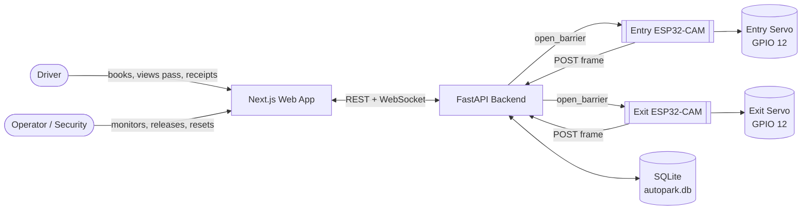

---

## 3. Container / component view

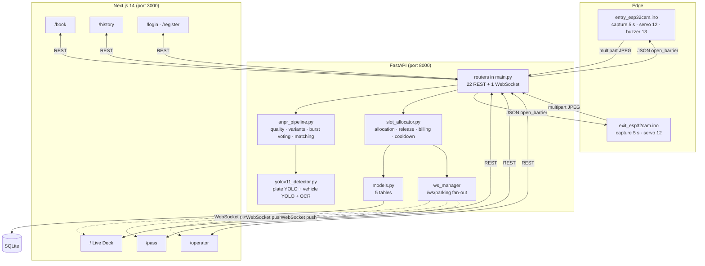

---

## 4. End-to-end data flow

### 4.1 Booking (before arrival)

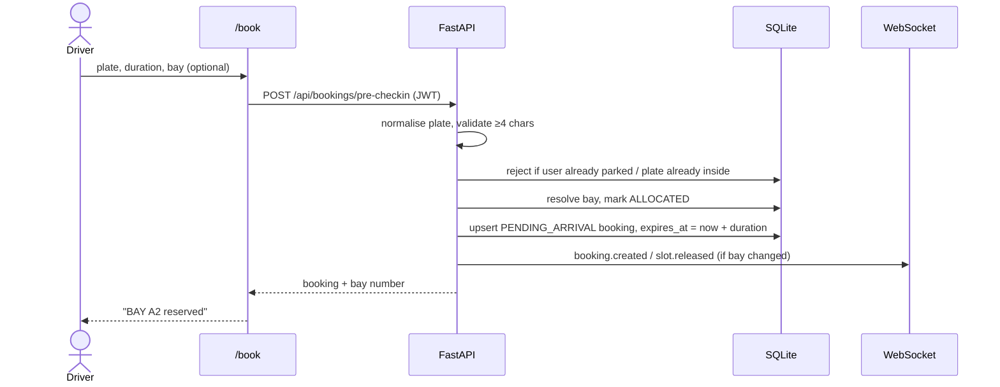

Key rule: **booking consumes the bay immediately.** A reserved bay is not offered to
anyone else, even though the car has not arrived.

### 4.2 Entry (authorised)

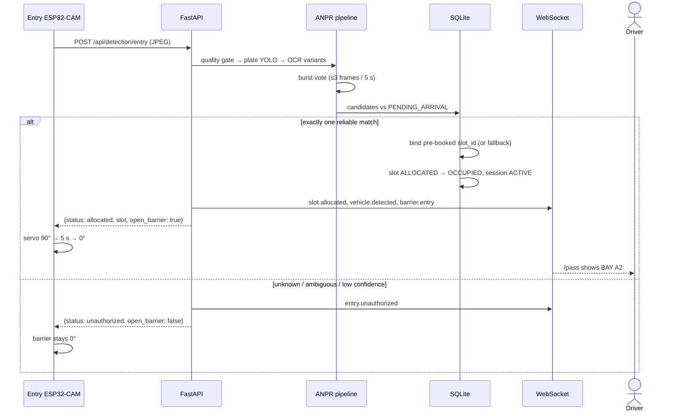

### 4.3 Exit

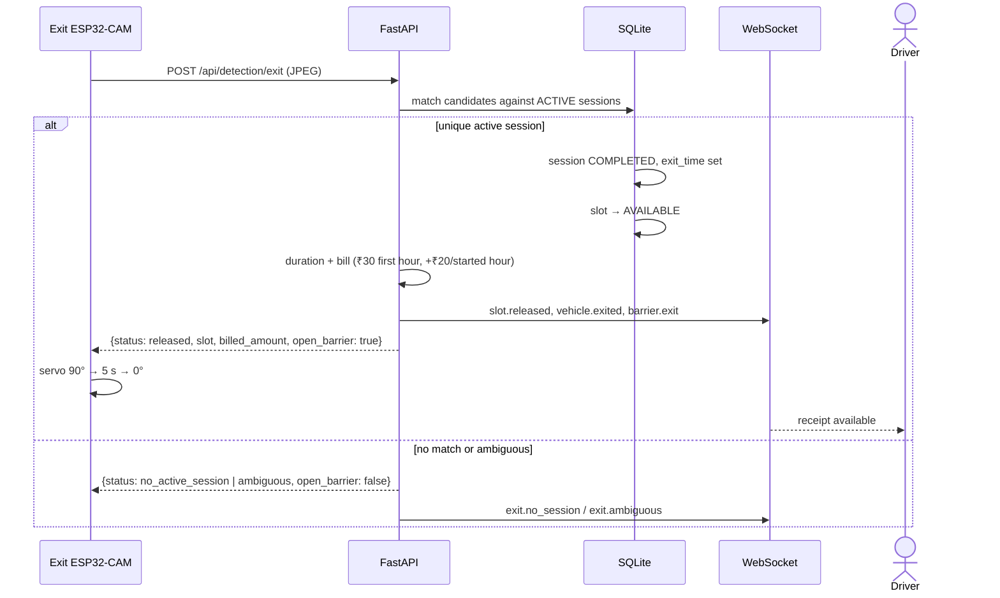

### 4.4 Realtime fan-out

Every state change is broadcast on `/ws/parking`. Clients (Live Deck, Active Pass,
Operator Console) subscribe once and patch local state. There is no polling loop for
occupancy.

Event types actually emitted by the backend:

| Event | Meaning |
|---|---|
| `slot.allocated` | A bay changed to ALLOCATED/OCCUPIED |
| `slot.released` | A bay became AVAILABLE |
| `booking.created` | Pre-registration created |
| `booking.cancelled` | Pre-registration cancelled |
| `vehicle.detected` | A frame produced a detection result |
| `vehicle.exited` | Exit matched an active session |
| `entry.unauthorized` | Entry refused |
| `exit.no_session` | Exit plate matched nothing |
| `exit.ambiguous` | Exit matched more than one session |
| `parking.full` | No bay available |
| `barrier.entry` / `barrier.exit` | Barrier action for the UI indicator |
| `buzzer.triggered` | Optional buzzer fired |
| `demo.reset` | Facility reset |

---

## 5. State machines

### 5.1 Parking bay

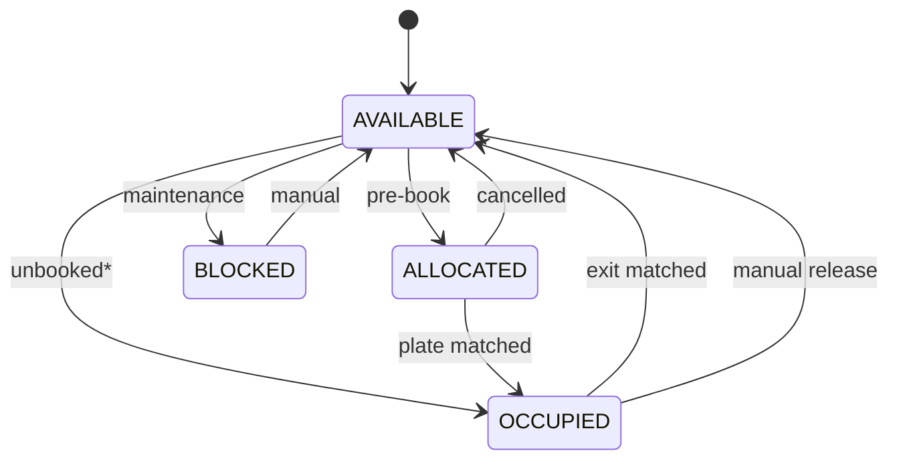

\* In the current access policy an unbooked vehicle is refused, so the direct
`AVAILABLE → OCCUPIED` transition only occurs through the HIL simulator, which is
intended as an operator override.

### 5.2 Booking

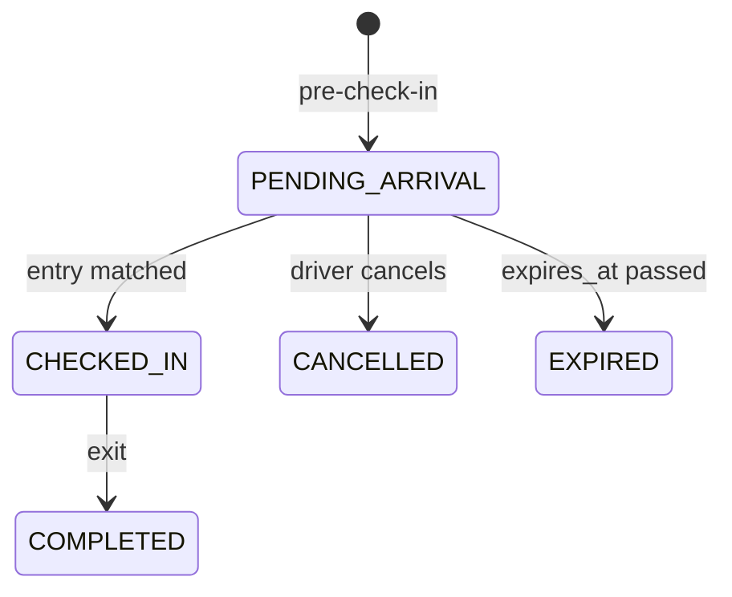

### 5.3 Session

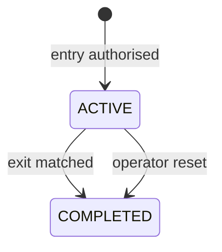

---

## 6. Why two cameras instead of per-bay sensors

| Dimension | Per-bay sensors | AutoPark (gate cameras) |
|---|---|---|
| Sensing devices | one per bay (6 here, n in general) | **2, constant** |
| Power/cabling per bay | required | none |
| Mounting per bay | required | none |
| Occupancy accuracy | direct measurement | derived; relies on plate reads |
| Failure blast radius | one bay | one gate (half the flow) |
| Unreadable plate | irrelevant | bay can appear stuck until override |
| Cost growth with capacity | linear | constant |
| Retrofit into existing lot | invasive | gate-mounted only |

**The honest trade-off:** direct sensing is more robust per bay. AutoPark exchanges
per-bay robustness for constant hardware cost and a single integration point, and pays
for it with a dependency on plate recognition quality. That dependency is managed with
confidence thresholds, ambiguity refusal, cooldowns, evidence capture and manual
release — not hidden.

---

## 7. Deployment topology

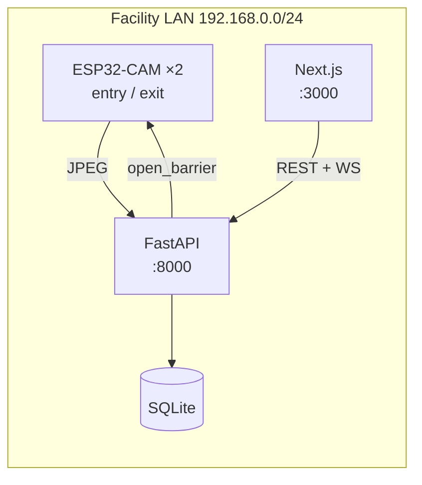

- No cloud dependency, no external database, no TLS terminator.
- Cameras are configured with the laptop's LAN address in firmware
  (`SERVER_HOST`, `SERVER_PORT`, `SERVER_PATH`).
- Both services are started detached with `scripts/host.sh`; logs in `.run/`.
- This is a **LAN deployment**, which is the realistic topology for a gate system. It
  is not an internet-hosted service.

---

## 8. Failure and degradation design

| Failure | System behaviour | Recovery |
|---|---|---|
| Backend unreachable | Cameras retry on next 5 s cycle; barrier stays closed (fail-safe) | restart backend |
| Camera offline | Last-seen status ages out after 30 s (`CAMERA_OFFLINE_TIMEOUT_SECONDS`) | power-cycle camera |
| Blurred / dark frame | Quality gate marks frame `blurry` / `poor_lighting`; no allocation | better lighting / refocus |
| Plate unreadable | `no_plate`; no allocation; event logged with evidence | manual release or retry |
| Plate matches two bookings | `ambiguous`; refused | operator verifies |
| Entry read succeeds, exit read fails | Bay remains OCCUPIED | operator manual release (`POST /api/parking/release/{slot}`) |
| Duplicate frames | 10 s per-plate cooldown + active-session check | automatic |
| Power loss mid-session | Session stays ACTIVE in DB | reset or manual release |
| Servo stalls | No position feedback; UI label is inferred, not measured | visual check / re-seat horn |

The barrier is deliberately **fail-closed**: the absence of an explicit `open_barrier:
true` from the backend leaves the arm at 0°.

---

## 9. Design decisions

| ID | Decision | Alternatives considered | Rationale | Trade-off accepted |
|---|---|---|---|---|
| D1 | Two gate cameras, no bay sensors | ultrasonic per bay; overhead vision | constant hardware cost; minimal retrofit | occupancy depends on plate reads |
| D2 | Pre-booked-only access | walk-in with buffer; hybrid | unambiguous policy; no double-allocation risk | no spontaneous visitors |
| D3 | Backend owns all state | camera-side decisions | single source of truth; auditable | backend is a single point of failure |
| D4 | Refuse on ambiguity | best-score admit | a false admit corrupts occupancy and revenue | occasional false rejects |
| D5 | SQLite | PostgreSQL | zero-ops, adequate for one lot | limited write concurrency |
| D6 | JWT + bcrypt | session cookies | stateless API, simple ESP32/browser split | token revocation is manual |
| D7 | WebSocket push | polling | instant UI, less load | connection lifecycle code |
| D8 | Servo barrier on GPIO 12 | buzzer only | physical access control, matches real gates | 5 V current and timer contention care |
| D9 | Deterministic billing in backend | client-side estimate | single authority; receipts cannot be edited | recomputation on every exit |
| D10 | Simulation endpoints | mock UI only | exercises the real DB/allocator/billing path | simulator can create real sessions |

---

## 10. Architectural invariants

These must remain true; violating one is a design regression.

1. **No bay is allocated without a plate decision.** The only exception is the explicit
   operator simulator.
2. **A bay is OCCUPIED only while an ACTIVE session references it.**
3. **Occupancy is never computed in the frontend.**
4. **The barrier opens only on an explicit backend boolean.**
5. **Every entry, exit and refusal writes a `DetectionEvent` row with evidence.**
6. **A booking always holds a concrete `slot_id`; releasing a booking releases the bay.**
7. **Ambiguity is a refusal, not a coin flip.**


---

# 03 — Technology Stack and Justification

# 03 — Technology Stack and Justification

> Every choice below is justified by a requirement of *this* system, not by popularity.
> In the viva, "why did you use X?" is really "what requirement forced X?".

---

## 1. Stack at a glance

| Layer | Technology | Version in repo | Role |
|---|---|---|---|
| Edge firmware | Arduino C++ (ESP32 core) | — | Capture + HTTP POST + servo control |
| Edge hardware | ESP32-CAM (AI-Thinker), SG90 servo, optional buzzer | — | Gate sensing and actuation |
| Plate detection | YOLOv11 (Ultralytics) | `ultralytics` (not pinned) | Locate plate region in frame |
| Plate reading | EasyOCR | (not listed in requirements) | Recognise characters |
| Image processing | OpenCV (headless) | `>=4.8.0` | Quality metrics, CLAHE, thresholding |
| Backend framework | FastAPI | `>=0.100.0` | REST + WebSocket API |
| ASGI server | Uvicorn | `>=0.22.0` | Serve the API |
| ORM | SQLAlchemy | `>=2.0.0` | Models and queries |
| Database | SQLite | stdlib | Persistence |
| Auth | PyJWT + bcrypt | `>=2.8.0`, `>=4.0.0` | Tokens and password hashing |
| Frontend framework | Next.js (App Router) | `^14.2.5` | Routing, rendering |
| UI runtime | React | `^18.3.1` | Components and state |
| Styling | Tailwind CSS | `^3.4.7` | Design system utilities |
| Icons | lucide-react | `^0.417.0` | Consistent line icons |
| Motion | Framer Motion | `^11.3.19` | Modal / card transitions |
| Language | TypeScript | `^5.5.4` | Type safety on the client |

---

## 2. Justification by requirement

### R1 — "The gate must work without a human"

**Chosen:** ESP32-CAM + FastAPI decision + servo.
**Why:** the ESP32-CAM is a single board with Wi-Fi, camera and GPIO. It can capture,
POST and drive a servo without a companion microcontroller. Offloading all decisions to
the backend means the camera firmware stays small enough to be reliable.
**Rejected:** Raspberry Pi at each gate (overkill, more power, more cost); Arduino Uno +
separate Wi-Fi shield (more wiring, less integrated).

### R2 — "Read Indian plates from a low-cost camera"

**Chosen:** YOLOv11 plate detector, then EasyOCR.
**Why:** a two-stage design separates *where* the plate is from *what it says*. The
detector can be fine-tuned on plate crops; the OCR engine can be swapped without
retraining. EasyOCR handles multi-line plates and returns per-token confidence, which
the scoring stage needs.
**Rejected:** single-shot OCR over the whole frame (too much background text); template
matching (fails on scale/rotation); cloud OCR (needs internet, adds latency and cost).

### R3 — "One source of truth, auditable"

**Chosen:** FastAPI + SQLAlchemy + SQLite.
**Why:** FastAPI gives typed request/response models and automatic OpenAPI docs at
`/docs`, which shortens integration and doubles as documentation for the report. SQLite
requires no server process and is sufficient for six bays and a single writer.
**Rejected:** PostgreSQL (operational overhead with no benefit at this scale); storing
state in memory (a restart would lose occupancy).

### R4 — "Live updates without refresh"

**Chosen:** WebSocket `/ws/parking`.
**Why:** occupancy changes are infrequent but must appear instantly on three screens.
A single broadcast channel is simpler than Server-Sent Events plus REST and supports
future bidirectional control.
**Rejected:** polling every second (wasteful, visible lag); long polling (more complex).

### R5 — "A UI that looks like an operations product, not a student demo"

**Chosen:** Next.js 14 + Tailwind + a monochrome token set ("District" design language).
**Why:** the App Router gives file-based routes for the five screens; Tailwind keeps the
design system in one config; the monochrome palette (near-black surfaces, white primary
actions, one accent per state) reads as infrastructure software.
**Rejected:** component libraries with default themes (immediately recognisable as a
template); gradient/neon dashboards (hard to read, dated).

### R6 — "Demonstrate without hardware"

**Chosen:** simulator endpoints that call the same allocator, DB and billing code.
**Why:** a demo that bypasses the backend would prove nothing. `/api/parking/simulate/*`
skips only frame capture.
**Rejected:** UI-only mock data.

---

## 3. Why these specific versions

- **Next.js 14 App Router** — the repo already uses server/client component boundaries;
  upgrading majors would churn every page for no functional gain.
- **React 18** — required by Next 14; concurrent rendering is not used explicitly.
- **SQLAlchemy 2.x** — the models use the 2.0 declarative style.
- **Pydantic 2.x** — FastAPI's response models and settings rely on it.
- **Tailwind 3.4** — custom colour tokens (`districtBg`, `districtCard`, …) are defined
  in `tailwind.config.js`.

---

## 4. Runtime topology and practical constraints

| Concern | Reality in this build |
|---|---|
| Backend interpreter | **`/opt/anaconda3/bin/python3`** — the default `python3` lacks SQLAlchemy |
| Backend start | `scripts/host.sh start` (detached), or `uvicorn app.main:app --port 8000` |
| Frontend start | `npm run dev` in `frontend/` (port 3000) |
| Database file | `backend/autopark.db` (root `autopark.db` is stale — no `users` table) |
| Camera → backend | plain HTTP on the LAN, no auth on `/api/detection/*` |
| Browser → backend | JWT bearer for account routes; occupancy routes are open |
| Public exposure | none — LAN only |

> **Report note:** state the interpreter constraint honestly if asked about
> reproducibility. It is an environment issue, not an architectural one, and it is
> fixed by pinning the interpreter in `scripts/host.sh`.

---

## 5. Dependency reality check

`backend/requirements.txt` currently lists:

```
fastapi, uvicorn[standard], sqlalchemy, pydantic, python-multipart,
opencv-python-headless, numpy, pillow, pytest, httpx, pyjwt, bcrypt
```

It **omits** the two packages the ANPR pipeline actually needs at runtime:

| Missing | Consequence | Fix |
|---|---|---|
| `ultralytics` | `import YOLO` fails; detector falls back or runs degraded | add `ultralytics>=8.3` |
| `easyocr` | no OCR reader; plate reading returns no candidates | add `easyocr>=1.7` |

On the current machine `/health` reports `"easyocr": false`, so the fallback path is
what runs. **This must be fixed before submission** if the report claims live ANPR,
because a fresh `pip install -r requirements.txt` will not reproduce the system.

**Fix (do this before the viva):**

```bash
/opt/anaconda3/bin/python3 -m pip install ultralytics easyocr
# then add both lines to backend/requirements.txt
```

Verify with:

```bash
curl -s http://localhost:8000/health | python3 -m json.tool
# expect: "yolo_plate_model": true, "easyocr": true
```

---

## 6. Alternatives summary table (for the literature/design chapter)

| Decision | Chosen | Main alternative | Reason for rejection |
|---|---|---|---|
| Occupancy sensing | Gate ANPR | per-bay ultrasonic | linear cost, invasive retrofit |
| Plate localisation | YOLOv11 | Haar cascade / contour heuristics | brittle under lighting and angle |
| OCR | EasyOCR | Tesseract | weaker on unconstrained scene text; EasyOCR returns confidence |
| Backend | FastAPI | Flask / Django | async + typed models + OpenAPI for free |
| DB | SQLite | PostgreSQL | ops overhead; single-lot scale |
| Realtime | WebSocket | SSE / polling | one channel for all clients; bidirectional ready |
| Frontend | Next.js | plain React SPA | routing, layout, deployment story |
| Barrier | SG90 servo | solenoid latch / buzzer only | cheap, visual, PWM-controlled |
| Auth | JWT | server sessions | stateless; simple for browser + API split |


---

# 04 — ANPR Pipeline (Technical Deep Dive)

# 04 — ANPR Pipeline (Technical Deep Dive)

> This is the chapter examiners probe hardest. Every threshold below exists in the code
> and can be pointed to by file and function name.

---

## 1. The problem ANPR actually solves here

The system does not need to know *what* a plate says in general. It needs to answer one
question reliably:

> **"Does this frame correspond to exactly one vehicle that is allowed to be here?"**

That reframing matters. A generic OCR system optimises character accuracy. AutoPark
optimises **decision correctness** — and when the evidence is insufficient, the correct
decision is *refuse*, not *guess*.

---

## 2. Pipeline overview

The pipeline has two halves. The first turns a camera frame into candidate plate readings.
The second decides whether those readings are strong enough to open the barrier. Both
halves run inside a single request, so a frame is never left half-processed.

### 2.1 Capture and reading (stages 1–4)

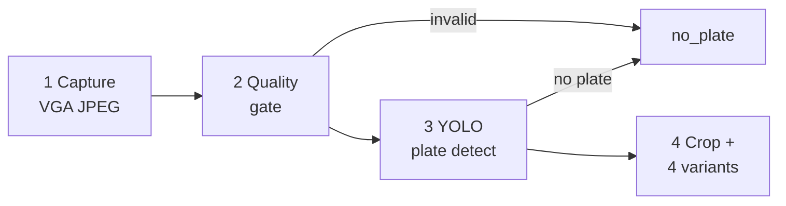

### 2.2 Decision path (stages 5–8)

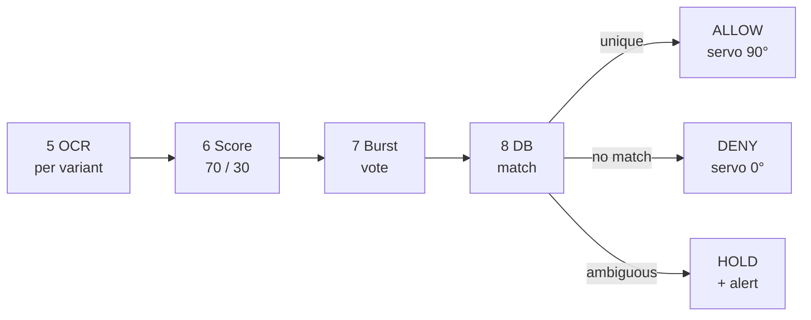

### 2.3 Where each stage lives

Stages live in:

| Stage | File | Function |
|---|---|---|
| Quality gate | `anpr_pipeline.py` | `assess_image_quality()` |
| Preprocessing variants | `anpr_pipeline.py` | `generate_plate_variants()` |
| OCR + candidate scoring | `anpr_pipeline.py` | `process_frame()` / `extract_candidates()` |
| Burst accumulation | `anpr_pipeline.py` | `FrameBurstAccumulator` |
| Entry matching | `anpr_pipeline.py` | `match_entry_pre_registration()` |
| Exit matching | `anpr_pipeline.py` | `match_exit_active_session()` |
| Allocation policy | `slot_allocator.py` | `allocate_entry_slot()` |
| Release + billing | `slot_allocator.py` | `release_exit_slot()` |

---

## 3. Stage 1 — Capture (edge)

| Parameter | Value | Reason |
|---|---|---|
| Capture interval | 5000 ms | Enough for a slow-moving car; keeps bandwidth low |
| Frame size | VGA 640×480 (PSRAM) / QVGA 320×240 (no PSRAM) | Plate must remain legible; PSRAM boards can afford VGA |
| JPEG quality | 10 (VGA) / 12 (QVGA) | Higher quality = larger payload; 10 is a good compromise |
| Frame buffers | 2 with `CAMERA_GRAB_LATEST` | Avoids sending a stale frame |
| Transport | HTTP multipart POST | Simple, debuggable, no broker needed |

Firmware is a **stateless sensor**: it does not decide, queue or retry beyond the next
cycle. If the backend is down, the next frame simply fails and the barrier stays closed.

---

## 4. Stage 2 — Image quality gate

Before spending compute on detection, the frame is graded:

| Metric | Computation | Threshold | Meaning |
|---|---|---|---|
| Sharpness | variance of Laplacian | `< 20.0` → `blurry` | motion blur / defocus |
| Brightness | mean pixel intensity | low/high bands | under/over-exposed |
| Contrast | standard deviation | low band | washed-out frame |
| Grade | derived | `invalid`, `blurry`, `poor_lighting`, `clear` | failure attribution |

Why it matters: it distinguishes **"camera problem"** from **"plate problem"** in the
diagnostics log. That is what makes the failure taxonomy defensible instead of a vague
"recognition failed".

**Report phrasing:** *"The quality gate converts an opaque recognition failure into an
attributable one — blur, lighting, plate localisation, or OCR."*

---

## 5. Stage 3 — Plate localisation (YOLOv11)

| Item | Value |
|---|---|
| Model | `backend/models/license_plate_best.pt` |
| Task | single-class object detection (plate region) |
| Inference confidence | 0.25 inside the detector |
| Backend acceptance | candidate confidence must clear **0.75** to be allocatable |
| Output | bounding box → crop → OCR |

Two confidences exist and they are **not the same thing**:

1. **Detector confidence** — how sure the model is that the box contains a plate.
2. **Candidate confidence** — the composite OCR score after voting.

The backend gate (`YOLO_CONFIDENCE_THRESHOLD = 0.75`) applies to the detection candidate
used for allocation. Do not conflate them on a slide; an examiner may ask.

A general vehicle model (`yolo11n.pt`) is also loaded to classify the vehicle type, but
the plate model is the one that gates access.

---

## 6. Stage 4 — Preprocessing variants

The crop is normalised four ways, because no single binarisation wins across lighting
conditions:

| Variant | Purpose | Typical failure it fixes |
|---|---|---|
| `adaptive` | local adaptive threshold | uneven illumination, shadows |
| `adaptive_inv` | inverted adaptive threshold | light text on dark plate |
| `otsu` | global Otsu threshold | clean, high-contrast plates |
| `clahe` | contrast-limited adaptive histogram equalisation | low-contrast / hazy frames |

Shared preprocessing: bilateral filtering (noise reduction without destroying edges),
CLAHE, and an unsharp mask (1.6 × original − 0.6 × blurred).

Evaluation order is deliberately `adaptive → adaptive_inv → otsu → clahe`, because
adaptive thresholding was observed to preserve the digit **4** better than **L** on the
ESP32-CAM images.

**Performance short-circuit:** once two variants have produced a candidate of at least
6 characters with confidence ≥ 0.75, the remaining variants are skipped. This keeps the
common case fast without weakening the difficult case.

---

## 7. Stage 5 — OCR and candidate scoring

EasyOCR runs with a restricted alphabet:

```
allowlist = "ABCDEFGHIJKLMNOPQRSTUVWXYZ0123456789"
detail = 1, paragraph = False
```

Restricting the alphabet removes punctuation noise and reduces confusions such as
`0`/`O` in non-plate text.

Results are sorted top-to-bottom, then left-to-right, so **two-line plates** concatenate
correctly (`KA 05` + `KK 0403` → `KA05KK0403`).

Candidates are then filtered:

- minimum 3 characters,
- at least two distinct characters (rejects `1111`, `AAAA`).

### Composite score

```
vote_ratio      = variants_that_agreed / 4
composite_score = 0.70 × max_confidence + 0.30 × vote_ratio
```

Clamped to 0.999. Why weight agreement? A single variant reading `KA05KK0403` at 0.80 is
less trustworthy than three variants agreeing on it at 0.78. The 70/30 split encodes
that intuition and is easy to defend.

Candidates are ranked by `(composite_score, votes)`.

---

## 8. Stage 6 — Multi-frame burst voting

A single frame is a single sample; motion blur and compression make any one frame
unreliable.

| Parameter | Value |
|---|---|
| Burst window | 5.0 s |
| Maximum frames | 3 |
| Aggregation | candidates merged across frames |
| Frame boost | `0.75 × max_conf + 0.25 × frame_ratio` |

`frame_ratio` is the fraction of frames in the burst that produced the candidate. A
reading seen in 3 of 3 frames outranks a higher-confidence reading seen once.

This is the practical answer to "what if one frame is bad?" — the system waits for
corroboration instead of trusting the first read.

---

## 9. Stage 7 — Database matching

### 9.1 Similarity scoring

`evaluate_plate_match(candidate, target)` returns:

| Condition | Score | Example |
|---|---|---|
| Exact match | **1.00** | `KA05KK0403` = `KA05KK0403` |
| Canonical match | **0.92** | `KA05KK04O3` → `KA05KK0403` |
| Substring / prefix (≥6 chars) | **0.88** | `INDKA01AB1234` contains `KA01AB1234` |
| Levenshtein distance 1, length ≥6 | **0.85** | one substitution |
| Levenshtein distance 1, length 4–5 | **0.75** | one substitution on a short plate |
| Levenshtein distance 2, length ≥7 | **0.76** | two edits on a long plate |
| Otherwise | **0.00** | — |

### 9.2 Canonicalisation map

OCR confuses characters that look alike. Before comparison:

```
I, L, J → 1
O, Q, D → 0
Z → 2
S → 5
B → 8
G → 6
```

So `KA05KK04O3` and `KA05KK0403` canonicalise to the same string. This is why a single
`O`/`0` error does not reject a legitimate driver.

### 9.3 Confidence weighting

The raw similarity is discounted by the OCR's own confidence:

```
adjusted_score = similarity × (0.80 + 0.20 × candidate_confidence)
```

A perfect string match read at 0.50 confidence scores `1.00 × 0.90 = 0.90`; the same
match at 0.95 scores `0.99`. The floor of 0.80 prevents a confident wrong read from
being discounted into a match, and the ceiling prevents a marginal read from
outranking a strong one.

### 9.4 Acceptance and ambiguity

| Rule | Value |
|---|---|
| Minimum adjusted score to be considered | **0.72** |
| Ambiguity condition | top two scores within **0.10** |
| Ambiguous outcome | **refuse**, raise operator alert |
| No candidate above threshold | `unauthorized` (entry) / `no_active_session` (exit) |

The ambiguity rule is the most important safety property in the project. If a reading
could plausibly belong to two bookings, the system does **not** pick the higher one — it
stops. A false admit creates a wrong bay, a wrong bill and a corrupted occupancy map; a
false reject costs one retry.

**Worked example — ambiguity**

```
Bookings: KA05KK0403, KA05KK0404
Reading : KA05KK0405  (one edit from each)
Scores  : 0.85, 0.85  → gap 0.00 < 0.10 → AMBIGUOUS → refuse
```

**Worked example — canonical match**

```
Booking: KA05KK0403
Reading: KA05KK04O3   (O instead of 0)
Canonical both → KA05KK0403 → similarity 0.92
candidate confidence 0.91 → adjusted 0.92 × 0.982 = 0.90 ≥ 0.72 → ALLOW
```

---

## 10. Stage 8 — Policy layer (allocation)

Matching produces a candidate booking; `allocate_entry_slot()` applies policy **in this
order**:

1. **Confidence gate** — `< 0.75` → `ignored`.
2. **Plate validity** — no candidate with ≥4 alphanumerics → `no_plate`.
3. **Already inside?** — plate matches an ACTIVE session → `already_allocated`
   (idempotent duplicate-frame handling).
4. **Cooldown** — same canonical plate within 10 s → `already_allocated`.
5. **Booking match** — unique, above threshold, non-ambiguous → authorised.
6. **Bay binding** — use the booking's `slot_id` if it is still AVAILABLE/ALLOCATED;
   otherwise fall back to the lowest-numbered free bay.
7. **Commit** — bay → OCCUPIED, session ACTIVE, booking CHECKED_IN, `DetectionEvent`
   written with evidence.
8. **Actuate** — response includes `open_barrier: true`, `barrier_action: OPEN`.

Every branch returns a machine-readable status, so the UI and the firmware never have to
parse prose.

---

## 11. Failure taxonomy

| Status | Cause | Barrier | Operator sees |
|---|---|---|---|
| `no_plate` | no plate box, unreadable, fewer than 4 alphanumerics (entry), bad quality | closed | "no plate" + stage |
| `ignored` | confidence < 0.75 | closed | low-confidence event |
| `unauthorized` | plate matches no pending booking | closed | driver + plate + alert |
| `ambiguous` | two bookings within 0.10 | closed | both candidate plates |
| `already_allocated` | duplicate frame / cooldown / already inside | closed | existing bay |
| `parking_full` | no free bay | closed | full-lot alert |
| `released` | exit matched | open | bay, duration, bill |
| `no_active_session` | exit plate matches no ACTIVE session | closed | plate + alert |
| `exit ambiguous` | two sessions within 0.10 | closed | both plates |

---

## 12. Complexity and performance notes

Let `V` = 4 preprocessing variants, `F` ≤ 3 burst frames.

- Plate detection: one YOLO inference per frame.
- OCR: up to `V` passes per frame, short-circuited to 2 when confident.
- Matching: linear scan over pending bookings or active sessions, each comparison is
  `O(L²)` Levenshtein on plate length `L` (≈10). Negligible.

So the cost is dominated by **YOLO + OCR**, not by the matching logic. That is the
correct place for the cost: the safety logic is cheap enough to run on every frame.

**What to say if asked about latency:** measure it. Report the median and 95th
percentile of end-to-end time (frame POST → JSON response) across at least 30 runs, and
state the hardware used.

---

## 13. Tuning knobs (useful for the "future work" slide)

| Knob | Location | Effect of increasing |
|---|---|---|
| `YOLO_CONFIDENCE_THRESHOLD` | `config.py` | fewer false admits, more rejects |
| `DETECTION_COOLDOWN_SECONDS` | `config.py` | fewer duplicates, slower retries |
| Ambiguity gap `0.10` | `anpr_pipeline.py` | stricter uniqueness, more holds |
| Match floor `0.72` | `anpr_pipeline.py` | fewer matches, higher precision |
| Burst window / frames | `anpr_pipeline.py` | more corroboration, more latency |
| Composite weights (0.70/0.30) | `anpr_pipeline.py` | trust OCR confidence vs. agreement |

Every one of these is a **precision/recall trade-off**, and the defaults are deliberately
biased toward precision. That is a defensible design choice for access control, and it
should be stated as such.


---

# 05 — Backend Design and Data Model

# 05 — Backend Design and Data Model

> Backend root: `backend/app/` · entrypoint: `backend/app/main.py` · port **8000**

---

## 1. Module map

| Module | Responsibility |
|---|---|
| `main.py` | App setup, 22 REST routes, 1 WebSocket route, startup warm-up, WebSocket broadcasts |
| `config.py` | Settings: slot list, thresholds, cooldown, JWT, database URL |
| `models.py` | Five SQLAlchemy models |
| `database.py` | Engine, session factory, `get_db` dependency |
| `schemas.py` | Pydantic request/response contracts |
| `auth.py` | bcrypt hashing, JWT creation/decoding, `get_current_user` |
| `slot_allocator.py` | Allocation, release, billing, cooldown, manual release, reset |
| `anpr_pipeline.py` | Quality gate, variants, OCR candidates, burst voting, DB matching |
| `yolov11_detector.py` | Plate YOLO + vehicle YOLO + OCR reader lifecycle |
| `yolo_detector.py` | Fallback detector and EasyOCR reader accessor |
| `frame_processor.py` | Per-camera frame processing wrapper |
| `train_yolov11.py` | Offline training script (not part of runtime) |
| `ws_manager.py` | WebSocket connection registry and broadcast |

---

## 2. Database schema

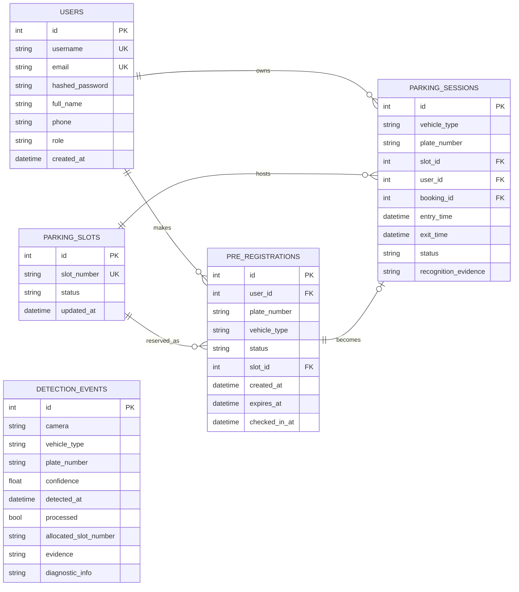

### Table notes

| Table | Purpose | Key invariant |
|---|---|---|
| `users` | Driver and operator accounts | unique username; bcrypt hash only |
| `parking_slots` | The six bays | `slot_number` unique; status is the occupancy authority |
| `pre_registrations` | Bookings before arrival | a booking holds exactly one `slot_id` |
| `parking_sessions` | Actual occupancy periods | `ACTIVE` ⇒ slot is `OCCUPIED` |
| `detection_events` | Audit trail of every detection/refusal | never deleted by reset |

Statuses:

- Slot: `AVAILABLE`, `ALLOCATED`, `OCCUPIED`, `BLOCKED`, `MAINTENANCE`
- Booking: `PENDING_ARRIVAL`, `CHECKED_IN`, `COMPLETED`, `CANCELLED`, `EXPIRED`
- Session: `ACTIVE`, `COMPLETED`

---

## 3. API reference

Base URL: `http://localhost:8000` · interactive docs: `/docs`

### 3.1 System

| Method | Path | Auth | Purpose |
|---|---|---|---|
| GET | `/` | — | Service banner |
| GET | `/health` | — | Health, model status, slot and session counts |
| GET | `/api/health` | — | Alias of `/health` |

### 3.2 Detection (edge cameras)

| Method | Path | Auth | Body | Purpose |
|---|---|---|---|---|
| POST | `/api/detection/entry` | — | multipart JPEG or form fields | Run ANPR, authorise, allocate, return barrier command |
| POST | `/api/detection/exit` | — | multipart JPEG or form fields | Run ANPR, match session, release, bill |

Form fallback fields: `vehicle_type`, `plate_number`, `confidence`, `sync`.
The firmware always uploads a JPEG.

### 3.3 Authentication

| Method | Path | Auth | Purpose |
|---|---|---|---|
| POST | `/api/auth/register` | — | Create account, return JWT |
| POST | `/api/auth/login` | — | Verify credentials, return JWT |
| GET | `/api/auth/me` | Bearer | Current user profile |

### 3.4 Bookings

| Method | Path | Auth | Purpose |
|---|---|---|---|
| POST | `/api/bookings/pre-checkin` | Bearer | Create or update a booking, bind a bay |
| GET | `/api/bookings/my-status` | Bearer | Active booking + active session |
| GET | `/api/bookings/my-history` | Bearer | Last 20 sessions → `{ "history": [...] }` |
| GET | `/api/bookings/pending` | — | All non-expired pending bookings (operator) |
| DELETE | `/api/bookings/{id}` | Bearer | Cancel own booking, release its bay |

### 3.5 Parking state and control

| Method | Path | Auth | Purpose |
|---|---|---|---|
| GET | `/api/parking/layout` | — | Slots with status and active session |
| GET | `/api/parking/slots` | — | Raw slot list |
| GET | `/api/parking/summary` | — | Counts: total, available, allocated, occupied, blocked |
| POST | `/api/parking/reset` | — | Reset facility: complete sessions, free bays, preserve history |
| POST | `/api/parking/release/{slot_number}` | — | Manual release of a stuck bay |
| POST | `/api/parking/simulate/entry` | — | HIL: authorised or unauthorised entry |
| POST | `/api/parking/simulate/exit` | — | HIL: exit for the active session |

### 3.6 Diagnostics

| Method | Path | Purpose |
|---|---|---|
| GET | `/api/anpr/diagnostics?limit=N` | Last N detection diagnostics (quality, candidates, timings, failure stage) |
| GET | `/api/anpr/debug-image/{name}` | Retrieve a stored debug capture |

### 3.7 WebSocket

| Path | Direction | Purpose |
|---|---|---|
| `/ws/parking` | server → client | Push all state-change events |

> **Security note for the report:** detection, parking-state, reset, release and
> simulation routes are intentionally unauthenticated so the ESP32-CAM and the demo can
> call them without a token. This is acceptable on an isolated facility LAN but must be
> stated as a limitation, not hidden.

---

## 4. Entry allocation algorithm

```
allocate_entry_slot(plate, confidence, candidates):
    if confidence < 0.75:                 return "ignored"
    if no candidate with >= 4 chars:      return "no_plate"
    lock allocation_lock:
        if plate matches an ACTIVE session:  return "already_allocated"
        if same canonical plate within 10 s: return "already_allocated"
        match = unique match among PENDING_ARRIVAL bookings
        if match is ambiguous:            return "ambiguous"
        if match is none:                 return "unauthorized"
        bay = booking.slot_id if still AVAILABLE/ALLOCATED
              else lowest-numbered AVAILABLE bay
        if no bay:                        return "parking_full"
        bay.status = OCCUPIED
        booking.status = CHECKED_IN
        create session(ACTIVE, plate, bay, booking, evidence)
        log DetectionEvent
        return { status: "allocated", slot: bay, open_barrier: true }
```

Notes:

- The **bay the driver booked wins** over the lowest-numbered bay. This was a real bug,
  fixed by reading `pending_booking.slot_id` first.
- The lock is an in-process `threading.Lock`. It is correct for one Uvicorn worker and
  insufficient for multiple workers — see limitations.
- Confidence here is the detection/candidate confidence supplied by the pipeline; the
  booking match score is a separate threshold (≥ 0.72).

---

## 5. Exit release algorithm

```
release_exit_slot(plate, confidence, candidates):
    if confidence < threshold: return "ignored"
    match candidates against ACTIVE sessions (score >= 0.72)
    if none:                      return "no_active_session"
    if top two within 0.10:       return "ambiguous"
    session = winner
    session.status = COMPLETED; session.exit_time = now
    bay.status = AVAILABLE
    booking.status = COMPLETED
    duration_minutes = max(1, floor((exit - entry) / 60))
    billed = 30 if d <= 60 else 30 + ((d - 1) // 60) * 20
    log DetectionEvent
    broadcast slot.released, vehicle.exited, barrier.exit
    return { status: "released", slot, duration_minutes, billed_amount, open_barrier: true }
```

---

## 6. Billing

**Formula (single source of truth, backend):**

```
if duration_minutes <= 60:
    amount = 30
else:
    amount = 30 + ((duration_minutes - 1) // 60) * 20
```

| Parked | Minutes | Amount |
|---|---|---|
| 1 min | 1 | ₹30 |
| 60 min | 60 | ₹30 |
| 61 min | 61 | ₹50 |
| 2 h | 120 | ₹50 |
| 2 h 1 min | 121 | ₹70 |
| 3 h | 180 | ₹70 |
| 3 h 1 min | 181 | ₹90 |

**Interpretation:** ₹30 covers the first hour; every additional **started** hour block
adds ₹20. Duration is floored to whole minutes and clamped to a minimum of 1.

**Important:** the frontend also estimates a fee for the history list, and it mirrors
this formula. The backend value is authoritative. For an in-progress session the client
shows a labelled **estimate**, not a paid amount.

---

## 7. Authentication and security

| Aspect | Implementation |
|---|---|
| Password storage | bcrypt hash (`bcrypt`), never plaintext |
| Token | JWT, HS256, payload `{sub: user_id, username, role, exp, iat}` |
| Expiry | 1440 minutes (24 h) |
| Secret | `JWT_SECRET` env var, with a development default in `config.py` |
| Transport | Bearer header |
| Roles | `driver`, `admin` stored on the user |
| Role enforcement | **not enforced on routes** — the operator console is not access-controlled |

Security limitations:

1. Default JWT secret is known; must be overridden in production.
2. No TLS; tokens travel in clear text on the LAN.
3. Detection and control routes are unauthenticated.
4. No rate limiting on login.
5. No refresh-token rotation or revocation list.

None of these affect the correctness of the parking logic, but all of them matter for a
real deployment. Stating them is stronger than being caught by them.

---

## 8. Concurrency and consistency

| Mechanism | Where | Guarantees |
|---|---|---|
| `allocation_lock` | `slot_allocator.py` | serialises allocation/release within the process |
| Per-plate cooldown | in-memory dict, 10 s | suppresses duplicate frames |
| DB transaction | SQLAlchemy session | commit-or-rollback per request |
| Slot status | database | occupancy authority |

**Known constraint:** the lock and cooldown live in process memory. Running Uvicorn with
multiple workers would allow two allocations to interleave. The correct production fix
is a database-level `SELECT … FOR UPDATE` or a unique partial index on active sessions
per bay. This is a legitimate "future work" item.

---

## 9. WebSocket contract

Connect: `ws://<host>:8000/ws/parking`

Every message:

```json
{ "type": "<event>", "data": { ... } }
```

| Type | Data highlights |
|---|---|
| `slot.allocated` | slot, plate, confidence |
| `slot.released` | slot, plate |
| `booking.created` | booking, plate, slot |
| `booking.cancelled` | booking id, slot |
| `vehicle.detected` | camera, detected, confidence, failure_stage |
| `vehicle.exited` | slot, plate |
| `entry.unauthorized` | camera, plate, message |
| `exit.no_session` | camera, plate, message |
| `exit.ambiguous` | camera, plate, message |
| `parking.full` | message |
| `barrier.entry` / `barrier.exit` | action, slot |
| `buzzer.triggered` | slot |
| `demo.reset` | message |

The manager keeps a set of live sockets, removes dead ones on send failure, and
broadcasts without blocking the request path.

---

## 10. Startup sequence

1. `Base.metadata.create_all()` — create missing tables.
2. `run_migrations()` — idempotent column additions (e.g. `plate_number`).
3. `init_slots_db()` — ensure the six configured bays exist; remove decommissioned bays
   only if they have no active session.
4. Background warm-up of YOLO and OCR so the first real frame is not slow.

Reset (`POST /api/parking/reset`):

- marks all ACTIVE sessions COMPLETED with an exit timestamp,
- cancels/complete active bookings,
- sets every configured bay AVAILABLE,
- clears cooldowns and caches,
- **preserves** historical sessions and detection events.

That last point matters for the demo: resetting between runs does not erase the audit
trail.

---

## 11. Error semantics

| Case | HTTP | Body |
|---|---|---|
| Bad credentials | 401 | `{"detail": "Invalid username or password"}` |
| Missing/expired token | 401 | `{"detail": "Could not validate credentials or session expired"}` |
| Plate < 4 chars | 400 | validation message |
| Bay already taken | 400 | `Bay A2 is currently allocated…` |
| Already parked | 400 | explains which vehicle and bay |
| No bay free | 400 | "All parking bays are fully occupied or reserved" |
| Unknown bay name | 400 | `Parking bay 'X' does not exist` |

Detection endpoints do **not** use HTTP errors for business outcomes; they return
`200` with a `status` field (`no_plate`, `unauthorized`, `ambiguous`, …) so the
firmware can branch without parsing error pages.


---

# 06 — Frontend Design

# 06 — Frontend Design

> Root: `frontend/src/` · framework: Next.js 14 App Router · port **3000**

---

## 1. Purpose of the frontend

The web client is not a dashboard bolted onto an API. It is the **driver's interface to
the gate** and the **operator's window into the lot**:

- a driver needs to reserve a bay, know exactly where to go, and get a receipt;
- an operator needs to see the lot, the cameras, the last decisions, and to intervene;
- an examiner needs to see failure behaviour, not just a happy path.

Everything is rendered from backend state. The client never computes occupancy.

---

## 2. Route map

| Route | Audience | Purpose |
|---|---|---|
| `/` | All | Live Deck: availability, bay cards, quick actions, activity log |
| `/book` | Driver | Choose a bay, plate and duration, create or update a booking |
| `/pass` | Driver | Active pass: assigned bay, session status, exit receipt |
| `/history` | Driver | Completed sessions, totals, itemised receipts |
| `/operator` | Operator | Digital twin, camera status, diagnostics, HIL controls |
| `/login` | Driver | Sign in |
| `/register` | Driver | Create account |
| `/logos` | Internal | Logo/brand exploration page (not part of the demo flow) |

Navigation (`Navbar.tsx`): **Live Deck · Pre-Book · Active Pass · Receipts**. The
operator console is reachable directly at `/operator`.

---

## 3. Page behaviour

### 3.1 Live Deck (`/`)

- Availability counter (`x / 6`) and per-zone filter (All / Zone A / Zone B).
- Search by bay, plate or zone.
- Bay cards show status, zone, plate (if occupied), rate, and one primary action:
  `Pre-Book Bay` or `View Active Pass`.
- Activity log streams WebSocket events.
- Unauthorised-entry banner appears on refusal events.

**Design intent:** a driver should answer "is there space, and where?" in under five
seconds, on a phone, without scrolling horizontally.

### 3.2 Pre-Book (`/book`)

- Reads `?slot=` from the query string so "Pre-Book Bay" on a card pre-selects that bay.
- Collects plate, vehicle type and duration.
- Sends `slot_number` in the pre-check-in payload, so the chosen bay is the one bound in
  the database.
- Handles three states honestly:
  - success → confirmation with bay number;
  - bay taken → inline error, other bays remain selectable;
  - already parked → explicit message naming the existing vehicle and bay.

### 3.3 Active Pass (`/pass`)

- Shows the active booking and/or active session.
- Displays `BAY <slot_number>` prominently — this is the payoff of the booking flow.
- On exit, renders the itemised receipt modal.
- Degrades to a clear "no active pass" state when nothing is booked.

### 3.4 Receipts (`/history`)

- Lists the last 20 sessions for the signed-in account.
- Aggregate metrics: total sessions, total **paid** amount (completed only), compliance.
- Search across plate, bay and status.
- `View Invoice` opens the receipt modal.
- **In-progress sessions are labelled as such** and show elapsed time plus an estimated
  fee — not a fabricated exit timestamp.

> This page was the site of a real defect: the API returns `{ "history": [...] }` and the
> page treated the response as a bare array, crashing with
> `sessions.filter is not a function`. Fixed by unwrapping the response, adding an error
> state, and separating completed from active sessions. It is a good example to mention
> under "defects found and fixed during validation".

### 3.5 Operator Console (`/operator`)

A single screen for staff and for the demo:

| Region | Content |
|---|---|
| Digital twin | 2D floorplan of all six bays, colour-coded by status |
| Camera monitors | Entry and exit stream status, last plate, last decision |
| Barrier indicators | Inferred state (LOCKED / OPEN) from backend events |
| Diagnostics drawer | Quality grade, candidate list, failure stage, timing |
| HIL controls | Simulate authorised entry, unauthorised entry, exit, manual release, reset |

**Honesty point:** the barrier indicator is inferred from the API response. There is no
position wire from the servo. Say "commanded open", not "measured open".

### 3.6 Auth pages (`/login`, `/register`)

- JWT stored in `localStorage` under `autopark_token`.
- On `401`, the token is removed and the user is treated as signed out.
- No refresh token; expiry is 24 h.

---

## 4. Design system

The UI uses a **high-contrast monochrome operations language**: near-black surfaces,
thin white borders, one white primary action per view, and state colour reserved for
meaning (green = available, amber = reserved, red = refusal).

### Core tokens (`tailwind.config.js`)

| Token | Value | Use |
|---|---|---|
| `districtBg` | `#09090B` | page background |
| `districtBgElevated` | `#121215` | modal / elevated surface |
| `districtCard` | `#141416` | cards |
| `districtCardHover` | `#1A1A1E` | hover |
| `districtBorder` | `#27272A` | dividers |
| `districtInput` | `#18181B` | inputs |
| `districtMuted` | `#A1A1AA` | secondary text |
| `districtSubtext` | `#71717A` | tertiary text |
| `districtWhite` | `#FFFFFF` | primary text / primary button |

Shape and depth:

- `districtCard` shadow: `0 4px 24px -2px rgba(0,0,0,.7)` + 1 px white inner ring.
- Pills and rounded-2xl/3xl corners; no gradients on surfaces.
- Type: heavy weights for headings (`font-black`), monospace for plates, bays and money.

### Why this works in a viva

- It photographs well on a projector — high contrast survives bad projectors.
- It reads as infrastructure software rather than a student template.
- Status is communicated by **label + colour**, so it still works for colour-blind
  viewers and in black-and-white printouts.

> **Framing caution:** the brand mark reads `districtPARK` and the token names are
> `district*`. In the report, describe the style as a "monochrome operations design
> language"; do not claim the visual identity as an original creation, and do not present
> it as an official District product.

---

## 5. Component inventory

| Component | Role |
|---|---|
| `Navbar` | Primary navigation, active-route state |
| `DistrictLogo` | Wordmark + barrier glyph |
| `StatsOverview` | Availability / occupancy metric cards |
| `ParkingLayout` | Bay grid and floorplan |
| `LiveActivityLog` | Event stream from WebSocket |
| `LiveCameraFeed` | Camera status and last frame/detection |
| `NotificationBanner` | Authorised / refused / full alerts |
| `UserPreCheckinPanel` | Booking form and booking status |
| `DemoControls` | HIL simulator buttons |
| `ExitReceiptModal` | Itemised receipt, active or completed |
| `Header` | Page-level heading block |

---

## 6. Realtime behaviour

```
connect ws://<api>/ws/parking
  on message → switch(type)
    slot.allocated / slot.released → update bay + summary
    booking.created / cancelled   → update pass + availability
    vehicle.* / barrier.*         → update activity log + indicators
    entry.unauthorized            → show alert banner
  on close → exponential reconnect, refetch REST snapshot
```

Why a snapshot refetch on reconnect: WebSocket messages are not replayed. After any
disconnect, the client cannot assume it saw every transition, so it re-reads
`/api/parking/layout` and `/api/parking/summary` and then resumes streaming. This is a
small detail that prevents a stale dashboard — worth mentioning if asked about
reliability.

---

## 7. UX states

Every data view implements four states:

| State | Treatment |
|---|---|
| Loading | spinner + explicit label ("Loading session receipts…") |
| Empty | explanation + next action ("Pre-Book Your First Slot") |
| Error | cause + **Try Again** (added to Receipts during validation) |
| Populated | data with status labels and actions |

The distinction between *empty* and *error* matters: an empty state that hides a failure
is a lie. This was fixed on the Receipts page and should be the pattern everywhere.

---

## 8. Responsiveness and accessibility

- Layout switches from two-column bay grid to single column below `sm`.
- Touch targets on primary actions are full-width and ≥ 44 px high.
- Contrast: white on `#09090B` is ~19:1; muted text on cards is ~5:1.
- Plates, bay IDs and money use monospace so digits align and remain legible in
  screenshots.
- Status is never communicated by colour alone.

Known gaps (state them, do not hide them):

- No explicit ARIA live region for WebSocket updates.
- No keyboard trap management in the receipt modal.
- No dark/light toggle — the product is intentionally dark-only.

---

## 9. Frontend \u2194 backend contract notes

- Base URL from `lib/config.ts` (`getApiBaseUrl()`), not hard-coded in pages.
- `my-history` returns an **object** (`{history: [...]}`); other booking endpoints return
  objects too. Parse defensively; do not assume arrays.
- Receipt fields come from the **exit response** on the pass page and are recomputed on
  the history page from `entry_time`/`exit_time`. The backend is authoritative.
- The Live Deck treats `ALLOCATED` (booked, not arrived) and `OCCUPIED` (inside) as
  different states; the copy reflects that ("Reserved" vs "Occupied").

---

## 10. What to show in the report

Recommended screenshots (capture at 1440 px wide, dark UI, real data):

1. Live Deck with mixed availability.
2. Pre-Book with a bay pre-selected from a card.
3. Active Pass showing `BAY A2`.
4. Receipts list with completed sessions.
5. Receipt modal (completed).
6. Operator console with the diagnostics drawer open.
7. Unauthorised entry banner.

Each screenshot should have a caption that states **what decision it proves**, not just
what it shows. Example: *"Figure 6.3 — Active Pass after entry. The bay displayed is the
bay selected at booking time, confirming end-to-end slot binding."*


---

# 07 — Hardware Integration

# 07 — Hardware Integration

> Firmware: `hardware/entry_esp32cam/entry_esp32cam.ino` (352 lines) and
> `hardware/exit_esp32cam/exit_esp32cam.ino` (347 lines)
> Wiring reference: `HARDWARE_GUIDE.md`

---

## 1. Bill of materials

| # | Component | Qty | Role | Indicative cost (INR)* |
|---|---|---|---|---|
| 1 | ESP32-CAM (AI-Thinker, OV2640, PSRAM recommended) | 2 | Gate camera + controller | 500–800 each |
| 2 | FTDI / USB-TTL programmer (3.3 V) | 1 | Flashing the ESP32-CAM | 200–400 |
| 3 | SG90 (or MG90S metal-gear) micro-servo | 2 | Boom barrier arm | 120–250 each |
| 4 | 5 V 2 A adapter or power bank | 2 | Stable servo + camera supply | 300–500 each |
| 5 | Active buzzer (optional) | 1–2 | Audible confirmation | 20 each |
| 6 | Jumper wires, breadboard | — | Prototyping | 150 |
| 7 | Boom arm material (cardboard / popsicle stick / 3D print) | 2 | Visible barrier arm | negligible |
| 8 | Mounting hardware, cable ties, base plates | — | Gate rig | 200 |

\* Indicative only — record the **actual** prices you paid in the report. Do not present
these as quotations.

**Why two servos, not one:** entry and exit are physically separate gates and must be
able to open independently. A single actuator would require a mechanical linkage across
the lot.

---

## 2. Pin map (both nodes)

| Signal | ESP32-CAM pin | Notes |
|---|---|---|
| Servo signal (orange/yellow) | **GPIO 12** | PWM control; 0° closed, 90° open |
| Servo VCC (red) | **5 V rail** | *not* 3.3 V — brown-outs and jitter otherwise |
| Servo GND (brown/black) | **GND** | must share ground with ESP32-CAM |
| Buzzer + (optional) | **GPIO 13** | active buzzer; `-1` disables in firmware |
| Buzzer − | GND | — |
| Camera | internal AI-Thinker pin map | `Y2…Y9`, `XCLK`, `PCLK`, `VSYNC`, `HREF`, `SIOD`, `SIOC`, `PWDN`, `RESET` |

GPIO 12 and 13 are free on the AI-Thinker camera pinout, which is why they were chosen.

### Power topology

```
5 V 2 A adapter ──┬── ESP32-CAM 5V
                  └── Servo VCC
GND ──────────────┬── ESP32-CAM GND
                  └── Servo GND
```

- Common ground is mandatory; without it the PWM signal has no reference.
- A 470 µF–1000 µF electrolytic capacitor across the 5 V rail near the servo reduces
  brown-out resets when the arm starts moving.
- Do **not** power the servo from the ESP32-CAM 3.3 V pin.

---

## 3. Wiring table — Entry node

| From | To | Purpose |
|---|---|---|
| ESP32-CAM 5V | 5 V rail | board power |
| ESP32-CAM GND | common GND | reference |
| GPIO 12 | servo signal | barrier PWM |
| 5 V rail | servo VCC | torque supply |
| common GND | servo GND | return |
| GPIO 13 | buzzer + | confirmation chirp (optional) |
| GND | buzzer − | return |

## 4. Wiring table — Exit node

Identical, without the buzzer:

| From | To | Purpose |
|---|---|---|
| ESP32-CAM 5V | 5 V rail | board power |
| ESP32-CAM GND | common GND | reference |
| GPIO 12 | servo signal | barrier PWM |
| 5 V rail | servo VCC | torque supply |
| common GND | servo GND | return |

---

## 5. Firmware lifecycle

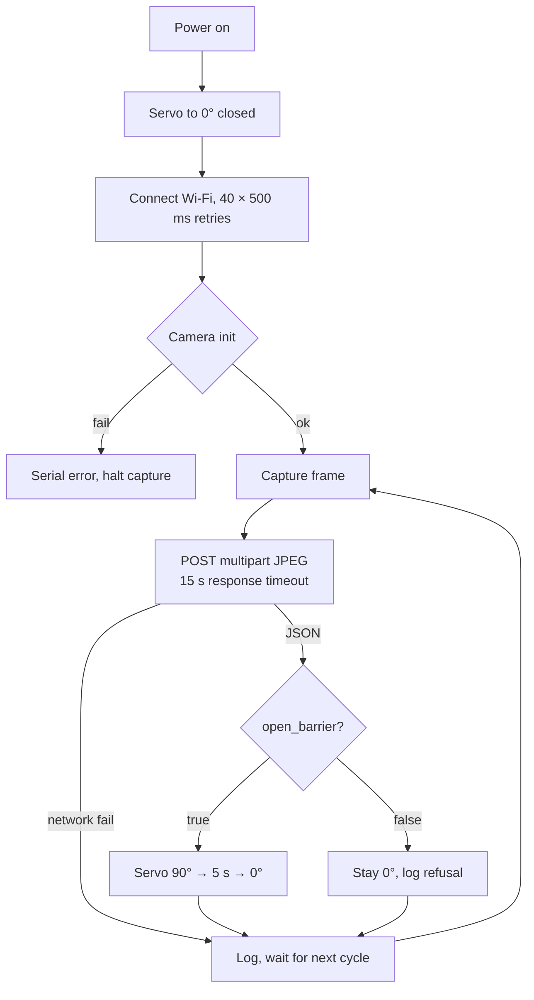

Firmware facts:

| Item | Value |
|---|---|
| Capture interval | 5000 ms, measured **after** the previous cycle completes |
| Response timeout | 15 s |
| JSON parsing | ArduinoJson (v6 and v7 compatible) |
| Frame streaming | multipart body written directly from the camera frame buffer |
| Wi-Fi recovery | reconnect attempt every 5 s when disconnected |
| Boot behaviour | servo calibrated to 0°; optional buzzer chirp |
| Server target | `SERVER_HOST`, `SERVER_PORT`, `SERVER_PATH` constants at the top of each sketch |

> **Before flashing:** update `WIFI_SSID`, `WIFI_PASSWORD` and `SERVER_HOST` to the
> laptop's LAN IP. The repository values are development defaults and will not work on
> another network. This is the single most common setup failure.

---

## 6. Barrier control contract

Backend response fields:

```json
{
  "status": "allocated",
  "slot": "A2",
  "open_barrier": true,
  "barrier_action": "OPEN",
  "trigger_buzzer": true
}
```

Firmware decision (entry):

```cpp
bool open_barrier = doc["open_barrier"] | false;
if (open_barrier || trigger_buzzer) {
    openEntryBoomBarrier();      // 90° → 5000 ms → 0°
} else {
    // gate stays at 0°
}
```

Exit is equivalent, keyed on `open_barrier || status == "released"`.

### Truth table

| Backend outcome | `open_barrier` | Entry barrier | Exit barrier |
|---|---|---|---|
| `allocated` (valid booking) | true | **OPEN 90° / 5 s** | — |
| `released` (valid session) | true | — | **OPEN 90° / 5 s** |
| `unauthorized` | false | closed 0° | — |
| `no_plate` | false | closed 0° | — |
| `ambiguous` | false | closed 0° | closed 0° |
| `no_active_session` | false | — | closed 0° |
| `parking_full` | false | closed 0° | — |
| `already_allocated` | false | closed 0° (already inside) | — |

The barrier is **fail-closed**: absence of an explicit `true` leaves the arm down.

---

## 7. Assembly procedure

1. **Bench-test the servo alone.** Sweep 0° → 90° → 0° with a test sketch before mounting
   anything. Confirm no buzzing/stalling at either end.
2. **Mount the servo** at the gate hinge point so the horn rotates the arm through 90°.
3. **Attach the arm** to the horn; balance it so gravity does not fight the servo.
4. **Set the closed position** with the arm horizontal across the lane at 0°.
5. **Set the open position** with the arm vertical at 90°.
6. **Mount the camera** above the lane, angled down at the plate position, 1.5–3 m away.
   Avoid direct headlight glare and direct sunlight into the lens.
7. **Power both rails** from the 5 V adapter; verify common ground with a multimeter.
8. **Flash and verify** the serial log shows Wi-Fi, camera init and `0° (Closed)`.
9. **Trigger a simulated entry** from `/operator` and watch the arm move.
10. **Adjust** camera angle and lighting until the plate fills a reasonable portion of
    the frame.

---

## 8. Bench checklist (run before every demo)

| Check | Pass criterion |
|---|---|
| Servo at rest | arm horizontal, no jitter, no buzzing |
| Manual test | arm sweeps 0° → 90° → 0° smoothly |
| Common ground | continuity between ESP32-CAM GND and servo GND |
| Supply | 5 V measured under load, not just at idle |
| Wi-Fi | serial prints connected + IP |
| Backend reachability | serial prints HTTP 200 |
| Camera focus | plate legible in the captured frame |
| Barrier response | simulated entry opens the arm within ~1 s of response |
| Fail-closed | simulated unauthorised entry leaves the arm down |

---

## 9. Troubleshooting

| Symptom | Likely cause | Fix |
|---|---|---|
| Servo twitches or resets the board when moving | 5 V supply sag / no common ground | separate 5 V supply, add capacitor, common GND |
| Servo does not move at all | wrong pin, no PWM timer, or horn unseated | verify GPIO 12, try `ESP32PWM::allocateTimer(2)` before `attach()` |
| Camera init fails | insufficient power or wrong board model | 5 V 2 A supply; select AI-Thinker |
| Wi-Fi never connects | 2.4 GHz only; 5 GHz SSID | use a 2.4 GHz network / hotspot |
| HTTP connect fails | `SERVER_HOST` still the old IP | set the laptop's current LAN IP |
| Response timeout | backend down or blocked by firewall | check `curl /health` from another device |
| Plate never recognised | camera angle, blur, lighting | adjust mount; check diagnostics quality grade |
| Barrier opens for everything | `open_barrier` always true in response | inspect backend status mapping |
| Barrier never opens | firmware condition inverted or `open_barrier` missing | check serial JSON log |

---

## 10. Hardware limitations (state these honestly)

1. **No position feedback.** The servo is open-loop; the UI label is inferred from the
   backend command. There is no sensor confirming the arm actually moved.
2. **5 s hold is fixed.** A slow or large vehicle may need longer. A loop sensor or
   second frame at exit would make this adaptive.
3. **Single lane.** One vehicle at a time per gate; no queue detection.
4. **LEDC timer contention.** The camera driver uses `LEDC_TIMER_0`; `ESP32Servo` may
   need an explicitly allocated timer on some builds. If the arm misbehaves, this is the
   first suspect.
5. **No weatherproofing.** The rig is bench-grade, not IP-rated.
6. **No tamper detection.** A plate photograph could in principle fool the camera; there
   is no liveness check.

All six are normal for a prototype and are listed as future work rather than papered over.


---

# 08 — Testing and Validation

# 08 — Testing and Validation

> All results below were produced on **28 October 2026** against an isolated backend
> instance on a throwaway database. The live demo database was not modified.

---

## 1. Test strategy

| Level | What it proves | How it is run |
|---|---|---|
| **Unit / logic** | allocation, matching, billing rules | Python calls on allocator/pipeline functions |
| **Integration** | API + database + allocator together | `scripts/verify_system.sh` (isolated DB) |
| **System / functional** | booking → entry → exit → receipt end to end | scripted HTTP calls |
| **UI** | pages render, states handled, realtime updates | browser checks |
| **Hardware-in-the-loop** | firmware + servo respond to backend contract | bench test with camera/servo |
| **Acceptance** | the demo script succeeds | dry run before the demo |

The automated suite is committed as **`scripts/verify_system.sh`**. It starts its own
backend on port 8010/8011/8012 with `DATABASE_URL` pointing at `/tmp`, so it can be run
during development without disturbing the demonstration data.

---

## 2. Environment

| Item | Value |
|---|---|
| OS | macOS (Darwin) |
| Python | `/opt/anaconda3/bin/python3` (backend dependencies installed here only) |
| Backend | Uvicorn, isolated port 8012 |
| Database | temporary SQLite file, created and deleted by the script |
| Frontend | Next.js dev server on 3000 (manual UI checks only) |
| Models | YOLO plate weights loaded; EasyOCR **not installed** in this environment |

> Because EasyOCR is absent, the automated suite exercises the **decision, allocation,
> billing and refusal logic** through the direct plate endpoint, not the OCR itself.
> OCR accuracy is a separate measurement; the protocol is in Section 6.9.

---

## 3. Automated system tests (executed)

Command:

```bash
./scripts/verify_system.sh 8012
```

Result:

```
==================== RESULTS ====================
PASS  T1 book requested bay  (B3)
PASS  T2 entry status  (allocated)
PASS  T2 entry bay  (B3)
PASS  T2 barrier open flag  (True)
PASS  T3 duplicate entry  (already_allocated)
PASS  T4 exit status  (released)
PASS  T4 released bay  (B3)
PASS  T4 amount (<=60m)  (30)
PASS  T5 cancel frees bay  (AVAILABLE)
PASS  T6 unauthorized status  (unauthorized)
PASS  T6 barrier stays shut  (False)
PASS  T7 ambiguous refused  (ambiguous)
PASS  T7 no barrier open  (False)
PASS  T8 duration ~61m  (61)
PASS  T8 amount (61m)  (50)
-------------------------------------------------
PASS=15  FAIL=0
```

### Test case detail

| ID | Scenario | Action | Expected | Actual | Verdict |
|---|---|---|---|---|---|
| T1 | Driver books a specific bay | pre-check-in `B3` | `slot_number = B3` | B3 | ✅ |
| T2 | Arrival allocates the booked bay | entry for `KA05KK0403` | `allocated`, slot B3, barrier true | allocated / B3 / True | ✅ |
| T3 | Duplicate frame does not double-allocate | repeat entry | `already_allocated` | already_allocated | ✅ |
| T4 | Exit releases the bay and bills hour 1 | exit | `released`, B3, ₹30 | released / B3 / 30 | ✅ |
| T5 | Cancelling a booking frees the bay | book A2 → cancel | A2 `AVAILABLE` | AVAILABLE | ✅ |
| T6 | Unregistered plate is refused | entry `UNAUTH999` | `unauthorized`, barrier false | unauthorized / False | ✅ |
| T7 | Two similar bookings are ambiguous | bookings …0403 & …0404, read …0405 | `ambiguous`, barrier false | ambiguous / False | ✅ |
| T8 | Second hour block is billed | 61-minute stay | 61 min, ₹50 | 61 / 50 | ✅ |

T7 is the important one: it proves the system **refuses to guess** when a reading sits
between two registrations. T2 proves the bay chosen at booking time is the bay actually
allocated — the regression that motivated the test.

---

## 4. Manual / UI checks

| ID | Check | Method | Result |
|---|---|---|---|
| U1 | All routes reachable | `GET /`, `/book`, `/pass`, `/operator`, `/history`, `/login`, `/register` | 200 |
| U2 | Receipts list renders with real data | signed-in account with completed sessions | ✅ |
| U3 | Receipt modal opens | click `View Invoice` | ✅ |
| U4 | In-progress session is not shown as a paid receipt | active session, open modal | ✅ labelled "Session In Progress", estimated fee |
| U5 | Receipts page handles empty history | account with no sessions | ✅ "No Past Parking Records" |
| U6 | Receipts page no longer crashes | reload with data | ✅ no `sessions.filter` error |
| U7 | Operator diagnostics request | `/api/anpr/diagnostics` | 200 |
| U8 | Operator reset path | `/api/parking/reset` (POST) | route exists (405 on GET as expected) |

> U7/U8 were endpoint mismatches found during documentation: the console called
> `/api/detection/diagnostics` and `/api/parking/simulate/reset`, both of which return
> 404. They were corrected to `/api/anpr/diagnostics` and `/api/parking/reset`.

---

## 5. Hardware-in-the-loop checks

| ID | Check | Pass criterion | Status |
|---|---|---|---|
| H1 | Servo sweeps 0° → 90° → 0° | smooth, no stall | bench test required |
| H2 | Barrier opens on authorised entry | arm lifts within ~1 s of response | bench test required |
| H3 | Barrier stays closed for unauthorised entry | no movement | bench test required |
| H4 | Exit barrier opens only on `released` | no movement otherwise | bench test required |
| H5 | Servo returns to 0° after 5 s | arm down | bench test required |
| H6 | Wi-Fi reconnect after router restart | capture resumes | bench test required |
| H7 | 5 V rail holds under servo load | no brown-out | bench test required |

These are marked as **bench tests** rather than claimed. Run them before the viva and
record the date and outcome in the report; examiners accept "we tested H1–H5 on
<date>" far more readily than an untested assertion.

---

## 6. Defect log

| ID | Defect | Impact | Root cause | Status |
|---|---|---|---|---|
| D-01 | Booked bay not honoured at entry | driver sent to wrong bay | allocator ignored `pending_booking.slot_id` | **Fixed** — verified by T2 |
| D-02 | Changing/cancelling a booking left the old bay reserved | phantom occupancy | bay released only on some paths | **Fixed** — verified by T5 |
| D-03 | Receipts page crashed | entire page unusable | API returns `{history:[…]}`, page assumed an array | **Fixed** — verified by U2/U6 |
| D-04 | Operator console diagnostics 404 | diagnostics panel empty | wrong path (`/api/detection/diagnostics`) | **Fixed** |
| D-05 | Operator reset 404 | reset button did nothing | wrong path (`/api/parking/simulate/reset`) | **Fixed** |
| D-06 | Active session shown as a paid exit receipt | misleading billing | modal assumed every row was completed | **Fixed** — U4 |
| D-07 | `easyocr` not installed / not in requirements | live ANPR degraded on this machine | environment + packaging gap | **Open** |
| D-08 | `ultralytics` not in requirements | clean install cannot run detector | packaging gap | **Open** |
| D-09 | Root `autopark.db` stale (no `users`) | auth fails if pointed at it | leftover file | **Open** — documented, ignore file |
| D-10 | Hardcoded default JWT secret | token forgery if deployed as-is | configuration default | **Open** — set `JWT_SECRET` |
| D-11 | `node_modules` / `.next` tracked in git | 13,612 junk files, ~600 MB | repository hygiene | **Open** |

A defect table is a strength, not an admission: it shows that the team tested, found
real defects, fixed them, and knows what remains.

---

## 7. Regression checklist (run before every submission/demo)

```bash
# 1. Services
./scripts/host.sh status
curl -s http://localhost:8000/health | python3 -m json.tool
curl -s -o /dev/null -w "%{http_code}\n" http://localhost:3000/

# 2. Logic suite (isolated DB, safe)
./scripts/verify_system.sh 8012

# 3. Clean demo state
curl -s -X POST http://localhost:8000/api/parking/reset

# 4. Confirm six bays available
curl -s http://localhost:8000/api/parking/summary | python3 -m json.tool
```

Expected: `PASS=15 FAIL=0`, `slots_total: 6`, `available: 6`, `active_sessions: 0`.

---

## 8. Traceability: objectives → evidence

| Objective | Evidence |
|---|---|
| O1 plate detection & reading | ANPR pipeline implemented; per-stage diagnostics endpoint (`/api/anpr/diagnostics`) |
| O2 pre-registered access only | T6 (unauthorized), T7 (ambiguous) |
| O3 chosen bay honoured | T1 + T2 |
| O4 occupancy from gate events | T4, T5, layout/summary checks |
| O5 automatic barrier | T2/T4 `open_barrier` flags; H1–H5 pending bench run |
| O6 realtime visibility | WebSocket events observed by UI; U1–U6 |
| O7 auditable billing | T4, T8; receipts U2–U5 |
| O8 demonstration without hardware | simulation endpoints used throughout T2–T8 |

---

## 9. What is still unmeasured

Be explicit in the report:

1. **Plate recognition accuracy** on a labelled frame set (needs EasyOCR installed).
2. **End-to-end latency distribution** (needs timestamps around the camera POST).
3. **False-admit / false-reject rates** under controlled conditions.
4. **Barrier actuation time** from response to arm movement.
5. **Long-run stability** (hours of continuous capture).

Section 6.9 gives the protocol for each. Do not put numbers in the
results chapter that were not produced by that protocol.


---

# 09 — Results and Evaluation

# 09 — Results and Evaluation

> This chapter tells you **what to measure, how to measure it, and how to report it**.
> It contains the results that exist (functional verification) and clearly labelled
> templates for the results that must still be produced (recognition accuracy, latency).
>
> **Do not fill a template with a guess.** A blank cell defended honestly is stronger
> than a number you cannot reproduce.

---

## 1. What has actually been demonstrated

### 1.1 Functional results (verified)

| Result | Evidence |
|---|---|
| End-to-end booking → entry → allocation → exit → billing works | 15/15 automated checks (Test Report, Section 6.3) |
| The bay chosen at booking is the bay allocated at entry | T1 + T2 |
| Cancelling a booking returns the bay to the pool | T5 |
| Duplicate frames do not double-allocate | T3 |
| Unknown plates are refused and the barrier stays closed | T6 |
| Two plausible bookings cause a refusal, not a guess | T7 |
| Billing changes correctly at the hour boundary | T4 (₹30) and T8 (₹50 at 61 min) |
| Six-bay occupancy is derived from gate events | layout/summary checks after T2/T4 |
| The web application exposes live state on all routes | U1–U8 |
| The barrier command is explicit and fail-closed | `open_barrier` true only on `allocated` / `released` |

### 1.2 Engineering metrics (measured from the repository)

| Metric | Value | How |
|---|---|---|
| Parking capacity | 6 bays | `settings.SLOTS` |
| Edge camera nodes | 2 | firmware directories |
| REST routes | 22 | `main.py` route decorators |
| WebSocket channels | 1 (`/ws/parking`) | `main.py` |
| Database tables | 5 | `models.py` |
| Backend modules | 13 | `backend/app/*.py` |
| Frontend pages | 8 | `frontend/src/app/**/page.tsx` |
| Frontend components | 11 | `frontend/src/components` |
| Total source lines | ≈10,266 | backend `.py` + frontend `.ts/.tsx` + `.ino` |
| Hardware cost scaling | O(1) in bays | architectural comparison |

---

## 2. Metrics that must still be measured

These definitions are used consistently throughout this report.

| Metric | Definition | Unit |
|---|---|---|
| **Plate detection rate (PDR)** | frames where a plate box is found ÷ frames containing a plate | % |
| **Exact recognition rate (ERR)** | readings exactly equal to ground truth ÷ frames with a detected plate | % |
| **Fuzzy recognition rate (FRR\*)** | readings accepted by the matcher as the correct vehicle ÷ frames with a detected plate | % |
| **False admit rate (FAR)** | unauthorised vehicles admitted ÷ unauthorised attempts | % |
| **False reject rate (FReR)** | authorised vehicles refused ÷ authorised attempts | % |
| **End-to-end latency** | camera POST start → JSON response received | ms (p50 / p95) |
| **Barrier actuation delay** | JSON received → arm reaches 90° | ms |
| **Availability** | time backend answers `/health` ÷ observation window | % |

\* Do not call this "accuracy" without qualification; define exactly what is counted.

### 2.1 Sampling protocol

1. **Plates.** Use at least 5 distinct plates, including two that differ by one
   character (e.g. `KA05KK0403` and `KA05KK0404`) — this is what exercises the
   ambiguity rule.
2. **Conditions.** For each plate, capture frames under four conditions:
   daylight, low light, angled (≈30°), and motion blur.
3. **Count.** At least 10 frames per plate-condition pair → ≥200 frames total.
4. **Ground truth.** Record a CSV: `frame, plate_truth, condition`.
5. **Run.** POST each frame to `/api/detection/entry` with a known booking state, or run
   the pipeline offline and log `status`, `plate_number`, `confidence`, `failure_stage`.
6. **Score.** Compute PDR, ERR, and the matcher-accepted rate. Report **per condition**,
   not only as an overall average — the per-condition table is what makes the result
   credible.

### 2.2 Latency protocol

Instrument the backend (or use the diagnostics timing block) to record:

```
t0 = request received
t1 = plate detected
t2 = OCR complete
t3 = match + DB commit complete
t4 = response written
```

Report `t4 − t0` as p50/p95 over ≥30 runs and state the hardware used
(machine CPU, camera resolution, frame size). A latency number without hardware context
is meaningless.

### 2.3 Results template (to fill after measurement)

**Table 9.x — Recognition performance by condition**

| Condition | Frames | Plate detected % | Exact match % | Matcher accepted % |
|---|---|---|---|---|
| Daylight, frontal | | | | |
| Low light | | | | |
| Angled ≈30° | | | | |
| Motion blur | | | | |
| **Overall** | | | | |

**Table 9.y — Decision outcomes**

| Outcome | Count | Rate |
|---|---|---|
| Correct admit (authorised vehicle) | | |
| Correct reject (unknown plate) | | |
| Correct hold (ambiguous) | | |
| False admit | | |
| False reject | | |

**Table 9.z — Latency**

| Stage | p50 | p95 |
|---|---|---|
| Frame POST → plate detected | | |
| Plate detected → OCR complete | | |
| OCR → decision committed | | |
| **Total end-to-end** | | |

> If the examiner asks "what is your accuracy?" and the table is empty, the correct
> answer is: *"The functional path is verified end-to-end; the recognition measurement is
> designed but not yet completed. Our design target is high precision, because the system
> refuses when uncertain."* Then show the refusal tests, which you **do** have.

---

## 3. System-level evaluation (argument, not measurement)

These analytical results hold without further measurement.

### 3.1 Hardware scaling

Let `n` be the number of bays.

| Architecture | Sensing devices | Cabling points | Cost growth |
|---|---|---|---|
| Per-bay sensor | `n` | `n` | linear |
| AutoPark | 2 (fixed) | 2 | constant |

For the pilot (`n = 6`), a per-bay design needs **6 sensors**; AutoPark needs **2
cameras**. The marginal sensing cost of adding a seventh bay is **zero** in AutoPark and
one sensor plus installation in the conventional design. This is the project's central
quantitative claim and it is exact, not estimated.

### 3.2 State-space correctness

The occupancy invariant is:

```
bay is OCCUPIED ⇔ ∃ session s : s.status = ACTIVE ∧ s.slot_id = bay.id
```

Every transition is one of:

- entry authorised → create ACTIVE session (T2),
- exit matched → close session (T4),
- operator reset/release → close session (documented).

There is no path that creates a second ACTIVE session for the same bay, because
allocation is serialised by `allocation_lock` and only selects `AVAILABLE` bays. This is
an argument about the code, and it is checkable by inspection.

### 3.3 Refusal behaviour

The system has four independent refusal gates:

1. confidence < 0.75,
2. fewer than 4 plate characters,
3. no matching booking,
4. ambiguous match (gap < 0.10).

All four were exercised or inspected; two are covered by T6 and T7. Multiple independent
gates are expected to keep the false-admit rate low, but that expectation is not a
result: the rate must be measured with the protocol in §6.9.

---

## 4. Comparison with related approaches

| Approach | Occupancy accuracy | Hardware per bay | Retrofit effort | Cost scaling | Audit trail |
|---|---|---|---|---|---|
| Manual attendant | high | none | none | labour | paper |
| Per-bay ultrasonic/IoT | high | sensor + power + mount | high | linear | digital |
| Overhead camera CV (lot-wide) | medium–high | 1 camera per zone | medium | stepwise | digital |
| **AutoPark (gate ANPR)** | derived | **none** | **gate only** | **constant** | **digital** |

The honest positioning: AutoPark is not more accurate than per-bay sensing. It is
**cheaper to scale and less invasive to retrofit**, at the cost of dependence on plate
reads. That sentence belongs in the abstract and the conclusion.

---

## 5. Threats to validity

List these in the report; examiners respect them.

| Threat | Effect | Mitigation |
|---|---|---|
| Small plate sample | accuracy estimate may not generalise | report per condition; state sample size |
| Single site / lighting | results tied to one installation | describe setup precisely |
| Synthetic/simulated entries | do not test OCR | separate functional tests from recognition tests |
| One operator | no inter-rater check on ground truth | double-check a 20 % sample |
| EasyOCR absent on dev machine | live ANPR not exercised here | install and rerun before submission |
| Camera mounting variability | angle changes recognition | fixed mount + documented distance |
| Clock skew | duration/billing edge cases | both entry and exit use server UTC time |

---

## 6. How to present results on a slide

Three slides maximum:

1. **"What works"** — the 15/15 functional suite, as a compact table or a single big
   number with the test IDs listed.
2. **"What we measured"** — recognition table (only if filled) or the scaling argument
   with the `n` vs `2` comparison.
3. **"What we refuse to claim"** — the refusal gates and the honest limitation. This
   slide builds more credibility than any accuracy number.

---

## 7. Minimum viable evaluation (if time is short)

If you cannot run the full 200-frame protocol, do this instead and label it clearly as a
**pilot**:

- 5 plates × 4 conditions × 3 frames = 60 frames.
- Report PDR and matcher-accepted rate only.
- Report one latency run of 10 frames with p50.
- State the limitation explicitly.

A small, honest pilot beats an invented 96.4 %.


---

# 10 — Limitations and Future Work

# 10 — Limitations and Future Work

> A limitations section is not a confession. It is evidence that you understand your own
> system boundary. Examiners reward specificity; they punish overclaiming.

---

## 1. Current limitations

### L1 — No walk-in entry (policy decision)

**What:** A vehicle without a pre-booking is refused, even if bays are free.
**Why:** it removes the hardest policy question (how many bays are held back for arrivals)
and keeps allocation unambiguous.
**Consequence:** the system is a *pre-booked gated lot*, not a general public car park.
**Mitigation today:** the operator console can simulate an authorised entry for a demo.
**Fix:** see §2.1.

### L2 — Occupancy is inferred, not measured

**What:** if a vehicle exits and its plate is never read, the bay remains `OCCUPIED`.
**Why:** there is no per-bay sensor by design.
**Consequence:** one unreadable exit can strand a bay until an operator intervenes.
**Mitigation today:** manual release (`POST /api/parking/release/{slot}`) and full reset,
both audited; the UI exposes them.
**Fix:** see §2.2.

### L3 — Recognition depends on OCR availability and image quality

**What:** the current development machine reports `"easyocr": false`; `requirements.txt`
omits `easyocr` and `ultralytics`.
**Consequence:** a clean install does not reproduce live ANPR; the automated suite
therefore validates decision logic, not OCR accuracy.
**Fix:** install both packages, pin them in `requirements.txt`, rerun the measurement
protocol.

### L4 — Single facility, six bays

**What:** one lot, one slot table, one WebSocket channel.
**Consequence:** no multi-lot or multi-level model; `lot_id` does not exist.
**Fix:** add a `lots` table and scope slots, sessions and broadcasts by `lot_id`. The
architecture generalises; the schema does not yet.

### L5 — No payment integration

**What:** the bill is computed and shown; no money moves.
**Consequence:** cannot claim a commercial billing system.
**Fix:** integrate a payment gateway (e.g. Razorpay/Stripe test mode) and store a payment
reference on the session. Keep the pricing engine server-side.

### L6 — Security hardening incomplete

| Issue | Risk | Fix |
|---|---|---|
| Default JWT secret in `config.py` | token forgery | require `JWT_SECRET` at startup |
| No TLS | token and plate data in clear text | reverse proxy with TLS |
| Detection/control routes unauthenticated | anyone on LAN can simulate entry | shared device key (`X-Device-Key`) for camera routes; admin auth for control |
| No rate limiting | brute-force login | limit attempts per IP/user |
| No token revocation | stolen token valid for 24 h | short-lived access + refresh rotation |

### L7 — Concurrency model is single-process

**What:** `allocation_lock` and the cooldown map live in process memory.
**Consequence:** multiple Uvicorn workers could interleave allocations.
**Fix:** database-level locking (`SELECT … FOR UPDATE`) or a unique partial index that
allows at most one ACTIVE session per slot, plus a shared cache (Redis) for cooldowns.

### L8 — SQLite write concurrency

**What:** one writer at a time; WAL not explicitly configured.
**Consequence:** fine for six bays and a handful of clients; not for a large deployment.
**Fix:** PostgreSQL with the same SQLAlchemy models (minimal code change).

### L9 — No barrier position feedback

**What:** the servo is open-loop; the UI shows the *commanded* state.
**Consequence:** a stalled arm can be reported as open.
**Fix:** add a limit switch or IR beam at the arm and report actual position.

### L10 — Fixed 5-second barrier hold

**What:** the arm closes after 5 s regardless of vehicle speed.
**Consequence:** a slow vehicle may be hit by the arm (in a real installation).
**Fix:** loop detector or second camera frame to confirm passage before lowering.

### L11 — No anti-spoofing

**What:** a printed plate photograph could be presented to the camera.
**Consequence:** access control can be defeated in principle.
**Fix:** vehicle fingerprinting (make/colour), a second factor (QR/NFC), or liveness cues.

### L12 — No native mobile app / offline mode

**What:** responsive web only; requires network connectivity.
**Consequence:** no push notifications, no offline pass.
**Fix:** PWA wrapper with cached pass; push via service worker.

### L13 — Repository hygiene

**What:** `node_modules` and `.next` are tracked (13,612 files, ~600 MB); two full
`backend_backup_*` copies exist; the root `autopark.db` is stale.
**Consequence:** clone/zip is slow; a new contributor may edit the wrong copy.
**Fix:** untrack build artifacts, add `.gitignore` entries, delete backups after tagging
a release.

### L14 — Documentation drift

**What:** an earlier conference-paper draft claims 8 bays and 96.4 % precision / 184 ms.
**Consequence:** submitting it would contradict the code.
**Fix:** use this dossier as the source of truth; correct the paper to 6 bays and remove
unmeasured numbers.

---

## 2. Future work

### 2.1 Re-enabling walk-in entry (highest-value extension)

The design question is not technical, it is policy: **how many bays are held back for
arrivals?**

A defensible rule:

```
free_now            = bays AVAILABLE
pending_bookings    = bookings PENDING_ARRIVAL
walkin_reserve      = ceil(0.20 × total_bays)        # policy knob
free_for_walkins    = free_now − pending_bookings − walkin_reserve
admit_walkin if free_for_walkins > 0
```

Implementation sketch:

1. On entry with no booking, compute `free_for_walkins`.
2. If positive, create an on-the-spot booking + session for that plate and allocate the
   lowest-numbered free bay.
3. If zero, return `parking_full` (not `unauthorized`) so the display can say "lot full"
   instead of "not registered".
4. Add a `source` column to sessions (`PREBOOKED` / `WALKIN`) for reporting.
5. Test the boundary: exactly `walkin_reserve` bays free → refuse walk-ins, keep
   pre-bookings honoured.

**Why this is a good viva answer:** it shows you understand that the hard part is
reservation policy, not code.

### 2.2 Stuck-bay recovery

Options, in increasing sophistication:

1. **Operator release with reason** (exists) — add a reason code and an audit entry.
2. **Timeout policy** — if a bay is OCCUPIED for longer than the booked duration + grace,
   flag it for review rather than auto-freeing it (auto-freeing risks a double-booking).
3. **Exit re-scan flow** — a kiosk at the exit lets the driver re-present the plate; the
   system matches by bay + partial plate.
4. **Occupancy reconciliation** — periodic manual walk-through in the operator UI.

### 2.3 Recognition improvements

| Idea | Expected benefit | Cost |
|---|---|---|
| Fine-tune the plate detector on local plates | higher PDR | labelled data + training time |
| Character-level segmentation + per-character confidence | better handling of partial reads | engineering |
| Temporal tracking across frames (not just voting) | ties a burst to one vehicle | moderate |
| Vehicle colour/make fingerprint | anti-spoofing + second factor | model integration |
| Indian HSRP format validation (state + district + series) | rejects impossible readings | rule engine |
| GPU inference | lower latency | hardware |

### 2.4 Product features

- Multi-lot support with a lot selector and per-lot dashboards.
- Reservation expiry notifications (push/email) before `expires_at`.
- Dynamic pricing (peak/off-peak) with the same server-side engine.
- Monthly passes and fleet accounts.
- Native/PWA app with an offline QR pass.
- Analytics: dwell time, utilisation by hour, revenue per bay.

### 2.5 Operations and reliability

- PostgreSQL + migrations (Alembic).
- Device authentication for camera routes and heartbeat monitoring.
- Structured logging + metrics (Prometheus) + alerting.
- Containerised deployment (`docker compose`) with TLS termination.
- Automated backup of the SQLite/Postgres database.

---

## 3. Roadmap

### Before submission (days)

| Task | Effort | Blocks |
|---|---|---|
| Install `easyocr` + `ultralytics`, pin in requirements | 30 min | recognition claims |
| Run the 60-frame pilot measurement | 1 day | results chapter |
| Bench-test H1–H7 (servo, barrier, power) | 2 h | hardware chapter |
| Delete backups, untrack `node_modules`/`.next` | 1 h | clean handover |
| Correct the paper to 6 bays | 30 min | consistency |
| Rehearse the demo twice | 2 h | viva |

### Short term (weeks)

- Walk-in policy with reservation buffer.
- Device key + admin auth on control routes.
- Stuck-bay timeout flagging.

### Long term (semester / product)

- Multi-lot, PostgreSQL, payments, PWA, analytics, anti-spoofing.

---

## 4. How to phrase limitations in the viva

> "The main limitation is inherent to the design: because we infer occupancy from gate
> events, an unreadable exit plate can leave a bay marked occupied. We mitigate it with
> manual release and a full reset, both audited. The alternative — a sensor in every bay —
> removes that failure but reintroduces linear hardware cost, which is exactly what this
> project set out to avoid. So the limitation is a deliberate trade-off, not an
> oversight."

That answer demonstrates ownership. Do not apologise for the design; explain it.


---

# 11 — Report Blueprint

# 11 — Report Blueprint

> Use this as the skeleton of the final report. Each section names the dossier file that
> contains the content, so you can copy, tighten and paste instead of writing from zero.

---

## 1. Front matter

| Item | Notes |
|---|---|
| Title page | Project title, team, guide, department, year |
| Declaration | Signed by each member |
| Certificate | Signed by guide / HOD |
| Acknowledgement | Keep to one page; name the guide and lab staff |
| Abstract | 250–300 words — use `01-project-overview.md` §2 |
| Table of contents | Auto-generate |
| List of figures / tables | Auto-generate; captions listed in §6 below |
| List of abbreviations | From `15-glossary-and-references.md` |

---

## 2. Chapter plan (target 70–90 pages)

### Chapter 1 — Introduction (8–10 pages)

| Section | Content | Source |
|---|---|---|
| 1.1 Background | Parking search, congestion, gate operations | `01` §3–4 |
| 1.2 Problem statement | Cost of per-bay sensing; no live availability | `01` §3 |
| 1.3 Motivation | Driver, operator, owner perspectives | `01` §4 |
| 1.4 Aim and objectives | O1–O8 table | `01` §5–6 |
| 1.5 Scope and limitations | In/out table | `01` §7, `10` §1 |
| 1.6 Organisation of the report | One paragraph | — |

**Must include:** Figure 1.1 (system concept), Table 1.1 (objectives).

### Chapter 2 — Literature Survey (8–10 pages)

| Section | Content | Source |
|---|---|---|
| 2.1 Smart parking architectures | sensor-based vs camera-based vs hybrid | `02` §6, `09` §4 |
| 2.2 ANPR techniques | detection + OCR pipelines, YOLO family | `04` §2–7 |
| 2.3 OCR for unconstrained text | EasyOCR vs Tesseract | `03` §2 (R2) |
| 2.4 Access control and actuation | barriers, servos, IoT gates | `07` |
| 2.5 Real-time dashboards | WebSocket vs polling | `03` §2 (R4) |
| 2.6 Research gap | constant-cost sensing with auditable access | `01` §9 |

**Do not** write a catalogue of 30 papers. Six to eight genuinely used sources, each
with a sentence on what you took from it, is stronger. Use the references in `15`.

### Chapter 3 — System Requirements and Analysis (6–8 pages)

| Section | Content | Source |
|---|---|---|
| 3.1 Functional requirements | FR table (book, admit, refuse, exit, bill, monitor) | `01` §6, `05` §3 |
| 3.2 Non-functional requirements | correctness, latency, availability, security, usability | `09` §2 |
| 3.3 Stakeholders / personas | driver, operator, owner, examiner | `01` §10 |
| 3.4 Feasibility | technical, economic, operational | `03`, `07` §1 |
| 3.5 Constraints | LAN, hardware, OCR, power | `03` §4, `07` §10 |

**Must include:** Table 3.1 (FRs with IDs), Table 3.2 (NFRs with acceptance criteria).

### Chapter 4 — System Design (10–12 pages)

| Section | Content | Source |
|---|---|---|
| 4.1 Architecture overview | edge / application / presentation / data | `02` §1–3 |
| 4.2 Data flow | entry, exit, booking sequences | `02` §4 |
| 4.3 State machines | bay, booking, session | `02` §5 |
| 4.4 Database design | ER diagram + table specs | `05` §2 |
| 4.5 API design | endpoint table + sample JSON | `05` §3 |
| 4.6 ANPR design | pipeline diagram, thresholds | `04` §2–11 |
| 4.7 Hardware design | wiring, pin map, power | `07` §2–4 |
| 4.8 Design decisions | trade-off table | `02` §9 |

**Figures:** 4.1 architecture, 4.2 entry sequence, 4.3 exit sequence, 4.4 ER,
4.5 bay state machine, 4.6 ANPR pipeline, 4.7 wiring.

### Chapter 5 — Implementation (12–15 pages)

| Section | Content | Source |
|---|---|---|
| 5.1 Development environment | stack, versions, tooling | `03` §1, §4 |
| 5.2 Backend implementation | modules, allocation, release, billing | `05` §4–6 |
| 5.3 ANPR implementation | variants, scoring, burst voting, matching | `04` §3–10 |
| 5.4 Frontend implementation | routes, design system, realtime | `06` |
| 5.5 Firmware implementation | capture loop, servo contract | `07` §5–6 |
| 5.6 Database implementation | seeding, migrations, reset | `05` §10 |
| 5.7 Integration challenges | OCR on ESP32 images, ambiguity, bay binding | `04`, `08` §6 |

**Code excerpts to include (short, annotated):**

1. Servo hold function (5 lines).
2. Confidence gate (3 lines).
3. Ambiguity check (6 lines).
4. Bay-binding preference (5 lines).
5. Billing formula (2 lines).

Do not paste whole files into the body; put full listings in an appendix.

### Chapter 6 — Testing and Results (8–10 pages)

| Section | Content | Source |
|---|---|---|
| 6.1 Test strategy | levels and environment | `08` §1–2 |
| 6.2 Functional tests | T1–T8 with actual results | `08` §3 |
| 6.3 UI tests | U1–U8 | `08` §4 |
| 6.4 Hardware tests | H1–H7 | `08` §5 |
| 6.5 Defects found and fixed | D-01…D-11 | `08` §6 |
| 6.6 Recognition results | your measured tables | `09` §2 |
| 6.7 Discussion | scaling argument, trade-offs | `09` §3–4 |

**This chapter is where marks are won.** A table of real pass/fail results plus a defect
log reads far better than screenshots with no narrative.

### Chapter 7 — Conclusion and Future Work (4–5 pages)

| Section | Content | Source |
|---|---|---|
| 7.1 Summary | what was built, what was proven | `01`, `09` §1 |
| 7.2 Objectives achieved | O1–O8 with evidence | `08` §8 |
| 7.3 Limitations | honest list | `10` §1 |
| 7.4 Future work | walk-in policy, multi-lot, security, payments | `10` §2 |
| 7.5 Closing statement | the constant-cost insight | `10` §4 |

### Back matter

- References (IEEE style) — `15` §3
- Appendix A: API reference — `05` §3
- Appendix B: wiring diagram and BOM — `07` §1–4
- Appendix C: firmware listing
- Appendix D: sample detection evidence / diagnostics
- Appendix E: test transcript (`verify_system.sh` output)

---

## 3. Page budget summary

| Chapter | Pages | Share |
|---|---|---|
| Front matter | 8 | 10 % |
| 1 Introduction | 9 | 11 % |
| 2 Literature | 9 | 11 % |
| 3 Requirements | 7 | 8 % |
| 4 Design | 11 | 13 % |
| 5 Implementation | 14 | 17 % |
| 6 Testing & Results | 9 | 11 % |
| 7 Conclusion | 5 | 6 % |
| References + appendices | 10 | 12 % |
| **Total** | **~82** | |

Universities differ; adjust to the mandated page count, but keep the **ratio** —
implementation and testing should together be at least a third of the report.

---

## 4. Writing rules that raise marks

1. **One idea per paragraph.** No paragraph longer than ~6 lines.
2. **Every figure must be referenced in the text** ("Figure 4.2 shows …") and must have a
   caption that states what it proves.
3. **Every claim needs a source or a test.** "Fast" is not a result; "p95 = X ms on
   <hardware>" is.
4. **Past tense for what you did; present tense for what the system does.**
5. **Define an acronym at first use**, then use it consistently.
6. **Do not use "we" and "I" interchangeably.** Pick "we" and stay with it.
7. **Avoid marketing adjectives** — "seamless", "cutting-edge", "revolutionary". Replace
   with a measurable property.
8. **Number every equation and table.**
9. **Keep code excerpts ≤ 15 lines** and explain them in the sentence above.
10. **Never present a placeholder as a measurement.** A blank table with a note is
    honest; a fabricated number is misconduct.

---

## 5. Abstract variants

### 150-word version (for the department template)

> AutoPark is a camera-based smart parking system that replaces per-bay occupancy sensors
> with two ESP32-CAM nodes at the entry and exit gates. A YOLOv11 detector locates the
> licence plate, EasyOCR reads it using four preprocessing variants and multi-frame
> voting, and a confidence-weighted matcher compares the reading against pending
> bookings. A vehicle is admitted only when exactly one booking matches; unknown or
> ambiguous plates are refused and the SG90 boom barrier stays closed. On admission the
> pre-booked bay is bound to the session and all clients update over WebSocket. Exit
> matches the plate to the active session, releases the bay and computes an itemised
> bill. Because occupancy is derived from gate events, sensing hardware cost is constant
> with lot size. The six-bay prototype includes a real-time dashboard, operator console,
> and a hardware-in-the-loop simulator.

### 300-word version

Use `01-project-overview.md` §2 verbatim; it is already written to this length.

---

## 6. Figure and table list (copy into the lists of figures/tables)

### Figures

| No. | Caption |
|---|---|
| 1.1 | Concept: two gate cameras replace per-bay sensors |
| 2.1 | Generic ANPR pipeline (detection → OCR → matching) |
| 3.1 | Use-case diagram: driver, operator, camera |
| 4.1 | System architecture (edge / backend / frontend / data) |
| 4.2 | Booking sequence |
| 4.3 | Authorised entry sequence |
| 4.4 | Exit and billing sequence |
| 4.5 | Entity–relationship diagram |
| 4.6 | Parking bay state machine |
| 4.7 | ANPR pipeline with thresholds |
| 4.8 | Entry and exit wiring diagram |
| 5.1 | Preprocessing variants of a plate crop |
| 5.2 | Candidate scoring and burst voting |
| 5.3 | Live Deck screenshot |
| 5.4 | Pre-Book with bay selection |
| 5.5 | Active Pass showing assigned bay |
| 5.6 | Receipt modal |
| 5.7 | Operator console with diagnostics |
| 6.1 | Test setup photograph |
| 6.2 | Barrier open / closed states |

### Tables

| No. | Caption |
|---|---|
| 1.1 | Objectives and evidence |
| 2.1 | Comparison of parking sensing approaches |
| 3.1 | Functional requirements |
| 3.2 | Non-functional requirements |
| 4.1 | Technology stack and justification |
| 4.2 | Match score bands |
| 4.3 | Refusal conditions and system response |
| 4.4 | API endpoints |
| 4.5 | Pin allocation |
| 5.1 | Billing examples |
| 6.1 | Functional test results |
| 6.2 | UI test results |
| 6.3 | Hardware test results |
| 6.4 | Defect log |
| 6.5 | Recognition accuracy by condition (measured) |
| 6.6 | Latency distribution (measured) |

---

## 7. Formatting checklist

- [ ] Same font and size throughout (usually 12 pt, 1.5 spacing).
- [ ] Page numbers; roman for front matter, arabic for body.
- [ ] Captions below figures, above tables; sourced where borrowed.
- [ ] All screenshots at consistent width and dark-theme consistent.
- [ ] Code in monospace, ≤ 15 lines in the body.
- [ ] Abbreviations expanded at first use.
- [ ] No orphan headings at the bottom of a page.
- [ ] References cited in the text, not just listed.
- [ ] PDF/A export if the department requires it.


---

# 12 — Presentation Deck

# 12 — Presentation Deck

> 18 slides · ~15 minutes · monochrome theme matching the product.
> Each slide gives the **on-slide text**, the **visual**, and the **speaker notes**.
> Keep on-slide text short; the notes are what you actually say.

---

## Slide 1 — Title (30 s)

**On slide**

```
AUTOPARK
Camera-based smart parking with ANPR-gated boom barriers

Final Year Project · <Department> · <College>
Team: <names>   Guide: <name>   <Month Year>
```

**Visual:** the barrier glyph / product wordmark on near-black.
**Say:** one sentence: "We built a parking system where two gate cameras replace a sensor
in every bay."

---

## Slide 2 — The problem (45 s)

**On slide**

```
Drivers can't see free bays before arriving
Operators can't see occupancy without walking the lot
Manned gates cost labour; per-bay sensors cost ~n devices

→ Availability, access and billing are still manual
```

**Visual:** a photo of a crowded lot or a simple cost-vs-bays line chart.
**Say:** "The obvious fix is a sensor in every bay. It works, but cost, cabling and
maintenance scale with capacity. For a small lot that is hard to justify."

**Do not say:** any city-wide statistic you cannot cite. If you cite Shoup's ~30 %
cruising figure, name the source.

---

## Slide 3 — The idea (45 s)

**On slide**

```
Two cameras. Two gates. No bay sensors.

Entry camera  → who is this, and may they enter?
Exit camera   → who is leaving, and what do they owe?

Occupancy is derived, not measured.
```

**Visual:** lot diagram with two camera icons at the gates and six bays with no devices.
**Say:** "A bay is free if and only if a vehicle entered and has not left. That is a
database fact, not a sensor reading."

---

## Slide 4 — Objectives (45 s)

**On slide**

```
1  Read plates from gate frames
2  Admit only pre-registered vehicles
3  Honour the bay the driver booked
4  Derive occupancy from gate events
5  Drive a physical barrier
6  Show state in real time
7  Bill and receipt automatically
8  Demonstrate without hardware
```

**Visual:** eight numbered chips, 4 × 2.
**Say:** read them quickly; do not explain each. "These eight became our test
traceability matrix."

---

## Slide 5 — Architecture (60 s)

**On slide**

```
Edge       2 × ESP32-CAM  (capture 5 s, servo, optional buzzer)
Backend    FastAPI + SQLite  (all decisions, all state)
Frontend   Next.js 14  (driver + operator, WebSocket)
Actuator   SG90 on GPIO 12  (0° closed, 90° open, 5 s)
```

**Visual:** the four-tier diagram from `02-system-architecture.md` §3.
**Say:** "Cameras are sensors, not controllers. If a camera is replaced, the lot state is
untouched. If the backend is down, the barriers fail closed."

---

## Slide 6 — Booking flow (45 s)

**On slide**

```
Driver picks plate, duration, bay
Booking immediately locks the bay (ALLOCATED)
expires_at = now + duration
Guaranteed hold — not a preference

Cancel → bay returns to the pool
```

**Visual:** booking sequence diagram (simplified to 4 boxes).
**Say:** "This is the decision that makes the rest simple: a booked bay is removed from
the available pool at booking time, not at arrival."

---

## Slide 7 — ANPR pipeline (75 s)

**On slide**

```
Frame → quality gate → YOLOv11 plate box → 4 preprocessing variants
      → EasyOCR → candidate scoring → 3-frame burst vote
      → match against bookings → ALLOW / DENY / HOLD
```

**Visual:** pipeline diagram with the four variants shown as thumbnails of one plate.
**Say:** explain the two ideas that matter: (1) multiple preprocessing variants because
no single binarisation wins, (2) burst voting because one frame is one sample.
Mention the 70/30 score: 70 % OCR confidence, 30 % cross-variant agreement.

---

## Slide 8 — The decision policy (75 s)

**On slide**

```
Admit only on a unique match.

confidence < 0.75        → ignore
plate < 4 characters     → refuse
no matching booking      → refuse
two matches within 0.10  → refuse (ambiguous)
```

**Visual:** four traffic-light rows, all ending in "barrier stays closed".
**Say:** "This is the core design choice. A false admit corrupts occupancy, billing and
the audit trail. A false reject costs one retry. So when evidence is insufficient, we
refuse." Give the two-bookings-one-edit-apart example.

**This is the slide examiners remember. Slow down here.**

---

## Slide 9 — Bays and allocation (45 s)

**On slide**

```
Booked bay wins over lowest-numbered bay
Duplicate frames suppressed: active-session check + 10 s cooldown
Entry:  ALLOCATED → OCCUPIED, session ACTIVE
Exit:   session COMPLETED, bay AVAILABLE
```

**Visual:** bay state machine (three states).
**Say:** "We had a real bug here — entry used to ignore the booked bay and allocate the
first free one. The fix was to bind `slot_id` at booking and prefer it at entry. It is
now a regression test."

---

## Slide 10 — Hardware (45 s)

**On slide**

```
ESP32-CAM (VGA with PSRAM) + SG90 servo
Servo signal: GPIO 12 · 5 V rail · common ground
0° closed → 90° open → 5 s hold → 0°
Barrier opens only on open_barrier = true
```

**Visual:** wiring photo and pin table side by side.
**Say:** mention fail-closed and the 5 V current requirement. Then the honest note:
"there is no position feedback, so the UI shows the commanded state, not a measured one."

---

## Slide 11 — The web application (45 s)

**On slide**

```
Live Deck     availability, zones, search, activity
Pre-Book      bay selection, plate, duration
Active Pass   "BAY A2" — the payoff
Receipts      sessions, totals, itemised invoice
Operator      digital twin, cameras, diagnostics, HIL
```

**Visual:** a 3-up screenshot strip (Deck / Pass / Operator).
**Say:** "The pass screen is the moment the system becomes useful to a driver: it tells
them exactly where to go."

---

## Slide 12 — Realtime (30 s)

**On slide**

```
WebSocket /ws/parking
13 event types (slot, booking, vehicle, barrier, refusal)
Reconnect → REST snapshot, then resume stream

No polling. No refresh button required.
```

**Visual:** event fan-out diagram.
**Say:** "Three screens stay consistent because the backend broadcasts every transition.
On reconnect we re-read a snapshot, because WebSocket messages are not replayed."

---

## Slide 13 — Live demo (2–3 min) — optional slot

**On slide**

```
1  Reset lot          4  Exit + receipt
2  Book B3            5  Unauthorised plate → stays closed
3  Entry → servo 90°  6  Operator console
```

**Visual:** the actual application, full screen.
**Say:** follow `14-demo-runbook.md`. If hardware fails, use the HIL simulator and say so
plainly — the simulator calls the same endpoints, so the logic shown is real.

---

## Slide 14 — Testing (60 s)

**On slide**

```
15 / 15 automated checks passed
booking · entry · duplicate · exit · cancel · refusal · ambiguity · billing

8 UI checks · 11 defects logged · 6 fixed

Hardware bench tests: to be reported after the bench run
```

**Visual:** the result table (green PASS column).
**Say:** highlight T7 ambiguity and T8 billing boundary. "We test the refusals as hard as
the happy path."

---

## Slide 15 — Results: the scaling argument (45 s)

**On slide**

```
Per-bay design:  n sensors, n cable runs
AutoPark:        2 cameras, independent of n

Pilot n = 6  →  2 cameras instead of 6 sensors
7th bay adds 0 sensing hardware
```

**Visual:** two bar charts: devices vs bays (linear) and AutoPark (flat).
**Say:** "This is exact, not estimated. It is the project's central quantitative claim."

**If you have recognition numbers, put them on the next slide — not here.** Do not mix a
measured accuracy figure with an architectural argument.

---

## Slide 16 — Limitations (45 s)

**On slide**

```
Occupancy is inferred → unreadable exit can strand a bay
Pre-booked only → no walk-ins (deliberate policy)
Single lot · no payments · LAN only · no servo feedback
```

**Visual:** a simple two-column "trade-off" table: what we gain / what we give up.
**Say:** "The stuck-bay case is the honest cost of removing per-bay sensors. We mitigate
it with audited manual release and reset. We would rather state it than be caught by it."

---

## Slide 17 — Future work (30 s)

**On slide**

```
Near:   install EasyOCR, measure accuracy, walk-in policy
Next:   multi-lot · PostgreSQL · payments · device auth
Later:  anti-spoofing · adaptive barrier hold · PWA
```

**Visual:** roadmap line with three horizons.
**Say:** one sentence each. Do not read the list.

---

## Slide 18 — Conclusion (30 s)

**On slide**

```
Two cameras instead of a sensor per bay
Admit only on a unique match
Occupancy, billing and audit derived from gate events

Hardware cost is constant with lot size.
```

**Visual:** the title slide image, dimmed.
**Say:** close on the insight, thank the panel, invite questions.

---

## Timing plan

| Block | Slides | Time |
|---|---|---|
| Problem & idea | 2–3 | 1:30 |
| Objectives | 4 | 0:45 |
| Architecture & flow | 5–6 | 1:45 |
| ANPR & policy | 7–9 | 3:15 |
| Hardware & UI | 10–12 | 2:00 |
| Demo | 13 | 2:30 |
| Testing & results | 14–15 | 1:45 |
| Limitations & future | 16–17 | 1:15 |
| Conclusion | 18 | 0:30 |
| **Total** | | **~15:15** |

---

## Five-minute version

Keep slides **1, 3, 5, 7, 8, 14, 18** only.

1. Title — 15 s
2. Idea — 45 s
3. Architecture — 45 s
4. ANPR pipeline — 60 s
5. Decision policy — 60 s
6. Testing — 60 s
7. Conclusion — 30 s

The decision-policy slide is never cut. It is the project's thesis.

---

## Deck design rules

- Same palette as the app: `#09090B` background, white text, one accent per state.
- **Maximum 6 bullets per slide, maximum 10 words per bullet.**
- No paragraph text on slides. The notes carry the explanation.
- One idea per slide; if a slide needs two diagrams, it is two slides.
- Use monospace for plates, bays, pins and money.
- Every number must be traceable to a test or the code — no decorative statistics.
- Rehearse with a timer; the demo is the only part allowed to overrun.


---

# 13 — Viva Preparation

# 13 — Viva Preparation

> 40 questions an examiner is likely to ask, with short answers you can defend.
> Answers are deliberately conservative: they claim only what the code and tests support.

---

## A. Architecture

**1. Why two cameras instead of a sensor in every bay?**
Because sensing cost should not scale with capacity. A per-bay design needs one device,
one power drop and one mount per bay; AutoPark needs two gate cameras regardless of bay
count. The trade-off is that occupancy becomes dependent on plate reads, which we manage
with refusal rules and manual override.

**2. How do you know a bay is free?**
A bay is `OCCUPIED` if and only if an `ACTIVE` session references it. Entry creates the
session, exit closes it. The database is the source of truth; the frontend only renders it.

**3. What if a vehicle exits and the plate is not read?**
The session stays `ACTIVE` and the bay stays occupied. That is the honest cost of the
design. The operator can release the bay manually, and the action is auditable. A
timeout-based flag is listed as future work.

**4. Isn't that a serious flaw?**
It is a deliberate trade-off, not an oversight. Direct sensing removes that failure but
reintroduces linear hardware cost, which is the problem we set out to solve. We state the
failure mode, provide a mitigation, and do not hide it.

**5. Where does the decision to open the barrier happen?**
In the backend, never in the firmware. The camera sends a frame; the backend returns
`open_barrier: true` only for `allocated` or `released`. Any other status leaves the arm
at 0° (fail-closed).

---

## B. ANPR and matching

**6. Why YOLO plus OCR instead of OCR on the whole frame?**
Separating localisation from recognition reduces background text and lets each stage be
tuned or replaced independently. Whole-frame OCR is noisy and slower.

**7. Why EasyOCR and not Tesseract?**
EasyOCR handles unconstrained scene text and returns per-token confidence, which the
scoring stage needs. Tesseract is strong on clean scanned documents, weaker on angled,
low-resolution camera frames.

**8. What does the preprocessing do?**
Four variants: adaptive threshold, inverted adaptive, Otsu, and CLAHE. They cover uneven
lighting, light-on-dark plates, clean high-contrast plates, and low-contrast frames. The
best candidates are voted across variants.

**9. How do you combine OCR results?**
`score = 0.70 × max_confidence + 0.30 × agreement_ratio`, where agreement is the fraction
of the four variants that produced the same reading. Confident and consistent wins.

**10. How do you handle a misread `O` versus `0`?**
Canonicalisation maps I/L/J→1, O/Q/D→0, Z→2, S→5, B→8, G→6 before comparison. A single
visual confusion therefore still matches, at a slightly lower score (0.92).

**11. What if the reading is one character off?**
Levenshtein distance 1 is accepted on plates of length ≥ 4, scored 0.85 for length ≥ 6
and 0.75 for length 4–5. The score is then discounted by OCR confidence.

**12. How do you avoid admitting a similar plate?**
Two independent protections: the match must be unique, and if the top two candidates are
within 0.10 of each other the result is **ambiguous** — a refusal. We also refuse plates
shorter than four characters and confidence below 0.75.

**13. Why 3 frames over 5 seconds?**
One frame is one sample. Three frames let a candidate be corroborated across frames while
staying within a car's approach time. A reading seen in 3 of 3 frames outranks one seen
once.

**14. What is your accuracy?**
The functional path is verified end-to-end; formal recognition accuracy has not yet been
measured. We have a protocol: ≥ 200 labelled frames across four lighting/angle conditions,
scored for detection rate, exact match and matcher-accepted rate. I can show the protocol
and the per-condition table. *(If you have completed it, quote the measured numbers and
the sample size — never a bare percentage.)*

**15. What is the latency?**
We measure it as camera POST to JSON response, reported as p50/p95 on stated hardware.
*(Quote only if measured.)* The pipeline cost is dominated by YOLO and OCR; the matching
logic is negligible.

---

## C. Backend, data and security

**16. Why SQLite?**
Zero operational overhead for a single-lot prototype, and it survives restarts. The
SQLAlchemy models make a PostgreSQL migration straightforward if scale demands it.

**17. What happens if two cars arrive at once?**
Allocation is serialised by a lock; a bay is only selected if it is `AVAILABLE`, then
marked occupied in the same critical section. Duplicate frames are further suppressed by
an active-session check and a 10-second per-plate cooldown.

**18. Does that hold with multiple server workers?**
No, and that is a known limitation. The lock and cooldown live in process memory. The fix
is a database-level row lock or a unique partial index allowing one ACTIVE session per
slot. We run a single worker.

**19. How are passwords stored?**
bcrypt hashes. Plaintext is never stored. Tokens are JWTs signed with HS256, valid for
24 hours.

**20. Is the operator console authenticated?**
Not currently — control routes are open so the demo and cameras can call them without a
token. It is acceptable on an isolated facility LAN and it is listed as a security
limitation. The fix is a device key for camera routes and an admin role check for control
routes.

**21. Where is billing computed?**
Server-side, from `entry_time` and `exit_time`. The client may display an estimate for an
in-progress session, but the backend value is authoritative. A client cannot change the
amount.

**22. What is the billing rule?**
₹30 for the first 60 minutes, then +₹20 for each additional started hour:
`30 + ((minutes − 1) // 60) × 20`. At 61 minutes it is ₹50; at 121 minutes, ₹70.

**23. What is the WebSocket for?**
Pushing state changes to the deck, pass and operator screens. On reconnect the client
re-reads a REST snapshot, because WebSocket messages are not replayed.

---

## D. Hardware

**24. Why a servo and not a solenoid?**
A servo gives positional control (0°/90°) and a visible arm, is cheap, and is easy to
drive from the ESP32 with PWM. A solenoid is binary and needs a driver stage.

**25. Why GPIO 12?**
It is free on the AI-Thinker camera pinout. GPIO 13 carries the optional buzzer. Using a
camera-used pin would conflict with the image sensor.

**26. Why 5 V for the servo?**
Torque. At 3.3 V the SG90 stalls or jitters. The servo is powered from a separate 5 V rail
with a common ground and a decoupling capacitor.

**27. What if the arm does not move?**
There is no position feedback, so the system cannot detect a stall. The UI reports the
commanded state, not a measured one. A limit switch is future work. On the bench, verify
the 5 V rail and the PWM timer allocation first.

**28. Why hold for 5 seconds?**
It is a fixed, conservative window for a car to pass. It is a parameter, and an adaptive
hold using a loop sensor is listed as future work.

**29. What happens if Wi-Fi drops?**
The firmware retries every 5 seconds. Frames fail, the barrier stays closed, and the lot
state is unchanged. A reconnect resumes capture on the next interval.

---

## E. Results and evaluation

**30. How did you test it?**
Three levels: an isolated automated suite (15 checks covering booking, allocation,
duplicate suppression, exit, cancellation, refusal, ambiguity and billing), UI checks,
and bench tests for the servo. The automated suite runs against a temporary database so it
cannot disturb demo data.

**31. Show me a test that proves the system refuses rather than guesses.**
Test T7: two bookings `KA05KK0403` and `KA05KK0404`, a reading `KA05KK0405`. The reading
is one edit from both, so the system returns `ambiguous` and the barrier stays closed.
That is the core safety property.

**32. What is the most important defect you found?**
Entry ignored the bay chosen at booking and allocated the first free bay. It was fixed by
binding `slot_id` at booking and preferring it at entry, and it is now a regression test
(T1 + T2). We also found and fixed a crash on the receipts page caused by an API shape
mismatch.

---

## F. Novelty, scope and the future

**33. What is novel here? Components like YOLO and EasyOCR are standard.**
The contribution is architectural and policy-level: constant-cost occupancy sensing for a
multi-bay lot, and a refusal-by-default authorisation policy with OCR-aware matching.
We do not claim to have invented ANPR.

**34. Why no walk-in entry?**
It was a deliberate scope decision: without a reservation-buffer policy, walk-ins create
double-allocation and fairness problems. The future-work design reserves a fixed
percentage of bays and only admits walk-ins while `free − pending − reserve > 0`.

**35. How would you deploy this for real?**
Add a lot identifier and multi-lot schema, move to PostgreSQL, put the API behind TLS with
device authentication, add payments, and add position feedback or a loop sensor for the
barrier. The core decision engine would not change.

**36. What about privacy?**
Plates are personal data. In a real deployment we would need retention limits, access
control on the audit log, encryption at rest, and a stated purpose. The prototype stores
plate images only as local debug evidence.

---

## G. Questions that test ownership

**37. Which part did you personally build?**
Answer truthfully and specifically. Name the file or subsystem, one decision you made,
and one problem you solved. "I did the frontend" is weak; "I built the booking-to-bay
binding and fixed the regression where entry ignored the booked bay" is strong.

**38. What would you do differently with another semester?**
Pick two: measure recognition properly, implement the walk-in reservation policy, add
device authentication, or add barrier feedback. Explain the trade-off, not just the wish.

**39. Why is the UI monochrome?**
High contrast survives bad projectors, reads as infrastructure software rather than a
template, and state is conveyed by label plus colour so it still works in print and for
colour-blind users.

**40. What is the one sentence you want us to remember?**
"A bay is free if and only if a vehicle entered and has not left — so two cameras can
replace a sensor in every bay."

---

## Things not to say

| Don't say | Say instead |
|---|---|
| "96.4 % accuracy" (unless measured) | "Functional path verified; recognition measurement protocol defined" |
| "8 bays" | "6 bays: A1–A3, B1–B3" |
| "It's hosted online" | "It runs on the facility LAN" |
| "Walk-in works" | "Access is pre-booked only; walk-in is future work" |
| "The servo confirms it opened" | "The backend commands the barrier; there is no position feedback" |
| "It's fully secure" | "Authentication covers accounts; control routes are LAN-only and listed as a limitation" |
| "AI decides" | "A deterministic rule engine decides; ML is used for detection and OCR" |

The last row matters: examiners are suspicious of "the AI decides". Be precise about
where learning is used (YOLO, OCR) and where rules are used (authorisation, allocation,
billing).


---

# 14 — Live Demo Runbook

# 14 — Live Demo Runbook

> Target: **8–10 minutes**, one driver flow, one refusal, one receipt, one operator
> moment. Rehearse it twice. The demo is the only part of the viva you can fully control.

---

## 1. T-60 minutes: setup checklist

| Check | Command / action | Expected |
|---|---|---|
| Services running | `./scripts/host.sh status` | port 8000 UP, port 3000 UP |
| Backend health | `curl -s localhost:8000/health` | `"status": "healthy"` |
| Models | same response | `"yolo_plate_model": true` (and `easyocr: true` if installed) |
| Frontend | open `http://localhost:3000` | Live Deck renders |
| LAN access | open `http://<LAN-IP>:3000` on your phone | page loads |
| Camera power | 5 V adapters connected, common ground | servo holds 0°, no jitter |
| Camera serial | Arduino IDE serial monitor @115200 | Wi-Fi + camera init + `0° (Closed)` |
| Camera target IP | top of each `.ino` | matches the laptop's **current** LAN IP |
| Booking login | sign in on the laptop | `/pass` loads |

> **Most common failure:** the laptop's IP changed and the firmware still points at the
> old one. Check `ipconfig getifaddr en0` and update `SERVER_HOST` if needed.

---

## 2. T-15 minutes: clean state

```bash
# 1. Free every bay, close every session, keep history
curl -s -X POST http://localhost:8000/api/parking/reset

# 2. Verify a clean lot
curl -s http://localhost:8000/api/parking/summary
# expect: total 6, available 6, active_sessions 0

# 3. Sanity-check the logic suite (uses its own DB, does not touch demo data)
./scripts/verify_system.sh 8012
# expect: PASS=15 FAIL=0
```

Then open these tabs, in this order:

1. `http://localhost:3000/` — Live Deck
2. `http://localhost:3000/book?slot=B3` — Pre-Book with B3 preselected
3. `http://localhost:3000/pass` — Active Pass
4. `http://localhost:3000/operator` — Operator Console
5. `http://localhost:8000/docs` — only if an examiner asks for the API

Set browser zoom so the bay grid is readable on the projector.

---

## 3. The script

### Step 1 — Frame the problem (30 s)

> "This is AutoPark. Normally a smart lot needs a sensor in every bay. We use two cameras
> at the gates and derive occupancy from entry and exit. Six bays here, but the sensing
> hardware does not grow with the number of bays."

Show the Live Deck: six bays, all available.

### Step 2 — Book a specific bay (60 s)

1. Click **Pre-Book Bay** on **B3** (or use the preselect tab).
2. Enter a plate, e.g. `KA05KK0403`.
3. Duration 2 hours.
4. Submit.

> "The bay is locked the moment the booking is created — it is not a preference. Watch
> B3 change from available to reserved on the deck."

**Point at:** B3 now `RESERVED` while the others remain `VACANT`.

### Step 3 — Entry (90 s)

1. Put the car (or the plate) in front of the **entry** camera.
2. Watch the serial monitor: HTTP 200 → JSON → `LIFTING ENTRY BARRIER (90°)`.
3. The arm lifts, holds 5 s, lowers.
4. Switch to `/pass`.

> "The camera posted a frame; the backend ran the plate pipeline; the plate matched
> exactly one booking; the bay was bound and the barrier was commanded open. The pass now
> shows the bay the driver booked."

**Point at:** `BAY B3` on the pass, and B3 `OCCUPIED` on the deck.

### Step 4 — Exit and receipt (90 s)

1. Move the car to the **exit** camera.
2. Serial: `EXIT CONFIRMED FOR SLOT B3 — LIFTING GATE`.
3. Open `/history` (or the pass receipt).

> "Exit matched the active session, released B3, and computed the bill: thirty rupees for
> the first hour. The receipt is itemised and stored."

**Point at:** B3 back to `AVAILABLE`, receipt modal, amount.

### Step 5 — Refusal (60 s) — **do not skip**

1. Go to `/operator` → **Simulate Unregistered Entry** (or present an unbooked plate).
2. Show the alert and the barrier **not moving**.

> "This is the part that matters. No booking, no entry. The barrier stays at zero and an
> alert is raised. We refuse rather than guess."

Optionally mention T7: two similar bookings produce `ambiguous`, also a refusal.

### Step 6 — Operator view (45 s)

1. Stay on `/operator`.
2. Point at the digital twin, camera status, and the diagnostics drawer.

> "The operator sees the same state, plus the last decision, the quality grade and the
> candidate readings. Manual release and reset are here for exceptions."

### Step 7 — Close (30 s)

> "Two cameras instead of a sensor per bay, a refusal-by-default authorisation policy, and
> occupancy, billing and audit derived from gate events. Thank you."

---

## 4. Fallback plans

### A. Hardware does not respond

Use the HIL simulator. Say this, explicitly:

> "The hardware is not responding on this network, so I'll use our hardware-in-the-loop
> simulator. It calls the same endpoints as the camera — the allocation, database, billing
> and WebSocket path are identical; only frame capture is skipped."

Then: `/operator` → **Simulate Authorised Entry** → show the bay and pass → **Simulate
Vehicle Exit** → show receipt.

**Do not** pretend the hardware worked. The simulator is a legitimate part of the build
and is listed as objective O8.

### B. OCR fails on the live camera

1. Check the diagnostics drawer: is the frame blurry, dark, or is no plate found?
2. Adjust the camera angle or lighting and retry once.
3. If it still fails, say: "The frame quality is below our threshold, so the system is
   correctly refusing. I'll demonstrate the decision path through the simulator."
4. Do not lower the threshold in front of the panel.

### C. Backend or frontend crashed

```bash
./scripts/host.sh start     # restarts both, ~20 s
curl -s localhost:8000/health
```

While it restarts, talk through the architecture slide. Never debug silently in front of
the panel.

### D. Booking fails because the bay is taken

That is the system working. Say "B3 is already held — the bay is locked at booking time,"
pick another bay, and move on.

---

## 5. Recovery commands

| Problem | Command |
|---|---|
| Backend down | `./scripts/host.sh start` |
| Port in use / stale process | `./scripts/host.sh stop && ./scripts/host.sh start` |
| Logs | `./scripts/host.sh logs` |
| Dirty demo state | `curl -X POST localhost:8000/api/parking/reset` |
| One stuck bay | `curl -X POST localhost:8000/api/parking/release/A2` |
| Verify logic after a change | `./scripts/verify_system.sh 8012` |

---

## 6. What to have open in the background

- Terminal 1: `./scripts/host.sh logs` (backend output, ANPR decisions)
- Terminal 2: Arduino serial monitor (firmware decisions)
- Browser tab: `/operator` (diagnostics + simulator)
- This runbook, printed or on a phone

The serial monitor is your best evidence during the demo: it shows the exact JSON the
backend returned and the barrier decision the firmware took.

---

## 7. Post-demo

1. Reset the lot if the next session needs a clean state.
2. Note anything that failed and add it to the defect log.
3. If a panel member asks a question you could not answer, write it down and follow up in
   the report/Q&A.

---

## 8. Demo anti-patterns

| Don't | Why |
|---|---|
| Book all six bays "to show it works" | Leaves you no room to demonstrate a second flow |
| Demo the happy path only | The refusal is the most defensible part of the project |
| Apologise for the simulator | It is a designed feature (O8), not a workaround |
| Improvise a code change live | Guarantees a broken demo |
| Quote an accuracy number you cannot show | One question destroys the credibility of everything else |
| Let the screen sleep / notifications appear | Turn on Do Not Disturb, disable sleep |


---

# 15 — Glossary, Abbreviations and References

# 15 — Glossary, Abbreviations and References

---

## 1. Abbreviations

| Abbreviation | Expansion |
|---|---|
| ANPR / ALPR | Automatic Number Plate Recognition / Automatic Licence Plate Recognition |
| API | Application Programming Interface |
| CORS | Cross-Origin Resource Sharing |
| CRUD | Create, Read, Update, Delete |
| CV | Computer Vision |
| DB | Database |
| ER | Entity–Relationship |
| GPIO | General-Purpose Input/Output |
| HIL | Hardware-in-the-Loop |
| HS256 | HMAC with SHA-256 (JWT signing algorithm) |
| HTTP | Hypertext Transfer Protocol |
| IoT | Internet of Things |
| JPEG | Joint Photographic Experts Group (image format) |
| JSON | JavaScript Object Notation |
| JWT | JSON Web Token |
| LAN | Local Area Network |
| MVP | Minimum Viable Product |
| OCR | Optical Character Recognition |
| ORM | Object–Relational Mapping |
| PDR | Plate Detection Rate |
| PSRAM | Pseudo-Static Random Access Memory |
| PWM | Pulse-Width Modulation |
| REST | Representational State Transfer |
| RF | Random Forest (not used here) |
| SQL | Structured Query Language |
| TLS | Transport Layer Security |
| UI / UX | User Interface / User Experience |
| UTC | Coordinated Universal Time |
| VGA / QVGA | 640×480 / 320×240 resolution |
| WS | WebSocket |
| YOLO | You Only Look Once (object detection family) |

---

## 2. Glossary of project terms

| Term | Meaning in AutoPark |
|---|---|
| **Allocation** | Binding a vehicle to a concrete bay and creating an ACTIVE session |
| **Ambiguity** | Two candidate matches whose scores differ by less than 0.10; the system refuses |
| **Boom barrier** | The physical arm driven by the SG90 servo |
| **Booking / pre-registration** | A `PENDING_ARRIVAL` record that holds a bay before the car arrives |
| **Burst** | Up to three frames within five seconds, voted together |
| **Canonicalisation** | Mapping visually confusable OCR characters (O→0, I→1, …) before comparison |
| **Cooldown** | A 10-second per-plate window that suppresses duplicate frames |
| **Detection event** | An audit row recording camera, plate, confidence and outcome |
| **Fail-closed** | The barrier stays down unless the backend explicitly says open |
| **Levenshtein distance** | Minimum number of single-character edits between two strings |
| **Occupancy** | A bay having an ACTIVE session; derived, not sensed |
| **Pre-check-in** | The booking action performed before arrival |
| **Session** | The interval between an authorised entry and the matching exit |
| **Slot / bay** | One parking space (A1–A3, B1–B3) |
| **Zone A / Zone B** | Two groups of three bays, used for filtering in the UI |

---

## 3. References (IEEE style)

The sources below are numbered, and the number is used wherever a source is cited in the text.

[1] T. Lin, H. Rivano, and F. Le Mouël, "A survey of smart parking solutions," *IEEE
Transactions on Intelligent Transportation Systems*, vol. 18, no. 12, pp. 3229–3253,
2017, doi: 10.1109/TITS.2017.2685143.

[2] D. Shoup, "Cruising for parking," *Transport Policy*, vol. 13, no. 6, pp. 479–486,
2006, doi: 10.1016/j.tranpol.2006.05.005.

[3] S. Du, M. Ibrahim, M. Shehata, and W. Badawy, "Automatic license plate recognition
(ALPR): A state-of-the-art review," *IEEE Transactions on Circuits and Systems for Video
Technology*, vol. 23, no. 2, pp. 311–325, 2013, doi: 10.1109/TCSVT.2012.2203741.

[4] J. Redmon, S. Divvala, R. Girshick, and A. Farhadi, "You only look once: Unified,
real-time object detection," in *Proc. IEEE Conf. Computer Vision and Pattern Recognition
(CVPR)*, 2016, pp. 779–788, doi: 10.1109/CVPR.2016.91.

[5] Ultralytics, "YOLO11 documentation," 2024. [Online]. Available:
https://docs.ultralytics.com/models/yolo11/

[6] Jaided AI, "EasyOCR: Ready-to-use OCR with 80+ languages," GitHub repository.
[Online]. Available: https://github.com/JaidedAI/EasyOCR

[7] G. Bradski, "The OpenCV library," *Dr. Dobb's Journal of Software Tools*, 2000.

[8] V. I. Levenshtein, "Binary codes capable of correcting deletions, insertions and
reversals," *Soviet Physics Doklady*, vol. 10, no. 8, pp. 707–710, 1966.

[9] Espressif Systems, *ESP32 Series Datasheet*, 2023. [Online]. Available:
https://www.espressif.com/sites/default/files/documentation/esp32_datasheet_en.pdf

[10] TowerPro, *SG90 Micro Servo Motor Datasheet*. [Online]. Available:
http://www.towerpro.com.tw/product/sg90-7/

[11] S. Ramírez, *FastAPI Documentation*, 2018. [Online]. Available:
https://fastapi.tiangolo.com

[12] Vercel, *Next.js Documentation*. [Online]. Available: https://nextjs.org/docs

[13] SQLAlchemy, *SQLAlchemy 2.0 Documentation*. [Online]. Available:
https://docs.sqlalchemy.org

[14] M. Jones, J. Bradley, and N. Sakimura, "JSON Web Token (JWT)," RFC 7519, Internet
Engineering Task Force, May 2015, doi: 10.17487/RFC7519.

[15] R. T. Fielding, "Architectural styles and the design of network-based software
architectures," Ph.D. dissertation, University of California, Irvine, 2000.

[16] OWASP Foundation, "Password storage cheat sheet." [Online]. Available:
https://cheatsheetseries.owasp.org/cheatsheets/Password_Storage_Cheat_Sheet.html

[17] J. Deng, W. Dong, R. Socher, L.-J. Li, K. Li, and L. Fei-Fei, "ImageNet: A
large-scale hierarchical image database," in *Proc. IEEE Conf. Computer Vision and
Pattern Recognition (CVPR)*, 2009, pp. 248–255, doi: 10.1109/CVPR.2009.5206848.

[18] A. Paszke et al., "PyTorch: An imperative style, high-performance deep learning
library," in *Advances in Neural Information Processing Systems (NeurIPS)*, vol. 32,
2019.

> **Citation hygiene:** do not cite a paper you have not at least read the abstract of.
> If an examiner asks "what did reference [3] contribute to your design?", you must be able
> to answer in one sentence. Fewer, well-understood references beat a long list.

---

## 4. BibTeX (drop into `references.bib`)

```bibtex
@article{lin2017survey,
  author  = {Lin, Trista and Rivano, Herv{\'e} and Le Mou{\"e}l, Fr{\'e}d{\'e}ric},
  title   = {A Survey of Smart Parking Solutions},
  journal = {IEEE Transactions on Intelligent Transportation Systems},
  volume  = {18}, number = {12}, pages = {3229--3253}, year = {2017},
  doi     = {10.1109/TITS.2017.2685143}
}

@article{shoup2006cruising,
  author  = {Shoup, Donald},
  title   = {Cruising for Parking},
  journal = {Transport Policy},
  volume  = {13}, number = {6}, pages = {479--486}, year = {2006},
  doi     = {10.1016/j.tranpol.2006.05.005}
}

@article{du2013alpr,
  author  = {Du, Shan and Ibrahim, Mahmoud and Shehata, Mohamed and Badawy, Wael},
  title   = {Automatic License Plate Recognition ({ALPR}): A State-of-the-Art Review},
  journal = {IEEE Transactions on Circuits and Systems for Video Technology},
  volume  = {23}, number = {2}, pages = {311--325}, year = {2013},
  doi     = {10.1109/TCSVT.2012.2203741}
}

@inproceedings{redmon2016yolo,
  author    = {Redmon, Joseph and Divvala, Santosh and Girshick, Ross and Farhadi, Ali},
  title     = {You Only Look Once: Unified, Real-Time Object Detection},
  booktitle = {Proc. IEEE Conference on Computer Vision and Pattern Recognition (CVPR)},
  pages     = {779--788}, year = {2016},
  doi       = {10.1109/CVPR.2016.91}
}

@misc{ultralytics2024yolo11,
  author = {{Ultralytics}},
  title  = {{YOLO11} Documentation},
  year   = {2024},
  url    = {https://docs.ultralytics.com/models/yolo11/}
}

@misc{easyocr,
  author = {{Jaided AI}},
  title  = {{EasyOCR}: Ready-to-use {OCR} with 80+ Languages},
  url    = {https://github.com/JaidedAI/EasyOCR}
}

@book{bradski2000opencv,
  author = {Bradski, Gary},
  title  = {The {OpenCV} Library},
  journal= {Dr. Dobb's Journal of Software Tools},
  year   = {2000}
}

@article{levenshtein1966binary,
  author  = {Levenshtein, Vladimir I.},
  title   = {Binary Codes Capable of Correcting Deletions, Insertions and Reversals},
  journal = {Soviet Physics Doklady},
  volume  = {10}, number = {8}, pages = {707--710}, year = {1966}
}

@misc{rfc7519,
  author = {Jones, Michael and Bradley, John and Sakimura, Nat},
  title  = {{JSON} Web Token ({JWT})},
  howpublished = {RFC 7519}, year = {2015},
  doi    = {10.17487/RFC7519}
}
```

---

## 5. Naming conventions used in this dossier

| Thing | Correct name | Avoid |
|---|---|---|
| The system | AutoPark | "Auto Park", "SmartPark", "BookMyShow clone" |
| The actuator | SG90 boom barrier servo | "buzzer", "gate motor" |
| The access rule | pre-booked-only | "walk-in supported" |
| The recognition step | ANPR pipeline | "AI scanning" |
| The occupancy model | derived occupancy | "sensor fusion" |
| The simulator | hardware-in-the-loop (HIL) simulator | "fake mode" |
| The bay identifier | bay / slot (`A1`…`B3`) | "parking id" |

Consistent naming is a small thing that makes a report look professional.
